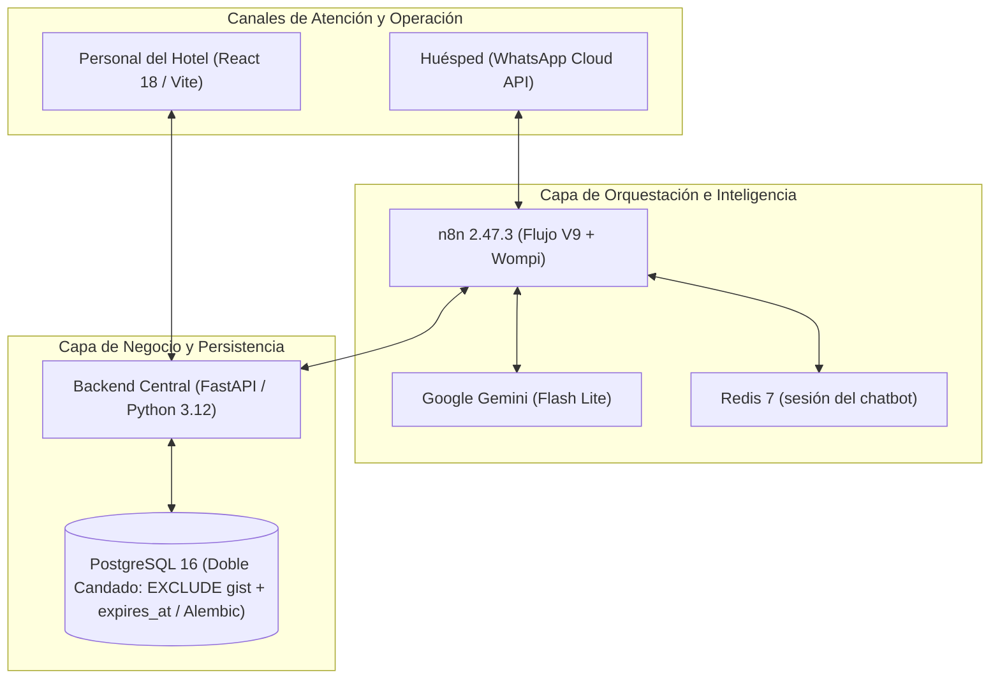

# SatoriPMS — Sistema de Gestión Hotelera y Reservas Automatizadas

[](https://www.python.org/) [](https://fastapi.tiangolo.com/) [](https://www.postgresql.org/) [](https://n8n.io/) [](https://react.dev/) [](https://www.typescriptlang.org/) [](https://www.docker.com/)

**SatoriPMS** es la plataforma integral de administración hotelera y atención automatizada diseñada para **Torre Satori** (Sevilla, Valle del Cauca). Su propósito es modernizar la operación diaria del hotel, ofreciendo atención continua a los huéspedes a través de WhatsApp y centralizando el control administrativo, financiero y de recepción en una aplicación web intuitiva.

El sistema resuelve la pérdida de reservas fuera del horario laboral y el riesgo de sobreventa mediante un flujo conversacional inteligente conectado a WhatsApp y un mecanismo de doble candado de concurrencia (bloqueo temporal de 15 minutos y validación estricta de solapamiento, ambos en PostgreSQL).

---

## Tabla de Contenidos

- [Contextualización y Propósito](#contextualización-y-propósito)
- [Estructura del Proyecto](#estructura-del-proyecto)
- [Tecnologías Utilizadas](#tecnologías-utilizadas)
- [Arquitectura del Sistema](#arquitectura-del-sistema)
- [Requisitos Previos](#requisitos-previos)
- [Configuración Necesaria](#configuración-necesaria)
- [Instrucciones de Instalación e Inicialización](#instrucciones-de-instalación-e-inicialización)
- [Validación y Pruebas Automatizadas](#validación-y-pruebas-automatizadas)
- [Documentación Detallada](#documentación-detallada)
- [Cómo Contribuir](#cómo-contribuir)
- [Equipo de Desarrollo](#equipo-de-desarrollo)

> [!NOTE]
> **El servidor central migró de Java/Spring Boot a Python/FastAPI.** El código Java anterior sigue en el historial de git (rama `main` hasta el commit `3185c2b`) y las migraciones y plantillas de referencia están en [docs/legacy-ref/](docs/legacy-ref/README.md).

---

## Contextualización y Propósito

En la operación hotelera tradicional, la atención manual de mensajes por WhatsApp, el control de disponibilidad en hojas de cálculo y la falta de sincronización entre recepción y ventas generan demoras de respuesta, pérdida de clientes y riesgo de sobreventa de habitaciones.

**SatoriPMS** resuelve esta problemática mediante un sistema unificado que:
- Atiende a los viajeros las 24 horas del día por WhatsApp, tanto mediante un menú guiado paso a paso como mediante un asistente con inteligencia artificial capaz de procesar solicitudes en lenguaje natural.
- Garantiza que dos personas no puedan reservar la misma habitación en las mismas fechas mediante un bloqueo temporal de 15 minutos en la base de datos mientras el huésped completa sus datos y realiza su pago.
- Permite abonar el 50% de anticipo o el 100% del valor de la estadía, liquidar saldos pendientes, cancelar reservas aplicando las políticas de reembolso del hotel sobre el dinero efectivamente pagado y dirigir a los huéspedes al perfil oficial del hotel en Google Reviews.
- Brinda al personal de recepción y a la administración un panel web para gestionar el catálogo de habitaciones (referencia actual de 9 habitaciones configurables), tarifas por temporada o eventos especiales, llegadas y salidas de huéspedes, ventas de productos de vitrina, control de inventario y reportes financieros.

---

## Estructura del Proyecto

```text
SatoriPMS/
├── apps/
│   ├── api/                 # Servidor central (Python 3.12, FastAPI, SQLAlchemy y migraciones Alembic)
│   └── web/                 # Aplicación web de recepción y administración (React 18, Vite)
├── docs/                    # Documentación técnica, manuales, diagramas y presupuestos
│   ├── Diagramas/           # Diagramas de arquitectura, concurrencia, secuencia y procesos
│   ├── Presupuesto/         # Modelo financiero, costos de operación y análisis de crisis
│   ├── legacy-ref/          # Referencia del backend Java anterior (migraciones, diagramas y flujos históricos)
│   └── modulos/             # Especificaciones funcionales y arquitectura por módulo
├── flows/
│   └── n8n/                 # Flujo conversacional del chatbot (V9 activo con Redis; V10 sin Redis en preparación)
├── scripts/                 # Scripts de desarrollo: levantar, detener, reiniciar, diagnosticar y publicar el flujo n8n
└── tests/
    ├── chatbot/             # Suite integral del chatbot y scripts de validación (Node.js y Python)
    └── backend/             # Pruebas del servidor central (pytest, base aislada satoripms_test)
```

---

## Tecnologías Utilizadas

| Tecnología / Herramienta | Tipo / Rol | Versión / Estándar |
| :--- | :--- | :--- |
| **Python** | Lenguaje Backend | 3.12 |
| **FastAPI** | Framework Backend | 0.115+ |
| **SQLAlchemy / Alembic** | Acceso a datos y control de versiones de la BD | 2.0 / 1.14 |
| **PostgreSQL** | Base de Datos Relacional | 16-alpine (extensión `btree_gist`) |
| **Redis** | Sesiones del flujo n8n V9 (solo n8n, no la API) | 7-alpine |
| **n8n** | Orquestador Conversacional | 2.47.3 |
| **Google Gemini** | Inteligencia Artificial | Gemini Flash Lite |
| **React** | Biblioteca de Frontend | 18 |
| **TypeScript** | Lenguaje de Frontend | 5 |
| **Vite** | Empaquetador y Servidor Web | 4 |
| **Tailwind CSS** | Framework de Estilos | 3.4 |
| **Docker & Compose** | Contenedores e Infraestructura | Docker 24+ / Compose 2.20+ |

---

## Arquitectura del Sistema



---

## Requisitos Previos

| Componente / Herramienta | Versión Mínima | Configuración Mínima Requerida |
| :--- | :--- | :--- |
| **Docker Engine** | 24.0+ | Daemon en ejecución con soporte para contenedores |
| **Docker Compose** | 2.20+ | Plugin `docker compose` o binario `docker-compose` |
| **Node.js** | 20.0+ LTS | Gestor de paquetes npm configurado |
| **Python** | 3.12+ | Solo para ejecutar `pytest` y el validador del flujo fuera de Docker |
| **Git** | 2.30+ | Cliente Git con soporte para clonado de repositorios |

---

## Configuración Necesaria

1. **Variables de Entorno:**
   En la raíz del proyecto se incluye la plantilla [.env.example](.env.example). Cópiala con el nombre `.env` y completa las contraseñas locales y las claves de conexión. Para obtener un paso a paso detallado de cada clave (WhatsApp Meta Cloud API, Gemini, Wompi, PostgreSQL, Redis y seguridad de la API), consulta la [Guía de Configuración del Entorno](docs/Guia_Configuracion_Entorno.md):
   ```bash
   cp .env.example .env
   ```
   Como mínimo defina `JWT_SECRET` (32 caracteres o más) y `SATORI_SERVICE_KEY` (la misma llave la usan la API y n8n). Los usuarios del personal (administrador y recepción) los crean las migraciones; consulta [docs/Guia_Configuracion_Entorno.md](docs/Guia_Configuracion_Entorno.md).

2. **Datos Iniciales del Hotel:**
   Las migraciones de Alembic (`apps/api/alembic/versions/`) crean el esquema y cargan las 9 habitaciones de referencia al arrancar la API. Las plantillas de semilla del backend Java anterior se conservan solo como referencia en [docs/legacy-ref/db-migrations/](docs/legacy-ref/README.md).

---

## Instrucciones de Instalación e Inicialización

1. **Clonar el repositorio:**
   ```bash
   git clone https://github.com/JuanJarias/SatoriPMS.git
   cd SatoriPMS
   ```

2. **Levantar la infraestructura local:**
   ```bash
   ./scripts/start-dev.sh
   ```
   Levanta PostgreSQL, la API FastAPI (aplica las migraciones de Alembic), Redis (solo para n8n) y n8n, espera a que cada servicio responda, abre el túnel público `zrok2` de n8n (si `N8N_PUBLIC_URL` es de zrok) e inicia la aplicación web en segundo plano. Al terminar muestra los enlaces de acceso.

   | Script | Para qué sirve |
   | :--- | :--- |
   | `./scripts/start-dev.sh` | Levanta todo y muestra los enlaces. Opciones: `--open` (abre los enlaces en el navegador), `--no-frontend`, `--frontend-only`, `--no-tunnel`, `--no-build`, `--sync-flow`. |
   | `./scripts/stop-dev.sh` | Detiene la web, el túnel y los contenedores **conservando los datos**. `--pause` solo pausa los contenedores. |
   | `./scripts/reset-dev.sh` | Borra contenedores y datos (pide escribir `RESET`). `--keep-n8n` conserva n8n; `--start --seed` vuelve a levantar todo con datos de prueba. |
   | `./scripts/status-dev.sh` | Diagnóstico: contenedores, servicios, túnel, vencimiento del token de WhatsApp y suscripción de la app en Meta. |
   | `./scripts/sync-n8n-flow.sh` | Importa y publica en n8n el flujo `V9_ChatbotReservas.json` y reinicia n8n para activarlo. |

   Todos los scripts aceptan `--help`. Los registros de la web y del túnel quedan en `.dev/`. La referencia completa está en [scripts/README.md](scripts/README.md).

3. **Servicios disponibles en el entorno local:**
   - **Servidor Principal (API FastAPI):** `http://localhost:8080` (documentación OpenAPI: `http://localhost:8080/docs`)
   - **Orquestador del Chatbot (n8n):** `http://localhost:5678` (flujo activo con pasarela de pago Wompi: [V9_ChatbotReservas.json](flows/n8n/V9_ChatbotReservas.json); el [V10](flows/n8n/V10_ChatbotReservas.json) guarda la sesión en PostgreSQL y aún no incorpora la llave de servicio ni el documento del titular).
   - **Base de Datos (PostgreSQL 16):** Puerto local `5432`.
   - **Sesiones del chatbot (Redis 7):** Puerto local `6379`, usado únicamente por n8n.
   - **Aplicación Web:** `http://localhost:5173`.

---

## Validación y Pruebas Automatizadas

El proyecto cuenta con una suite integral de 65 pruebas automatizadas que validan los 5 flujos conversacionales de WhatsApp, las novedades del flujo V9 (pagos Wompi, seguridad de la API) y los requisitos no funcionales de ITIL 4 (doble candado de concurrencia, sobrecarga de 50 peticiones simultáneas y tarifas dinámicas):

```bash
# Suite completa del chatbot (65 pruebas)
node tests/chatbot/suite_pruebas_chatbot.js

# Únicamente un flujo específico (ejemplo: Flujo 1 Reserva Guiada)
node tests/chatbot/suite_pruebas_chatbot.js --flow 1

# Pruebas de cobro Wompi e integridad estructural del flujo n8n
node tests/chatbot/test_pago_wompi_v9.js
python3 tests/chatbot/verify_n8n_flow_integrity.py

# Pruebas del servidor central (pytest; crea y migra la base aislada satoripms_test).
# Requiere PostgreSQL levantado (./scripts/start-dev.sh) y las dependencias de apps/api/requirements.txt
pytest
```

---

## Documentación Detallada

Toda la documentación funcional, de diseño, diagramas y presupuesto del proyecto se encuentra organizada en la carpeta [docs/](docs/README.md). Consulta el [índice de documentación](docs/README.md) para explorar cada módulo.

---

## Cómo Contribuir

1. Crea una rama descriptiva a partir de la rama de trabajo vigente (`feat/nombre-funcionalidad` o `fix/nombre-correccion`).
2. Realiza tus cambios verificando que los contenedores levanten sin errores y que las pruebas en `tests/chatbot/` se ejecuten satisfactoriamente (`node tests/chatbot/suite_pruebas_chatbot.js`).
3. Actualiza la documentación técnica correspondiente en [docs/](docs/README.md).
4. Abre una solicitud de integración (Pull Request) describiendo el propósito y alcance de los cambios realizados.

---

## Equipo de Desarrollo

- **Juan José Arias Gallego** — Product Owner
- **Esteban Guarín Valencia** — Scrum Master
- **Juan Felipe Garzón Trejos** — Desarrollador
