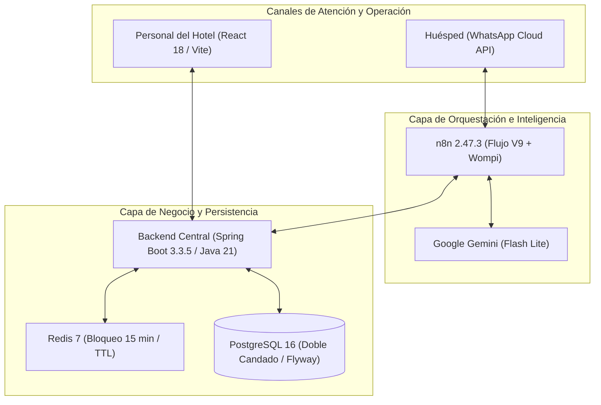

# SatoriPMS — Sistema de Gestión Hotelera y Reservas Automatizadas

[](https://www.oracle.com/java/) [](https://spring.io/projects/spring-boot) [](https://www.postgresql.org/) [](https://redis.io/) [](https://n8n.io/) [](https://react.dev/) [](https://www.typescriptlang.org/) [](https://www.docker.com/)

**SatoriPMS** es la plataforma integral de administración hotelera y atención automatizada diseñada para **Torre Satori** (Sevilla, Valle del Cauca). Su propósito es modernizar la operación diaria del hotel, ofreciendo atención continua a los huéspedes a través de WhatsApp y centralizando el control administrativo, financiero y de recepción en una aplicación web intuitiva.

El sistema resuelve la pérdida de reservas fuera del horario laboral y el riesgo de sobreventa mediante un flujo conversacional inteligente conectado a WhatsApp y un mecanismo de doble candado de concurrencia (bloqueo temporal en memoria rápida y validación estricta de solapamiento en base de datos).

---

## Tabla de Contenidos

- [Contextualización y Propósito](#contextualización-y-propósito)
- [Estructura del Proyecto](#estructura-del-proyecto)
- [Tecnologías Utilizadas](#tecnologías-utilizadas)
- [Arquitectura del Sistema](#arquitectura-del-sistema)
- [Requisitos Previos](#requisitos-previos)
- [Configuración Necesaria](#configuración-necesaria)
- [Instrucciones de Instalación e Inicialización](#instrucciones-de-instalación-e-inicialización)
- [Validación y Pruebas Automatizadas](#validación-y-pruebas-automatizadas)
- [Documentación Detallada](#documentación-detallada)
- [Cómo Contribuir](#cómo-contribuir)
- [Equipo de Desarrollo](#equipo-de-desarrollo)

---

## Contextualización y Propósito

En la operación hotelera tradicional, la atención manual de mensajes por WhatsApp, el control de disponibilidad en hojas de cálculo y la falta de sincronización entre recepción y ventas generan demoras de respuesta, pérdida de clientes y riesgo de sobreventa de habitaciones.

**SatoriPMS** resuelve esta problemática mediante un sistema unificado que:
- Atiende a los viajeros las 24 horas del día por WhatsApp, tanto mediante un menú guiado paso a paso como mediante un asistente con inteligencia artificial capaz de procesar solicitudes en lenguaje natural.
- Garantiza que dos personas no puedan reservar la misma habitación en las mismas fechas mediante un bloqueo temporal de 15 minutos en Redis mientras el huésped completa sus datos y realiza su pago.
- Permite abonar el 50% de anticipo o el 100% del valor de la estadía, liquidar saldos pendientes, cancelar reservas aplicando las políticas de reembolso del hotel sobre el dinero efectivamente pagado y dirigir a los huéspedes al perfil oficial del hotel en Google Reviews.
- Brinda al personal de recepción y a la administración un panel web para gestionar el catálogo de habitaciones (referencia actual de 9 habitaciones configurables), tarifas por temporada o eventos especiales, llegadas y salidas de huéspedes, ventas de productos de vitrina, control de inventario y reportes financieros.

---

## Estructura del Proyecto

```text
SatoriPMS/
├── apps/
│   ├── api/                 # Servidor central (Java 21, Spring Boot, reglas de negocio y seguridad)
│   └── web/                 # Aplicación web de recepción y administración (React 18, Vite)
├── db/
│   └── seed/                # Scripts de desarrollo y datos iniciales auxiliares
├── docs/                    # Documentación técnica, manuales, diagramas y presupuestos
│   ├── Diagramas/           # Diagramas de arquitectura, concurrencia, secuencia y procesos
│   ├── Presupuesto/         # Modelo financiero, costos de operación y análisis de crisis
│   └── modulos/             # Especificaciones funcionales y arquitectura por módulo
├── flows/
│   └── n8n/                 # Flujo conversacional del chatbot (V9 activo; V8 de respaldo en pastVersions/)
├── scripts/                 # Scripts de desarrollo: levantar, detener, reiniciar, diagnosticar y publicar el flujo n8n
└── tests/
    └── chatbot/             # Suite integral de pruebas automatizadas y scripts de validación
```

---

## Tecnologías Utilizadas

| Tecnología / Herramienta | Tipo / Rol | Versión / Estándar |
| :--- | :--- | :--- |
| **Java** | Lenguaje Backend | 21 (LTS) |
| **Spring Boot** | Framework Backend | 3.3.5 |
| **PostgreSQL** | Base de Datos Relacional | 16-alpine (extensión `btree_gist`) |
| **Flyway** | Control de Versiones de BD | Integrado con Spring Boot |
| **Redis** | Memoria Rápida y Bloqueos | 7-alpine (Scripts Lua) |
| **n8n** | Orquestador Conversacional | 2.47.3 |
| **Google Gemini** | Inteligencia Artificial | Gemini Flash Lite |
| **React** | Biblioteca de Frontend | 18 |
| **TypeScript** | Lenguaje de Frontend | 5 |
| **Vite** | Empaquetador y Servidor Web | 4 |
| **Tailwind CSS** | Framework de Estilos | 3.4 |
| **Docker & Compose** | Contenedores e Infraestructura | Docker 24+ / Compose 2.20+ |

---

## Arquitectura del Sistema



---

## Requisitos Previos

| Componente / Herramienta | Versión Mínima | Configuración Mínima Requerida |
| :--- | :--- | :--- |
| **Docker Engine** | 24.0+ | Daemon en ejecución con soporte para contenedores |
| **Docker Compose** | 2.20+ | Plugin `docker compose` o binario `docker-compose` |
| **Node.js** | 20.0+ LTS | Gestor de paquetes npm configurado |
| **Git** | 2.30+ | Cliente Git con soporte para clonado de repositorios |

---

## Configuración Necesaria

1. **Variables de Entorno:**
   En la raíz del proyecto se incluye la plantilla [.env.example](.env.example). Cópiala con el nombre `.env` y completa las contraseñas locales y las claves de conexión. Para obtener un paso a paso detallado de cada clave (WhatsApp Meta Cloud API, Gemini, Wompi, PostgreSQL, Redis y seguridad de la API), consulta la [Guía de Configuración del Entorno](docs/Guia_Configuracion_Entorno.md):
   ```bash
   cp .env.example .env
   ```
   Como mínimo defina `JWT_SECRET` (32 caracteres o más) y `SATORI_SERVICE_KEY` (la misma llave la usan la API y n8n). Para crear el primer usuario administrador, complete `SATORI_ADMIN_USERNAME` y `SATORI_ADMIN_PASSWORD` antes del primer arranque.

2. **Datos Iniciales del Hotel (Plantillas de Semilla):**
   Para proteger la información comercial del hotel, las plantillas de habitaciones y productos vienen con extensión `.example`. Para cargar los datos de referencia (incluidas las 9 habitaciones de prueba), genera los archivos locales. Son migraciones repetibles (`R__`), así que pueden crearse en cualquier momento sin chocar con las migraciones versionadas:
   ```bash
   cp apps/api/src/main/resources/db/migration/R__seed_rooms.sql.example \
      apps/api/src/main/resources/db/migration/R__seed_rooms.sql

   cp apps/api/src/main/resources/db/migration/R__seed_products.sql.example \
      apps/api/src/main/resources/db/migration/R__seed_products.sql
   ```

---

## Instrucciones de Instalación e Inicialización

1. **Clonar el repositorio:**
   ```bash
   git clone https://github.com/JuanJarias/SatoriPMS.git
   cd SatoriPMS
   ```

2. **Levantar la infraestructura local:**
   ```bash
   ./scripts/start-dev.sh
   ```
   Levanta PostgreSQL, Redis, la API y n8n, espera a que cada servicio responda, abre el túnel público `zrok2` de n8n (si `N8N_PUBLIC_URL` es de zrok) e inicia la aplicación web en segundo plano. Al terminar muestra los enlaces de acceso.

   | Script | Para qué sirve |
   | :--- | :--- |
   | `./scripts/start-dev.sh` | Levanta todo y muestra los enlaces. Opciones: `--no-frontend`, `--frontend-only`, `--no-tunnel`, `--no-build`, `--sync-flow`. |
   | `./scripts/stop-dev.sh` | Detiene la web, el túnel y los contenedores **conservando los datos**. `--pause` solo pausa los contenedores. |
   | `./scripts/reset-dev.sh` | Borra contenedores y datos (pide escribir `RESET`). `--keep-n8n` conserva n8n; `--start --seed` vuelve a levantar todo con datos de prueba. |
   | `./scripts/status-dev.sh` | Diagnóstico: contenedores, servicios, túnel, vencimiento del token de WhatsApp y suscripción de la app en Meta. |
   | `./scripts/sync-n8n-flow.sh` | Importa y publica en n8n el flujo `V9_ChatbotReservas.json` y reinicia n8n para activarlo. |

   Todos los scripts aceptan `--help`. Los registros de la web y del túnel quedan en `.dev/`. La referencia completa está en [scripts/README.md](scripts/README.md).

3. **Servicios disponibles en el entorno local:**
   - **Servidor Principal (API):** `http://localhost:8080` (Documentación Swagger / OpenAPI: `http://localhost:8080/swagger-ui/index.html`)
   - **Orquestador del Chatbot (n8n):** `http://localhost:5678` (flujo activo con pasarela de pago Wompi: [V9_ChatbotReservas.json](flows/n8n/V9_ChatbotReservas.json); versiones anteriores en [pastVersions/](flows/n8n/pastVersions/)).
   - **Base de Datos (PostgreSQL 16):** Puerto local `5432`.
   - **Gestor de Bloqueos y Sesiones (Redis 7):** Puerto local `6379`.
   - **Aplicación Web:** `http://localhost:5173`.

---

## Validación y Pruebas Automatizadas

El proyecto cuenta con una suite integral de 65 pruebas automatizadas que validan los 5 flujos conversacionales de WhatsApp, las novedades del flujo V9 (pagos Wompi, seguridad de la API) y los requisitos no funcionales de ITIL 4 (doble candado de concurrencia, sobrecarga de 50 peticiones simultáneas y tarifas dinámicas):

```bash
# Suite completa del chatbot (65 pruebas)
node tests/chatbot/suite_pruebas_chatbot_v8.js

# Únicamente un flujo específico (ejemplo: Flujo 1 Reserva Guiada)
node tests/chatbot/suite_pruebas_chatbot_v8.js --flow 1

# Pruebas de cobro Wompi e integridad estructural del flujo n8n
node tests/chatbot/test_pago_wompi_v9.js
python3 tests/chatbot/verify_n8n_flow_integrity.py

# Pruebas del servidor central (seguridad, tarifas por noche); con Docker activo,
# ENABLE_DOCKER_TESTS=true agrega la prueba de persistencia sobre PostgreSQL real
cd apps/api && mvn test
```

---

## Documentación Detallada

Toda la documentación funcional, de diseño, diagramas y presupuesto del proyecto se encuentra organizada en la carpeta [docs/](docs/README.md). Consulta el [índice de documentación](docs/README.md) para explorar cada módulo.

---

## Cómo Contribuir

1. Crea una rama descriptiva a partir de la rama de trabajo vigente (`feat/nombre-funcionalidad` o `fix/nombre-correccion`).
2. Realiza tus cambios verificando que los contenedores levanten sin errores y que las pruebas en `tests/chatbot/` se ejecuten satisfactoriamente (`node tests/chatbot/suite_pruebas_chatbot_v8.js`).
3. Actualiza la documentación técnica correspondiente en [docs/](docs/README.md).
4. Abre una solicitud de integración (Pull Request) describiendo el propósito y alcance de los cambios realizados.

---

## Equipo de Desarrollo

- **Juan José Arias Gallego** — Product Owner
- **Esteban Guarín Valencia** — Scrum Master
- **Juan Felipe Garzón Trejos** — Desarrollador
