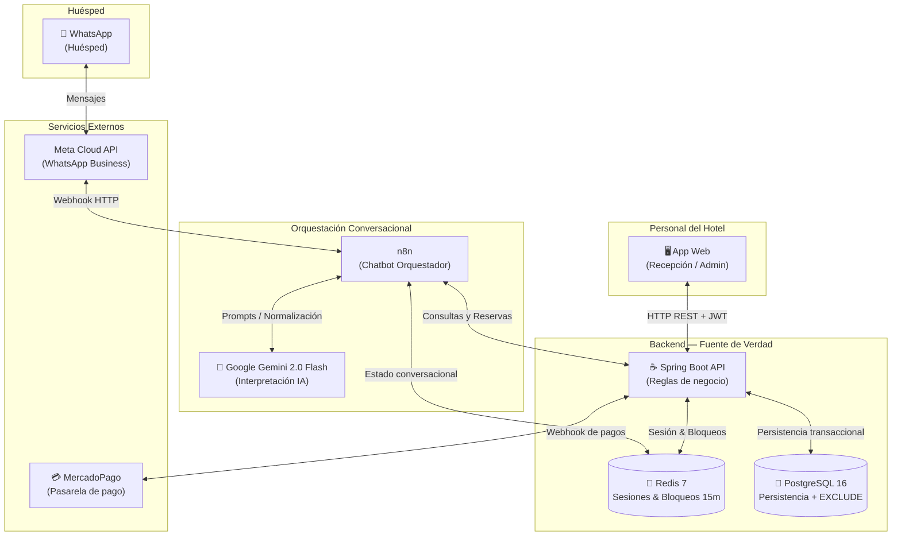

# SatoriPMS

**Proyecto Integrador II — Universidad Icesi**

Property Management System (PMS) diseñado para centralizar y automatizar la operación diaria del hotel Torre Satori, ubicado en Sevilla (Valle del Cauca). El sistema opera a través de dos canales complementarios: un **chatbot de WhatsApp** para huéspedes y una **aplicación web** para recepción y administración, ambos respaldados por un backend único que concentra todas las reglas de negocio.

**Equipo:** Juan José Arias Gallego (PO) · Esteban Guarín Valencia (SM) · Juan Felipe Garzón Trejos (Dev)

---

## 1. Propósito y Contexto

Torre Satori gestiona hoy su operación de forma completamente manual: reservas coordinadas por WhatsApp o en persona, sin registro estructurado de huéspedes, sin control confiable del estado de las habitaciones y sin visibilidad operativa del negocio.

**SatoriPMS** resuelve esto automatizando el ciclo completo de operación hotelera:

- Reservas 24/7 sin que el huésped instale nada (WhatsApp).
- Prevención de dobles reservas mediante bloqueo temporal + restricción a nivel de base de datos.
- Panel operativo unificado para check-in, check-out, tienda y finanzas.
- Trazabilidad histórica completa de huéspedes, estadías y consumos.

---

## 2. Arquitectura del Sistema


---

## Infraestructura y Puertos

El proyecto utiliza Docker Compose para levantar la infraestructura local.

| Servicio | Puerto | Descripción |
|----------|--------|-------------|
| **API** | `8080` | Backend Spring Boot. Expone los endpoints REST. |
| **Frontend** | `5173` | Panel de administración (App Web). |
| **n8n** | `5678` | Plataforma de flujos para el chatbot. |
| **PostgreSQL**| `5432` | Base de datos relacional (expuesto solo localmente). |
| **Redis** | `6379` | Caché y manejo de estados/bloqueos temporales. |

Para levantar el proyecto se tiene un Script:
```bash
./start-dev.sh
```


---

## 3. Estructura del Repositorio

```
SatoriPMS/
├── README.md                        # Este archivo
├── docker-compose.yml               # Orquestación de la infraestructura
├── start-dev.sh                     # Script de arranque rápido del entorno local
├── .env.example                     # Plantilla de variables de entorno
│
├── apps/
│   ├── api/                         # Backend — Spring Boot (Java 21)
│   │   ├── src/main/java/...        # Código fuente por módulo de negocio
│   │   ├── src/main/resources/
│   │   │   └── db/migration/        # Migraciones Flyway (V1 → V4)
│   │   └── Dockerfile               # Imagen JRE ligera (compilación en host)
│   └── web/                         # Frontend — React + Vite
│       └── src/pages/               # Vistas de la aplicación
│
├── flows/n8n/                       # Flujos del chatbot exportados en JSON
│   ├── V1_ChatbotReservas.json      # Menú principal y escalamiento
│   ├── V2_ChatbotReservas.json      # Selección de habitación con BD
│   ├── V3_ChatbotReservas.json      # Multi-habitación y bloqueos Redis
│   ├── V4_ChatbotReservas.json      # Integración IA (Gemini)
│   ├── V5_ChatbotReservas.json      # Persistencia en PostgreSQL
│   └── V6_ChatbotReservas.json      # Consulta y cancelación de reserva ← activo
│
└── docs/                            # Documentación del proyecto
    ├── cambios_commit.md            # Registro de cambios del commit actual
    ├── Documento_Maestro_SatoriPMS.md
    └── modulos/                     # Documentación modular del sistema
        ├── generalidades_nucleo.md  # Contexto, objetivos, alcance y reglas de negocio
        ├── chatbot_whatsapp.md      # Flujos conversacionales y especificaciones de n8n
        ├── aplicacion_web.md        # Vistas y funcionalidades del panel web
        ├── backend_api.md           # Endpoints REST y módulos lógicos internos
        ├── base_datos.md            # Esquema, migraciones y restricciones
        ├── seguridad.md             # Autenticación, roles y Ley 1581
        ├── infraestructura.md       # Docker Compose, puertos y variables de entorno
        ├── tienda_inventario.md     # Módulo de tienda y catálogo
        ├── facturacion_finanzas.md  # Ingresos, egresos y reportes
        ├── resenas_fidelizacion.md  # Reseñas y huéspedes recurrentes
        ├── gestion_proyecto.md      # Scrum, EDT, cronograma y riesgos
        ├── diseno_uxui.md           # Diseño conversacional y mockups
        ├── decisiones_pendientes.md # Puntos abiertos por definir con el stakeholder
        └── estado_actual.md         # ← Avance real del proyecto (qué está hecho / qué falta)
```

---

## 4. Módulos del Sistema

### Módulo 1 — Chatbot de WhatsApp

El canal principal de los huéspedes. n8n orquesta la conversación sin tomar decisiones de negocio: todo se valida contra el backend.

| Flujo | Descripción |
|---|---|
| **Hacer una reserva** | Reserva guiada paso a paso: fechas, habitaciones, huéspedes, datos del titular, mascota, acompañantes y confirmación. |
| **Asistente IA** | El huésped describe su estadía en lenguaje libre; Gemini interpreta y extrae los datos sin confirmar disponibilidad por su cuenta. |
| **Revisar o Cancelar reserva** | Consulta por código único de reserva, presentación de detalles y cancelación con doble confirmación y políticas de reembolso. |
| **Ver reseñas del hotel** | Calificaciones y comentarios de huéspedes anteriores. |
| **Escribir una reseña** | Captura de calificación (1–5 estrellas) y comentario tras el check-out. |
| **Hablar con un agente** | Escalamiento a recepcionista humano con validación de horario de atención. |

📄 Documentación completa: [`docs/modulos/chatbot_whatsapp.md`](docs/modulos/chatbot_whatsapp.md)

---

### Módulo 2 — Aplicación Web

Panel de recepción y administración. Dos roles: **Administrador** (acceso total) y **Recepcionista** (operación diaria).

| Vista | Función |
|---|---|
| **Panel de habitaciones** | Estado en tiempo real: disponible, ocupada, en limpieza, mantenimiento. |
| **Check-in / Check-out** | Registro de entrada/salida con validación de identidad y consolidación de consumos. |
| **Reservas manuales** | Crear, modificar o cancelar reservas desde la app (presencial o por teléfono). |
| **Conversaciones** | Monitor de sesiones del chatbot; marcar escalados como resueltos. |
| **Tienda** | Ventas, inventario y cargo de consumos a habitación. |
| **Finanzas** | Ingresos, egresos, exportación de informes y cálculo de sueldos. |
| **Reseñas y fidelización** | Panel de calificaciones y panel de huéspedes recurrentes. |
| **Administración** | Usuarios, roles, recuperación de contraseña y auditoría de acciones. |

📄 Documentación completa: [`docs/modulos/aplicacion_web.md`](docs/modulos/aplicacion_web.md)

---

### Módulo 3 — Backend API (Spring Boot)

Monolito modular con arquitectura hexagonal. Es la **única fuente de verdad** para reglas de negocio, disponibilidad, precios y persistencia.

| Endpoint clave | Método | Propósito |
|---|---|---|
| `/api/rooms/availability` | `GET` | Habitaciones libres para un rango de fechas |
| `/api/bookings/lock` | `POST` | Bloqueo temporal de habitaciones (15 min en Redis) |
| `/api/bookings/confirm` | `POST` | Creación de reservas en batch con estado `pending_payment` |
| `/api/bookings/group/{code}` | `GET` | Consulta de reserva por código único de 8 caracteres |
| `/api/bookings/group/{code}/cancellation` | `POST` | Cancelación con cálculo de reembolso (RN-03) |
| `/api/bookings/{id}/payment-confirmation` | `POST` | Confirmación de pago vía webhook |

📄 Documentación completa: [`docs/modulos/backend_api.md`](docs/modulos/backend_api.md)

---

### Módulo 4 — Base de Datos y Prevención de Doble Reserva

PostgreSQL 16 con extensión `btree_gist`. La restricción central del sistema:

```sql
CONSTRAINT no_overlapping_bookings EXCLUDE USING gist (
    room_id WITH =,
    stay_range WITH &&
) WHERE (status IN ('pending_payment', 'confirmed'))
```

Esta restricción impide —a nivel de motor, no de aplicación— que dos reservas activas se solapen para la misma habitación y fechas. Al cancelar una reserva, su estado pasa a `cancelled` y las fechas se liberan automáticamente sin eliminar el registro histórico.

📄 Documentación completa: [`docs/modulos/base_datos.md`](docs/modulos/base_datos.md)

---

## 5. Reglas de Negocio Centrales

| Regla | Definición |
|---|---|
| **RN-01** | Si el número de personas supera la capacidad máxima → se rechaza. Si supera la base pero no la máxima → se cobra un cargo adicional por persona extra. |
| **RN-02** | Las habitaciones se bloquean temporalmente por **15 minutos** (Redis) al elegirlas. Al confirmar el pago, el bloqueo de Redis se libera y la reserva queda protegida permanentemente por la restricción `EXCLUDE` de PostgreSQL. |
| **RN-03** | Cancelación con reembolso escalonado: **>72 h antes → 100 %** · **24–72 h → 50 %** · **<24 h o no-show → 0 %**. |
| **RN-04** | Un producto con ventas históricas no puede eliminarse, solo desactivarse. |
| **RN-05** | Toda reserva pagada genera un recibo almacenado en el sistema y asociado a la reserva. |
| **RN-06** | Toda estadía debe respetar la duración mínima y máxima de noches definida por el hotel. |

---

## 6. Infraestructura Local

### Servicios y Puertos

| Servicio | Contenedor | Puerto | Rol |
|---|---|---|---|
| PostgreSQL 16 | `satori_postgres` | `5432` (solo local) | Persistencia y restricción anti-doble-reserva |
| Redis 7 | `satori_redis` | `6379` (solo local) | Sesiones conversacionales y bloqueos temporales |
| n8n | `satori_n8n` | `5678` | Orquestación del chatbot |
| Backend API | `satori_api` | `8080` | API REST — reglas de negocio |
| App Web (Vite) | — | `5173` | Panel de recepción/administración |

### Arranque del Entorno

```bash
# Clona el repositorio y configura variables de entorno
cp .env.example .env
# Edita .env con tus claves (WhatsApp, Gemini, MercadoPago, etc.)

# Levanta toda la infraestructura (compila el JAR en el host primero)
./start-dev.sh
```

> Para activar n8n, establece `COMPOSE_PROFILES=n8n` en `.env` y define `N8N_PUBLIC_URL` con la URL pública donde Meta enviará los webhooks. Para desactivarlo, deja `COMPOSE_PROFILES` vacío y ejecuta `docker compose up -d --remove-orphans`; el volumen `n8n_data` se conserva.

### Variables de Entorno Requeridas

| Grupo | Variables clave |
|---|---|
| Base de datos | `DATABASE_URL`, `POSTGRES_USER`, `POSTGRES_PASSWORD`, `POSTGRES_DB` |
| Redis | `REDIS_HOST`, `REDIS_PORT` |
| WhatsApp / Meta | `WHATSAPP_TOKEN`, `WHATSAPP_PHONE_ID`, `WHATSAPP_VERIFY_TOKEN` |
| IA | `GEMINI_API_KEY` |
| Pasarela de pago | `MERCADOPAGO_ACCESS_TOKEN`, `MERCADOPAGO_WEBHOOK_SECRET` |
| n8n | `N8N_PUBLIC_URL`, `N8N_BASIC_AUTH_USER`, `N8N_BASIC_AUTH_PASSWORD`, `N8N_BLOCK_ENV_ACCESS_IN_NODE` |

Ver plantilla completa en [`.env.example`](.env.example).

---

## 7. Flujos de n8n — Evolución por Versiones

Cada versión del chatbot se exporta como `V<N>_ChatbotReservas.json` en `flows/n8n/`. Para importar una versión en n8n:

```bash
docker compose exec -T n8n n8n import:workflow \
  --input=/home/node/.n8n/workflows/V6_ChatbotReservas.json
```

| Versión | Cambios principales |
|---|---|
| **V1** | Menú principal, escalamiento a recepcionista, inactividad |
| **V2** | Selección de habitación con consulta real a PostgreSQL |
| **V3** | Soporte multi-habitación y bloqueos temporales en Redis |
| **V4** | Integración de Google Gemini como capa de normalización de lenguaje |
| **V5** | Persistencia real de reservas en PostgreSQL (batch multi-habitación) |
| **V6** | Subflujo de consulta y cancelación de reserva con código único ← **activo** |

---

## 8. Errores Comunes y Soluciones

| Componente | Error | Causa | Solución |
|---|---|---|---|
| Docker | Contenedor no arranca | JAR no compilado | Ejecutar `./start-dev.sh` (compila el JAR antes de levantar Docker) |
| n8n | `403 Forbidden` en llamadas a la API | Endpoint no permitido en `SecurityConfig` | Revisar `SecurityConfig.java` y la lista de rutas permitidas |
| n8n | `$env` no disponible en nodo | Variable de entorno bloqueada | Asegurar `N8N_BLOCK_ENV_ACCESS_IN_NODE=false` en `.env` |
| WhatsApp | Webhook no recibe mensajes | `N8N_PUBLIC_URL` apunta a URL inválida | Actualizar `N8N_PUBLIC_URL` con la URL pública actual del túnel |
| PostgreSQL | Error en reserva solapada | Restricción `no_overlapping_bookings` activa | Comportamiento correcto: las fechas ya están ocupadas |
| PostgreSQL | Error en `payment_status` | Valor fuera del `CHECK` constraint | Usar solo: `pending`, `paid`, `refunded`, `partial` |
| n8n | Flujo no refleja cambios en JSON | El JSON editado no se reimportó | Reimportar con `n8n import:workflow` y reiniciar el contenedor |

---

## 9. Prerequisitos

Para replicar el entorno de desarrollo localmente:

- **Sistema operativo:** Linux, macOS o Windows con WSL2
- **Hardware mínimo:** 4 CPU, 8 GB RAM, 20 GB de disco libre
- **Software requerido:**
  - Docker Engine (≥ 24.0) y Docker Compose (≥ 2.20)
  - Java 21 + Maven 3.9 (para compilar el JAR en el host)
  - Node.js 20+ y npm (para el frontend React)
- **Cuentas externas necesarias:**
  - Meta Developer App con WhatsApp Business API habilitada
  - Google AI Studio (clave de API para Gemini)
  - MercadoPago (cuenta Sandbox para desarrollo)

---

## 10. Documentación del Proyecto

| Documento | Contenido |
|---|---|
| [`docs/modulos/generalidades_nucleo.md`](docs/modulos/generalidades_nucleo.md) | Contexto, objetivos, alcance, épicas y reglas de negocio |
| [`docs/modulos/chatbot_whatsapp.md`](docs/modulos/chatbot_whatsapp.md) | Especificación de todos los flujos conversacionales |
| [`docs/modulos/aplicacion_web.md`](docs/modulos/aplicacion_web.md) | Vistas y funcionalidades del panel web |
| [`docs/modulos/backend_api.md`](docs/modulos/backend_api.md) | Endpoints REST, módulos lógicos e integraciones |
| [`docs/modulos/base_datos.md`](docs/modulos/base_datos.md) | Esquema, migraciones Flyway y restricciones de integridad |
| [`docs/modulos/seguridad.md`](docs/modulos/seguridad.md) | JWT, roles, auditoría y Ley 1581 de 2012 |
| [`docs/modulos/infraestructura.md`](docs/modulos/infraestructura.md) | Docker Compose, puertos y variables de entorno |
| [`docs/modulos/tienda_inventario.md`](docs/modulos/tienda_inventario.md) | Catálogo, ventas y rotación de productos |
| [`docs/modulos/facturacion_finanzas.md`](docs/modulos/facturacion_finanzas.md) | Ingresos, egresos, reportes y sueldos |
| [`docs/modulos/resenas_fidelizacion.md`](docs/modulos/resenas_fidelizacion.md) | Reseñas de huéspedes y programa de fidelización |
| [`docs/modulos/gestion_proyecto.md`](docs/modulos/gestion_proyecto.md) | Scrum, EDT, cronograma y matriz de riesgos |
| [`docs/modulos/decisiones_pendientes.md`](docs/modulos/decisiones_pendientes.md) | Puntos abiertos por definir con el stakeholder |
| [`docs/modulos/estado_actual.md`](docs/modulos/estado_actual.md) | **Avance real:** qué está implementado y qué falta |
| [`docs/cambios_commit.md`](docs/cambios_commit.md) | Registro de cambios del commit actual |

---

> **Convención de idioma:** todo el código del proyecto (variables, funciones, tablas, endpoints) se escribe en **inglés**. Todo el contenido visible para el usuario final —mensajes del chatbot, textos de la app web— se escribe en **español**.
