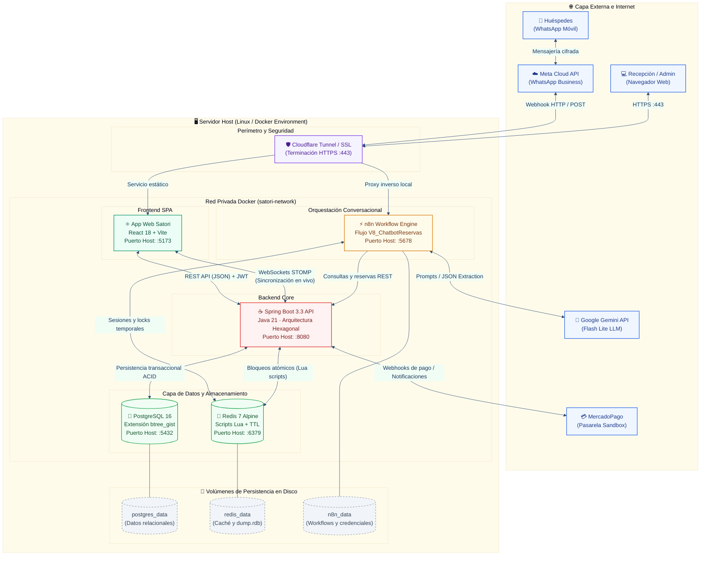

# Diagrama 01 — Arquitectura de Infraestructura y Servicios

Este diagrama detalla la topología de contenedores de **Docker Compose**, asignación de puertos, redes aisladas, volúmenes de persistencia y la interacción con los servicios en la nube (Meta WhatsApp Cloud API, Google Gemini AI Studio, Cloudflare y MercadoPago).

---

---

### Componentes y Matriz de Puertos

| Servicio | Imagen Docker | Puerto Contenedor | Puerto Host | Red Docker | Propósito Técnico |
|---|---|:---:|:---:|---|---|
| **Spring Boot API** | `eclipse-temurin:21-jre-alpine` | `8080` | `8080` | `satori-network` | Servidor de aplicaciones backend, endpoints REST, seguridad Spring Security y sockets. |
| **App Web (React)** | `node:20-alpine` (Vite dev) | `5173` | `5173` | `satori-network` | Panel administrativo de recepción para check-in, check-out y visualización de ocupación. |
| **n8n Workflow** | `n8nio/n8n:latest` | `5678` | `5678` | `satori-network` | Orquestador de flujos conversacionales, integración con Meta API y Gemini. |
| **PostgreSQL** | `postgres:16-alpine` | `5432` | `5432` | `satori-network` | Base de datos relacional principal con extensión `btree_gist` para exclusión física. |
| **Redis** | `redis:7-alpine` | `6379` | `6379` | `satori-network` | Almacenamiento en memoria para candados distribuidos (TTL 15 min) y estados de sesión. |
