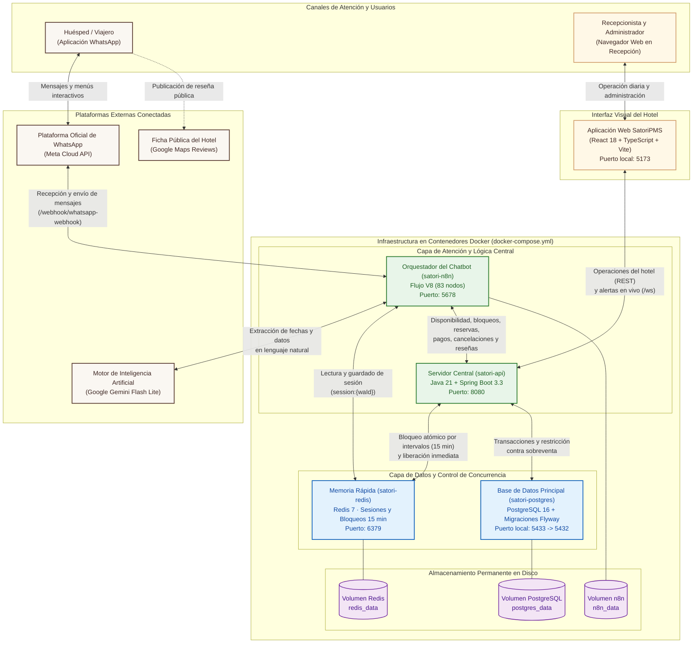

# 01. Arquitectura de Infraestructura y Servicios — SatoriPMS

## 1. Propósito del Diagrama

Este diagrama representa cómo están organizados y conectados los servicios tecnológicos de **SatoriPMS**. Permite observar qué elementos interactúan con los huéspedes y el personal del hotel en el exterior, y cómo los cuatro contenedores principales del sistema colaboran dentro de una red interna protegida para garantizar rapidez, seguridad y respaldo permanente de los datos de **Torre Satori**.

---

## 2. Diagrama General de Infraestructura

---

## 3. Explicación de Componentes y Flujo de Comunicación

1. **Canal de Huéspedes (WhatsApp e Inteligencia Artificial):**
   - El viajero se comunica desde su teléfono con el número oficial de **Torre Satori**.
   - La plataforma de WhatsApp entrega el mensaje al **Orquestador del Chatbot** (`Contenedor de n8n : "satori-n8n"`), el cual recupera en milisegundos el paso actual de la conversación desde la **Memoria Rápida** (`Contenedor de Redis : "satori-redis"`).
   - Cuando el huésped escribe una solicitud en lenguaje libre, el orquestador se apoya en el motor **Google Gemini Flash Lite** para interpretar las fechas, la cantidad de personas y las preferencias.
2. **Canal de Recepción y Administración (Aplicación Web):**
   - El recepcionista y el administrador operan desde el navegador web conectándose directamente con el **Servidor Central** (`Contenedor del servidor : "satori-api"`).
   - A través de este canal se gestionan las 9 habitaciones de referencia (creación, edición y eliminación segura), los eventos especiales con descuentos, las llegadas y salidas de huéspedes, la tienda interna y los reportes contables.
3. **Aislamiento y Respaldo de Datos:**
   - Ni la base de datos (`Contenedor de PostgreSQL : "satori-postgres"`) ni la memoria rápida reciben conexiones directas desde internet; solo el servidor central y el orquestador interno pueden consultarlas.
   - Los tres volúmenes de almacenamiento (`"postgres_data"`, `"redis_data"` y `"n8n_data"`) garantizan que toda la información permanezca intacta aunque el servidor se reinicie.
