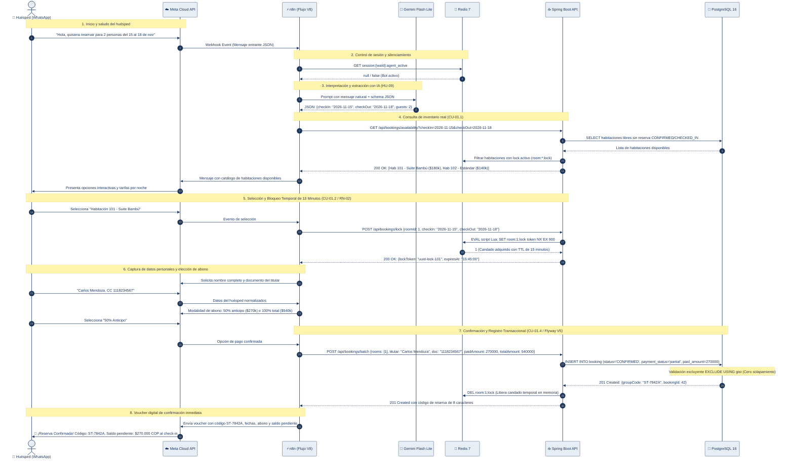

# Diagrama 02 — Flujo Integral de Reserva por WhatsApp

Este diagrama describe el ciclo conversacional completo de reserva a través de **WhatsApp Business**, desde la recepción del mensaje inicial hasta la confirmación de la reserva y persistencia transaccional en la base de datos con abono parcial o total.

---

---

### Puntos Clave de la Arquitectura Conversacional

1. **Idempotencia de Sesión:** Redis almacena el estado de la conversación bajo la clave `session:{waId}`, permitiendo que el usuario retome el flujo si se interrumpe momentáneamente.
2. **Candado de 15 Minutos:** Durante el paso 5, la habitación queda completamente invisible para otros usuarios. Si el cliente no completa los datos antes de que expire el TTL, Redis purga la llave automáticamente y la habitación vuelve al inventario público.
3. **Persistencia de Abono:** En el paso 7, la base de datos almacena el valor efectivamente pagado en la columna `paid_amount` (`V5__add_paid_amount_and_review_entity.sql`), estableciendo el estado de pago como `partial` para liquidar el saldo pendiente al momento del check-in.
