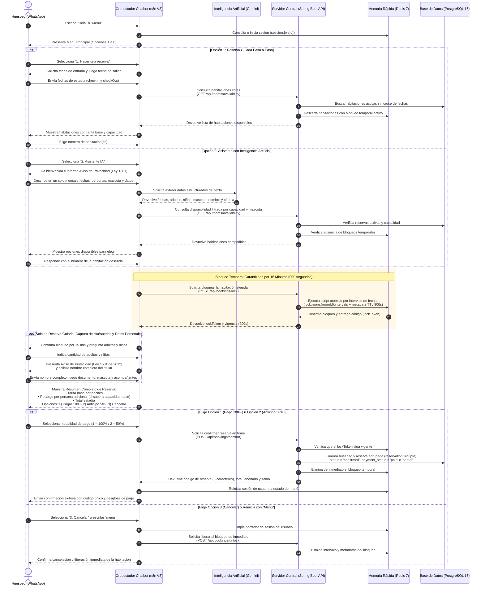

# 02. Flujo de Reserva Automatizada por WhatsApp — SatoriPMS

## 1. Propósito del Diagrama

Este diagrama detalla paso a paso cómo un huésped realiza una reserva a través del asistente de WhatsApp de **Torre Satori** (tanto por la ruta guiada como mediante el asistente con inteligencia artificial), incluyendo la consulta de disponibilidad real, el bloqueo temporal de 15 minutos, la presentación del aviso de privacidad de datos personales, el desglose transparente de tarifa base y recargo por persona adicional, y las tres opciones de cierre: pago del 100%, anticipo del 50% o cancelación con liberación inmediata del bloqueo.

---

## 2. Diagrama de Secuencia del Proceso de Reserva

---

## 3. Aspectos Clave del Flujo

1. **Dos caminos complementarios hacia la misma reserva:** Tanto el viajero que prefiere ser guiado pregunta por pregunta como el que prefiere redactar un solo mensaje en lenguaje natural convergen en las mismas reglas de validación del servidor central.
2. **Transparencia en el cobro de personas adicionales:** Antes de que el huésped elija cómo pagar, el resumen discrimina siempre la tarifa base de las noches y el valor adicional cuando el grupo supera la capacidad base de la habitación.
3. **Liberación inmediata ante desistimiento:** Si el viajero decide cancelar en el paso de pago o escribe *"menú"* para empezar de nuevo, el flujo invoca de inmediato la liberación del candado en memoria (`Liberar bloqueo : "POST /api/bookings/unlock"`), evitando que la habitación quede retenida innecesariamente.
