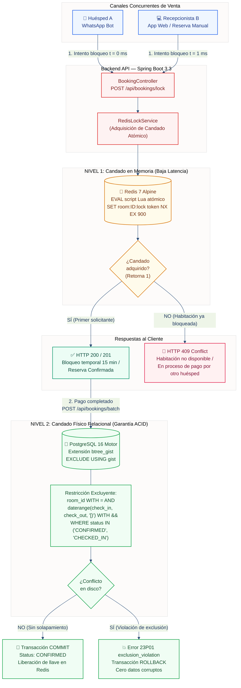

# Diagrama 03 — Concurrencia y Mecanismo de Doble Candado Anti-Overbooking

Este diagrama ilustra la arquitectura de **Doble Candado** implementada en Torre Satori PMS para garantizar la prevención absoluta de sobreventa (*overbooking*), protegiendo la consistencia tanto en memoria de baja latencia como a nivel de bloque en disco.

---

---

### Explicación de los Dos Niveles de Blindaje

1. **Nivel 1 (Redis 7 — Preventivo):** Opera en memoria volátil en $< 5\text{ ms}$. Si dos clientes solicitan la misma habitación para las mismas fechas, el comando atómico `SET ... NX EX 900` entrega el candado al primero y rechaza al segundo de inmediato con un código de conflicto `409 Conflict`, evitando saturar la base de datos con peticiones redundantes.
2. **Nivel 2 (PostgreSQL 16 — Estructural):** La restricción `EXCLUDE USING gist` opera en el motor relacional. Incluso si la capa de Redis se cayera, se reiniciara o la red sufriera particiones extremas, el motor físico de base de datos aborta con excepción `23P01 exclusion_violation` cualquier intento de insertar dos reservas activas con fechas solapadas para la misma habitación.
