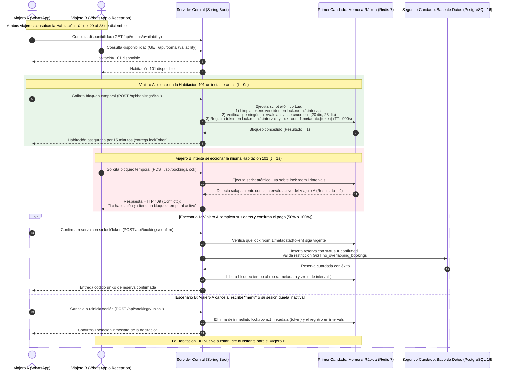
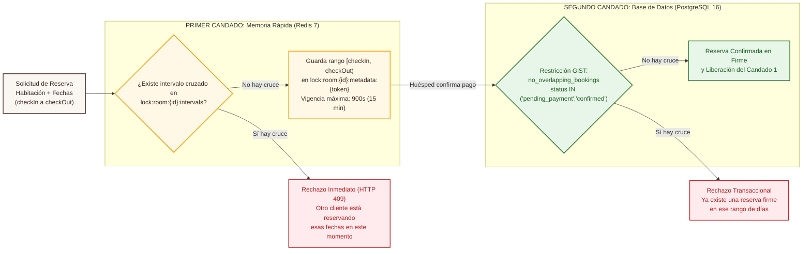

# 03. Prevención de Sobreventa: Arquitectura de Doble Candado — SatoriPMS

## 1. Propósito del Diagrama

Uno de los riesgos más críticos para cualquier hotel es la **sobreventa**: que dos clientes distintos intenten reservar la última habitación disponible para las mismas fechas al mismo tiempo.

Este documento explica visualmente cómo **SatoriPMS** elimina ese riesgo mediante un **sistema de Doble Candado**:
1. **Primer Candado (En memoria rápida Redis por 15 minutos):** Protege la habitación desde el segundo exacto en que el primer viajero la selecciona, evaluando intervalos de fechas de manera atómica.
2. **Segundo Candado (En la base de datos PostgreSQL de forma permanente):** Impide matemáticamente guardar dos reservas activas con fechas cruzadas para una misma habitación.

---

## 2. Diagrama de Competencia Simultánea entre Dos Usuarios

---

## 3. Diagrama de las Dos Capas de Protección por Intervalos de Fechas

---

## 4. Ventajas de Este Diseño para Torre Satori

1. **Bloqueo inteligente por fechas y no por habitación completa:** Si el Viajero A está reservando la Habitación 101 para Navidad (24 al 26 de diciembre), el Primer Candado solo bloquea esas fechas específicas. Si al mismo tiempo el Viajero B desea la misma Habitación 101 para Año Nuevo (30 de diciembre al 2 de enero), el sistema le permite reservar sin ningún obstáculo.
2. **Cero habitaciones retenidas cuando el usuario se arrepiente:** Además de la expiración automática de 15 minutos, cuando un usuario presiona *"Cancelar"* o regresa al *"Menú"* en WhatsApp, el sistema libera el Primer Candado de inmediato (`Liberación inmediata : "POST /api/bookings/unlock"`).
3. **Respaldo definitivo en base de datos:** Aunque una reserva ingrese por WhatsApp y otra desde el computador de recepción en el mismo milisegundo, el Segundo Candado en PostgreSQL garantiza que jamás puedan guardarse dos reservas activas superpuestas.
