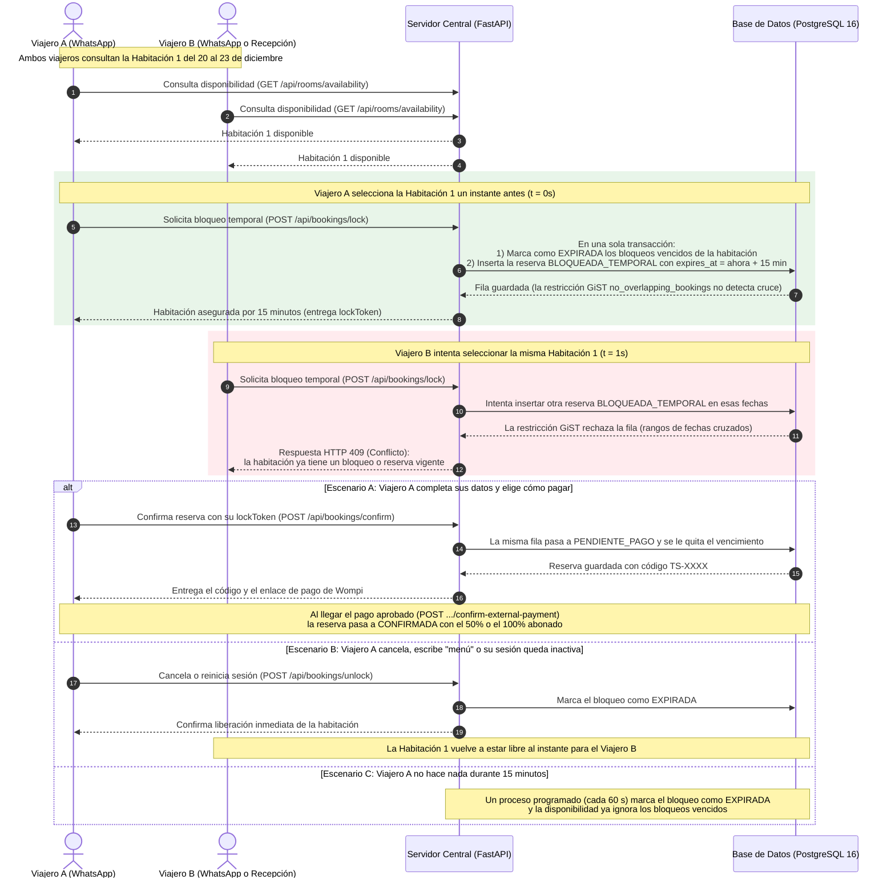
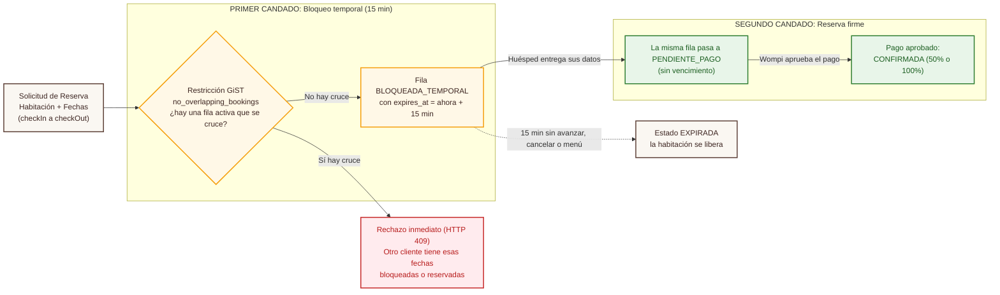

# 03. Prevención de Sobreventa: Doble Candado en PostgreSQL — SatoriPMS

## 1. Propósito del Diagrama

Uno de los riesgos más críticos para cualquier hotel es la **sobreventa**: que dos clientes distintos intenten reservar la última habitación disponible para las mismas fechas al mismo tiempo.

Este documento explica visualmente cómo **SatoriPMS** elimina ese riesgo con un **doble candado que vive íntegramente en la base de datos PostgreSQL** (el servidor central no usa Redis):
1. **Primer Candado (bloqueo temporal de 15 minutos):** Desde el segundo exacto en que un viajero elige una habitación, se guarda una reserva en estado `BLOQUEADA_TEMPORAL` con una hora de vencimiento (`expires_at`). Si el viajero no avanza, el bloqueo expira solo.
2. **Segundo Candado (reserva firme):** Cuando el viajero entrega sus datos, la misma fila pasa a `PENDIENTE_PAGO` (a la espera del pago aprobado) y luego a `CONFIRMADA`, sin vencimiento.

Ambos candados son la **misma restricción matemática** del motor de base de datos (`EXCLUDE USING gist`), que impide que dos filas activas de una misma habitación tengan fechas cruzadas. Por eso no existe ninguna ventana de tiempo en la que dos solicitudes simultáneas puedan tomar la misma habitación.

---

## 2. Diagrama de Competencia Simultánea entre Dos Usuarios

---

## 3. Diagrama de los Dos Candados Sobre la Misma Restricción

---

## 4. Ventajas de Este Diseño para Torre Satori

1. **Bloqueo por fechas y no por habitación completa:** Si el Viajero A está reservando la Habitación 1 para Navidad (24 al 26 de diciembre), solo esas fechas quedan retenidas; otro viajero puede reservar la misma habitación para la semana siguiente.
2. **Cero habitaciones retenidas cuando el usuario se arrepiente:** Además de la expiración automática de 15 minutos, cuando un usuario presiona *"Cancelar"* o vuelve al *"Menú"* en WhatsApp, el bloqueo se libera de inmediato.
3. **Una sola fuente de verdad:** Como el bloqueo y la reserva son filas de la misma tabla, no existe el riesgo de que un almacén de bloqueos y la base de datos queden desincronizados. Aunque una reserva ingrese por WhatsApp y otra desde recepción en el mismo milisegundo, PostgreSQL garantiza que jamás puedan guardarse dos reservas activas cruzadas.
4. **Reserva firme solo con pago aprobado:** Una reserva del chatbot no se confirma por una pantalla de éxito, sino únicamente cuando la pasarela aprueba la transacción; mientras tanto retiene la habitación como `PENDIENTE_PAGO`.
