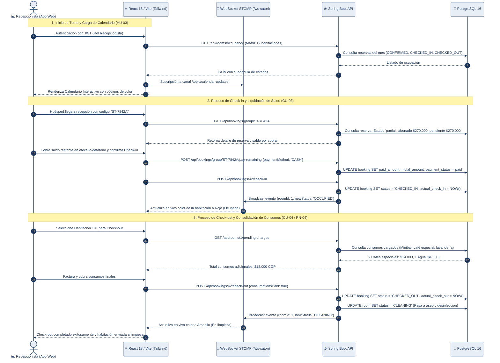

# Diagrama 04 — Gestión Operativa en Recepción (App Web & WebSockets)

Este diagrama modela la interacción entre el personal de recepción en la **App Web (React 18)**, la sincronización bidireccional mediante **WebSockets STOMP**, y los procesos de negocio en el backend (Check-in, Check-out, consumos de tienda RN-04 y liquidación de saldos).

---

---

### Módulos y Reglas de Negocio en Recepción

1. **Sincronización por WebSockets (`HU-03.1`):** Cualquier cambio realizado por WhatsApp (bloqueo o reserva nueva) emite un evento al canal `/topic/calendar-updates`, actualizando la pantalla del recepcionista sin necesidad de recargar la página (*zero polling*).
2. **Liquidación de Saldos (`/pay-remaining`):** Permite cobrar el 50% restante a huéspedes que reservaron con abono previo, unificando la cuenta antes de emitir la llave.
3. **Consolidación de Consumos (RN-04):** Durante el check-out, la API audita los cargos de tienda cargados a la habitación y no permite cerrar la estadía hasta que el saldo de consumos quede en `$0 COP`.
