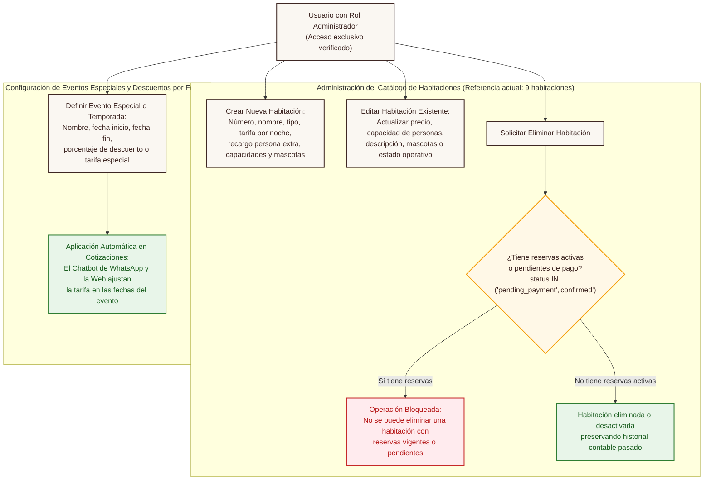

# 04. Gestión Operativa de Recepción y Administración en la Web — SatoriPMS

## 1. Propósito del Diagrama

Este documento ilustra los flujos de trabajo dentro de la **Aplicación Web de SatoriPMS**, diferenciando con claridad:
1. **La operación diaria de Recepción:** Atención del calendario de ocupación, creación de reservas manuales, registro de llegada del huésped (Check-in), cargo de productos de la tienda interna a la cuenta de la habitación y liquidación de salida (Check-out).
2. **La gestión exclusiva del Administrador:** Creación, edición completa y eliminación protegida de las habitaciones del hotel (referencia actual de 9 habitaciones), así como la configuración de eventos especiales y descuentos por fechas.

---

## 2. Diagrama de Procesos Operativos de Recepción

```mermaid
flowchart TB
    classDef recep fill:#FFF8E7,stroke:#D4A373,stroke-width:2px,color:#3E2723
    classDef sys fill:#E3F2FD,stroke:#1565C0,stroke-width:2px,color:#0D47A1
    classDef ok fill:#E8F5E9,stroke:#2E7D32,stroke-width:2px,color:#1B5E20
    classDef warn fill:#FFEBEE,stroke:#C62828,stroke-width:2px,color:#B71C1C

    subgraph Llegada["1. Llegada del Huésped o Reserva Manual"]
        direction TB
        R1["Recepcionista consulta Calendario de Ocupación<br/>o crea Reserva Manual (origen: 'web')"]:::recep
        R2["Verifica documento del titular, acompañantes<br/>y estado de pago de la reserva"]:::recep
        R3{"¿Reserva con anticipo<br/>del 50% (partial)?"}:::sys
        R4["Permite cobrar el 50% restante al ingreso<br/>o mantenerlo en cuenta para la salida"]:::recep
        R5["Registra Check-in:<br/>Habitación pasa a estado Ocupada"]:::ok
    end

    subgraph Estadia["2. Consumos de Tienda Interna Durante la Estadía"]
        direction TB
        T1["Huésped solicita bebida, café o snack<br/>en la vitrina de recepción"]:::recep
        T2["Sistema valida existencias en inventario<br/>y congela el precio unitario del día (unit_price)"]:::sys
        T3{"¿Paga en el acto o<br/>carga a la habitación?"}:::sys
        T4["Pago inmediato (paid = true):<br/>Ingresa directo a caja del día"]:::ok
        T5["Cargo a la habitación (paid = false):<br/>Se acumula en la cuenta de la reserva"]:::recep
    end

    subgraph Salida["3. Salida del Huésped y Cierre de Cuenta (Check-out)"]
        direction TB
        S1["Recepcionista inicia proceso de Check-out"]:::recep
        S2["Sistema consolida estado de cuenta:<br/>• Saldo pendiente de hospedaje<br/>• Consumos de tienda con paid = false"]:::sys
        S3{"¿Existen saldos o<br/>consumos sin pagar?"}:::sys
        S4["Bloquea salida hasta registrar<br/>el cobro total de los pendientes"]:::warn
        S5["Marca consumos como pagados (paid = true),<br/>cambia reserva a 'finished' y libera habitación"]:::ok
    end

    R1 --> R2 --> R3
    R3 -->|"Sí (falta 50%)"| R4 --> R5
    R3 -->|"No (pagada 100%)"| R5
    R5 --> T1 --> T2 --> T3
    T3 -->|"Paga de contado"| T4
    T3 -->|"A la cuenta"| T5
    T4 --> S1
    T5 --> S1
    S1 --> S2 --> S3
    S3 -->|"Sí hay deuda"| S4 --> S5
    S3 -->|"Cuenta en $0"| S5
```

---

## 3. Diagrama de Gestión Exclusiva del Administrador (Habitaciones y Eventos Especiales)

---

## 4. Reglas Operativas Destacadas

1. **Autonomía total sobre las habitaciones:** A medida que **Torre Satori** defina o ajuste las descripciones y precios definitivos de sus **9 habitaciones** (o agregue nuevas unidades en el futuro), el administrador puede actualizarlas en segundos desde la aplicación web.
2. **Protección contra borrado accidental:** El sistema impide que una habitación con reservas vigentes o futuras sea eliminada, evitando dejar sin habitación asignada a un huésped que ya reservó.
3. **Eventos especiales alineados con el calendario turístico de Sevilla:** Permite programar con antelación descuentos promocionales o tarifas de temporada para fechas clave del municipio.
