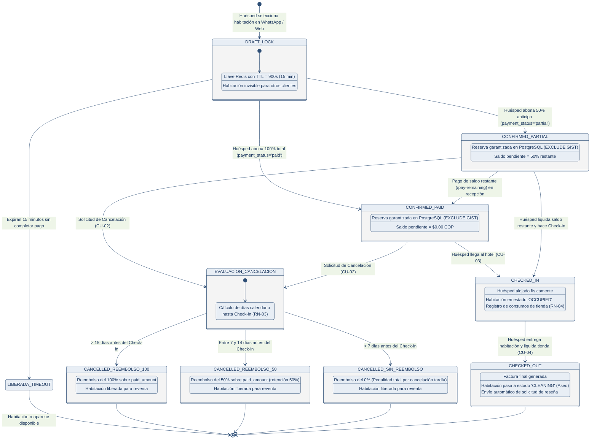

# Diagrama 05 — Máquina de Estados y Ciclo de Vida de la Reserva

Este diagrama documenta la **máquina de estados finita** de una reserva en SatoriPMS, detallando las transiciones de pago, la vigencia de los bloqueos temporales en Redis y las políticas de cancelación y reembolso proporcional (**Regla de Negocio RN-03**).

---

---

### Tabla de Reglas de Transición y Devoluciones (RN-03)

| Estado Origen | Evento Desencadenante | Estado Destino | Regla de Negocio Aplicada |
|---|---|---|---|
| `DRAFT_LOCK` | Transcurren 15 min sin abono | `LIBERADA_TIMEOUT` | La llave expira en Redis (`DEL room:{id}:lock`); inventario vuelve a la matriz pública. |
| `DRAFT_LOCK` | Pago del 50% confirmado | `CONFIRMED_PARTIAL` | Se asienta en PostgreSQL con `paid_amount = total * 0.5` y `payment_status = 'partial'`. |
| `DRAFT_LOCK` | Pago del 100% confirmado | `CONFIRMED_PAID` | Se asienta en PostgreSQL con `paid_amount = total` y `payment_status = 'paid'`. |
| `CONFIRMED_*` | Cancelación > 15 días antes | `CANCELLED` | **Reembolso 100%:** Se devuelve el 100% del monto efectivamente pagado (`paid_amount`). |
| `CONFIRMED_*` | Cancelación 7–14 días antes | `CANCELLED` | **Reembolso 50%:** Se devuelve el 50% de `paid_amount`; el hotel retiene el otro 50%. |
| `CONFIRMED_*` | Cancelación < 7 días antes | `CANCELLED` | **Penalidad Total:** 0% de reembolso; el hotel retiene el 100% de lo pagado. |
| `CHECKED_IN` | Check-out completado | `CHECKED_OUT` | Exige validar que todos los consumos de tienda (`RN-04`) estén pagados en `$0 COP`. |
