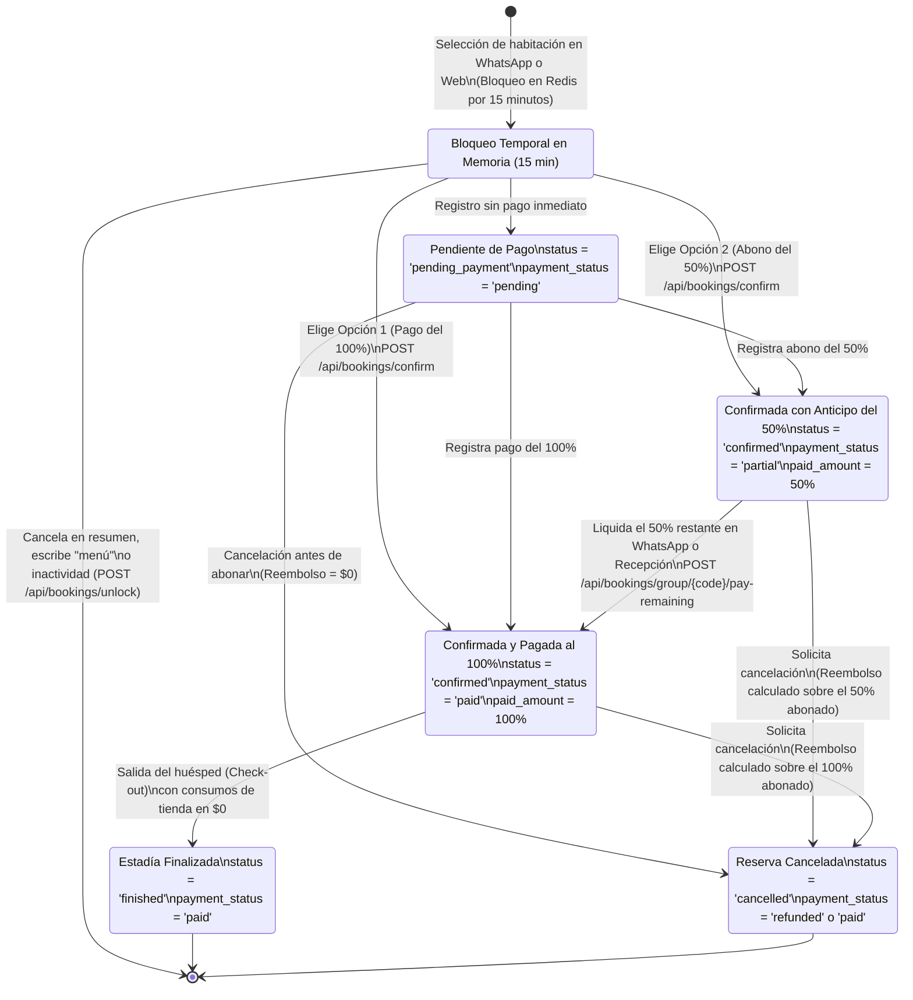
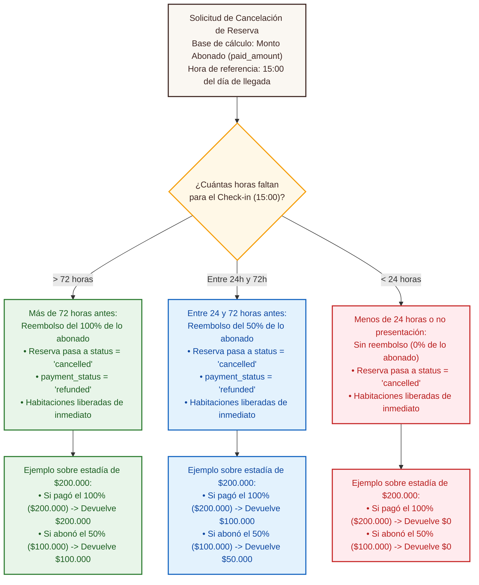

# 05. Ciclo de Vida de una Reserva y Política de Reembolso — SatoriPMS

## 1. Propósito del Diagrama

Este documento describe todos los estados por los que transita una reserva dentro de **SatoriPMS** desde que el viajero selecciona una habitación hasta que concluye su estadía o solicita una cancelación, mostrando de forma explícita cómo se calcula el reembolso **exclusivamente sobre el dinero que el huésped haya abonado hasta ese momento** (`Monto abonado : "paid_amount"`).

---

## 2. Diagrama de Estados de la Reserva y del Pago

Los estados representados corresponden exactamente a los valores que gestiona el servidor y la base de datos del hotel:
- **Estados de la reserva (`Estado de la reserva : "status"`):** `'pending_payment'`, `'confirmed'`, `'finished'`, `'cancelled'`.
- **Estados financieros (`Estado del pago : "payment_status"`):** `'pending'`, `'partial'`, `'paid'`, `'refunded'`.

---

## 3. Árbol de Decisión de Reembolso sobre el Monto Efectivamente Pagado

Cuando un huésped solicita cancelar su reserva confirmada (`POST /api/bookings/group/{code}/cancellation`), el sistema toma dos datos reales de la reserva:
1. Las horas que faltan desde el momento de la cancelación hasta las **15:00 horas (3:00 p. m.) del día de entrada**.
2. El **monto efectivamente pagado por el cliente hasta ese instante (`Monto abonado : "paid_amount"`)**.

---

## 4. Garantías Financieras y Operativas del Ciclo de Vida

1. **Coherencia entre consulta y cancelación:** Tanto cuando el huésped consulta su reserva antes de decidir (`GET /api/bookings/group/{code}`) como cuando confirma la cancelación definitiva (`POST /api/bookings/group/{code}/cancellation`), el servidor aplica exactamente la misma fórmula sobre el monto abonado (`paid_amount`).
2. **Liberación inmediata de disponibilidad:** En cuanto el estado cambia a `'cancelled'`, la restricción de la base de datos deja de bloquear ese rango de fechas y la habitación vuelve a aparecer disponible en WhatsApp y en la aplicación web sin requerir intervención manual.
