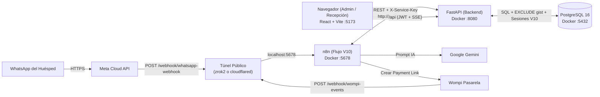

# Guía Completa de Arquitectura, `.env` y Despliegue en Vivo — SatoriPMS

Esta guía explica **cómo se conectan todas las piezas**, **qué le falta exactamente a tu `.env` actual** y **el orden exacto para levantar todo sin errores** antes de la presentación con el cliente.

---

## 1. ¿Cómo funciona la arquitectura? (El porqué de cada componente)



### Por qué existe cada parte y qué hace en el despliegue
1. **PostgreSQL 16 (`satori_postgres`, puerto `5432`):** es la única base de datos del sistema. Guarda habitaciones (`1–9`), reservas (bloqueando solapamientos con `EXCLUDE USING gist`), inventario, ventas, auditoría **y también las sesiones del chatbot `V10`** (ya no usamos Redis).
2. **FastAPI (`satori_api`, puerto `8080`):** es el cerebro único de reglas de negocio, seguridad JWT, cálculos de tarifas/reembolsos `RN-03`, Excel `.xlsx`, reseñas Google Travel y tiempo real SSE. Tanto la web React como el bot `n8n` hablan únicamente con esta API.
3. **React + Vite (`apps/web`, puerto `5173`):** interfaz visual para Recepción y Administración. En desarrollo reenvía `/api/...` hacia la API (`:8080`).
4. **n8n (`satori_n8n`, puerto `5678`):** motor de automatización que ejecuta [V10_ChatbotReservas.json](../flows/n8n/V10_ChatbotReservas.json). Recibe los mensajes que reenvía Meta, consulta disponibilidad y crea bloqueos/reservas en FastAPI enviando la llave interna `X-Service-Key`, pide ayuda a Gemini para lenguaje natural y genera enlaces de pago en Wompi.
5. **Túnel público (`zrok2` o `cloudflared`):** **por qué es obligatorio para WhatsApp y Wompi en vivo:** Meta y Wompi viven en Internet y **no pueden enviar webhooks a `http://localhost:5678`**. El túnel crea una URL `https://...` pública que reenvía el tráfico hacia tu puerto local `5678`.

---

## 2. Auditoría exacta de tu `.env` hoy y cómo obtener lo que falta

> **Estado detectado en tu equipo hoy:**
> - **Ya tienes configurados:** `DATABASE_URL`, `POSTGRES_*`, `SATORI_SERVICE_KEY`, `META_APP_ID`, `META_APP_SECRET`, `WHATSAPP_PHONE_ID`, `WHATSAPP_ACCOUNT_ID`, `WHATSAPP_VERIFY_TOKEN`, `WHATSAPP_TEST_PHONE`, `GEMINI_API_KEY`, `GOOGLE_PLACE_ID`, `GOOGLE_REVIEWS_URL`, `N8N_BASIC_AUTH_*`, `COMPOSE_PROFILES=n8n`.

### Lo que DEBES completar / corregir antes de probar en vivo:

| Variable en `.env` | Estado actual detectado | Por qué importa | Cómo obtenerla / valor exacto |
|---|---|---|---|
| **`JWT_SECRET`** | Placeholder (`cambia_...`) | Firma los tokens JWT de `admin` y `recepcion`. Sin clave fuerte (`≥32` caracteres) el arranque seguro falla o es inseguro. | Ejecuta `openssl rand -hex 32` en terminal y pega el resultado. |
| **`WHATSAPP_TOKEN`** | **VENCIDO (`HTTP 401`)** | Meta exige este token para que `n8n` pueda responder mensajes al WhatsApp del cliente. Los temporales caducan cada **24 h**. | Entra a [Meta for Developers](https://developers.facebook.com/) → Tu App → *WhatsApp → API Setup* → **Generate access token** y pégalo en `.env` **el mismo día de la demo**. *(Si tu app está en Modo Desarrollo, agrega los celulares de prueba en el campo "To" ahí mismo).* |
| **`WOMPI_ENABLED`**<br>`WOMPI_API_URL`<br>`WOMPI_CHECKOUT_URL`<br>`WOMPI_PUBLIC_KEY`<br>`WOMPI_PRIVATE_KEY`<br>`WOMPI_EVENTS_SECRET`<br>`WOMPI_INTEGRITY_SECRET`<br>`WOMPI_LINK_EXPIRATION_HOURS` | **FALTAN todas en `.env`** *(tampoco están declaradas)* | Sin ellas, `V10` crea la reserva pero no puede generar el link de pago Wompi y pide hablar con `*agente*`. | Entra a [Comercio Wompi](https://comercios.wompi.co/) (o [Sandbox Wompi](https://comercios.sandbox.wompi.co/) si usarás tarjetas de prueba sin dinero real) → **Desarrolladores → Programación** y copia las 4 llaves:<br>• **Producción:** `WOMPI_API_URL=https://production.wompi.co/v1`, `WOMPI_ENVIRONMENT=production`, llaves `pub_prod_...`, `prv_prod_...`, `prod_events_...`, `prod_integrity_...`.<br>• **Sandbox (recomendado para ensayos sin plata real):** `WOMPI_API_URL=https://sandbox.wompi.co/v1`, `WOMPI_ENVIRONMENT=sandbox`, llaves `pub_test_...`, `prv_test_...`, `test_events_...`, `test_integrity_...`.<br>Añade también `WOMPI_ENABLED=true`, `WOMPI_CHECKOUT_URL=https://checkout.wompi.co/l/` y `WOMPI_LINK_EXPIRATION_HOURS=24`. |
| **`N8N_PUBLIC_URL`** | Apunta a un `trycloudflare.com` de sesión previa | Debe coincidir **exactamente** con el túnel activo en **tu** portátil para que Meta y Wompi lleguen a `satori_n8n`. | Ver Paso 3 abajo (según uses `zrok2` o `cloudflared`, pegas la URL `https://.../` aquí). |
| **`ENVIRONMENT`**<br>`JWT_EXPIRES_MINUTES`<br>`PAYMENT_WEBHOOK_SECRET` | Usan valores por defecto internos (tienes la vieja `JWT_EXPIRES_IN`) | Mantienen limpio el contrato actual de FastAPI. | Agrega:<br>`ENVIRONMENT=development`<br>`JWT_EXPIRES_MINUTES=480`<br>`PAYMENT_WEBHOOK_SECRET=<openssl rand -hex 32>` |

### Variables que NO necesitas para la demo (puedes dejar vacías)
- `GOOGLE_PLACES_API_KEY`: sin ella ya ves la calificación real **`4.8 ★ / 19 opiniones`** desde Google Travel sin tarjeta de crédito.
- `SENTRY_DSN`, `BACKUP_ENCRYPTION_KEY`, `R2_*`: son para monitoreo/backups en servidor productivo (`P9`).

---

## 3. Flujo paso a paso para levantar todo desde cero en tu Fedora

### Paso 0 · Permisos de Docker (una sola vez en este portátil)
**Por qué:** ahora mismo tu usuario `jjarias` no pertenece al grupo `docker`, por eso los scripts fallan con `permission denied`.
```bash
sudo usermod -aG docker "$USER"
newgrp docker
docker info >/dev/null && echo "Docker listo"
```

### Paso 1 · Instalar y abrir el túnel (`zrok2` o `cloudflared`)
**Por qué:** `zrok2` y `cloudflared` **no** están instalados todavía en este Fedora. Elige **una** opción:
- **Opción A (`cloudflared` rápido — cero cuentas previas, ideal para mañana):**
  1. Descarga el binario Linux (`cloudflared-linux-amd64`) e instálalo en `/usr/local/bin/cloudflared`.
  2. Ejecútalo en una terminal aparte:
     ```bash
     cloudflared tunnel --url http://localhost:5678
     ```
  3. Copia la URL `https://xxxx.trycloudflare.com/` que imprime y pégala en `N8N_PUBLIC_URL=` en `.env`.
- **Opción B (`zrok2` — URL fija integrada en `start-dev.sh`, recomendada si quieres conservar el mismo dominio):**
  1. Instala `zrok2` en Fedora con el script oficial de OpenZiti (o RPM desde releases de GitHub `openziti/zrok`):
     ```bash
     curl -sSLf https://get.openziti.io/install.bash | sudo bash -s zrok2
     zrok2 version
     ```
  2. Crea una cuenta gratis en [my.zrok.io](https://my.zrok.io), copia tu **Account Token** y habilita tu portátil:
     ```bash
     zrok2 enable <TU_ACCOUNT_TOKEN>
     ```
  3. Elige un subdominio único (ej. `satorijarias`) y pruébalo 5 segundos para verificar la URL que te asigna (`https://satorijarias.shares.zrok.io`):
     ```bash
     zrok2 share public 5678 -n "public:satorijarias" --headless
     ```
     *(Detén con `Ctrl+C` cuando confirmes la URL).*
  4. Pon esa URL exacta en `.env`:
     ```env
     N8N_PUBLIC_URL=https://satorijarias.shares.zrok.io/
     ```
     A partir de ese momento, `./scripts/start-dev.sh` abre ese mismo túnel en segundo plano automáticamente al arrancar.

### Paso 2 · Actualizar `.env` con tus llaves reales
Asegúrate de tener actualizados en `.env`:
- `JWT_SECRET` (nuevo de `openssl rand -hex 32`)
- `WHATSAPP_TOKEN` (recién generado en Meta, vigente 24 h)
- Las 8 variables `WOMPI_*`
- `N8N_PUBLIC_URL` (con la URL exacta del Paso 1 terminada en `/`)

### Paso 3 · Reconstruir y recrear los contenedores (`api` + `n8n` + `postgres`)
**Por qué `--build --force-recreate` es OBLIGATORIO:**  
- `--build` compila dentro de Docker tu backend más reciente (excluido Redis, `PENDIENTE_PAGO` 24 h, `toggle-bot`, Google Travel reseñas, `Tienda` CRUD).  
- `--force-recreate` obliga a Docker a crear contenedores nuevos para que `satori_api` y `satori_n8n` **carguen las variables nuevas del `.env`** (un simple `restart` no relee `.env`).

```bash
docker compose --profile n8n up -d --build --force-recreate
```
*(Si más adelante ves errores de migración vieja de Java en PostgreSQL, reinicia la BD limpia con `./scripts/reset-dev.sh --keep-n8n -y` como vimos en [GUIA_DEMO.md](GUIA_DEMO.md)).*

### Paso 4 · Publicar el flujo `V10` dentro de `n8n`
**Por qué es obligatorio:** `n8n` guarda los flujos en su volumen SQLite `n8n_data` y cachea por `versionId`. Aunque exista `V10_ChatbotReservas.json` en disco, `n8n` **no lo ejecuta hasta que lo importas, lo publicas y reinicias el contenedor**.
```bash
./scripts/sync-n8n-flow.sh
```
*(Si es la primera vez que usas `n8n` en este PC, abre `http://localhost:5678` y crea el usuario propietario inicial antes o después de importar).*

### Paso 5 · Conectar los Webhooks en Meta y Wompi al túnel activo
**Por qué:** tanto Meta (mensajes entrantes) como Wompi (aviso de pago aprobado) deben saber a qué URL pública enviar los eventos POST:
1. **En Meta for Developers** (*WhatsApp → Configuración → Webhook → Editar*):
   - **URL de devolución de llamada:** `<N8N_PUBLIC_URL>webhook/whatsapp-webhook` (ej. `https://xxxx.trycloudflare.com/webhook/whatsapp-webhook`)
   - **Token de verificación:** el valor exacto de `WHATSAPP_VERIFY_TOKEN` en tu `.env`.
   - Clic en **Verificar y guardar**, y asegúrate de que el campo **`messages`** esté **Suscrito**.
2. **En Wompi** (*Desarrolladores → Eventos / Webhooks*):
   - **URL de eventos:** `<N8N_PUBLIC_URL>webhook/wompi-events` (ej. `https://xxxx.trycloudflare.com/webhook/wompi-events`)
   - Asegúrate de estar editando en el mismo entorno (Sandbox o Producción) de las llaves que pegaste en `.env`.

### Paso 6 · Levantar la UI Web y verificar todo antes de presentar
```bash
./scripts/start-dev.sh --no-build --open
./scripts/status-dev.sh
```
Verifica que `./scripts/status-dev.sh` muestre **en verde `[OK]`**:
- `satori_postgres`, `satori_api`, `satori_n8n` arriba.
- Web respondiendo en `http://localhost:5173`.
- Túnel público respondiendo `200` en `/healthz`.
- **Meta Token válido** y **App suscrita a la cuenta de WhatsApp Business**.

---

## 4. Prueba rápida de punta a punta (2 minutos)
1. Envía `"Hola"` por WhatsApp al número configurado → n8n `V10` guarda sesión en PostgreSQL y responde el menú de 5 opciones.
2. Completa una reserva (opción `1` o mensaje natural) hasta elegir pago 50% / 100% → recibes el enlace `https://checkout.wompi.co/l/...` y en la web (`http://localhost:5173` → **Reservas**) aparece en **`Pendiente de pago`**.
3. Al completarse el pago en Wompi, el webhook `/webhook/wompi-events` actualiza la reserva en PostgreSQL a **`Confirmada`** y la web se actualiza en vivo vía SSE.
4. Si algo falla en el salón, aplica al instante el **Plan B** documentado en [GUIA_DEMO.md](GUIA_DEMO.md).
