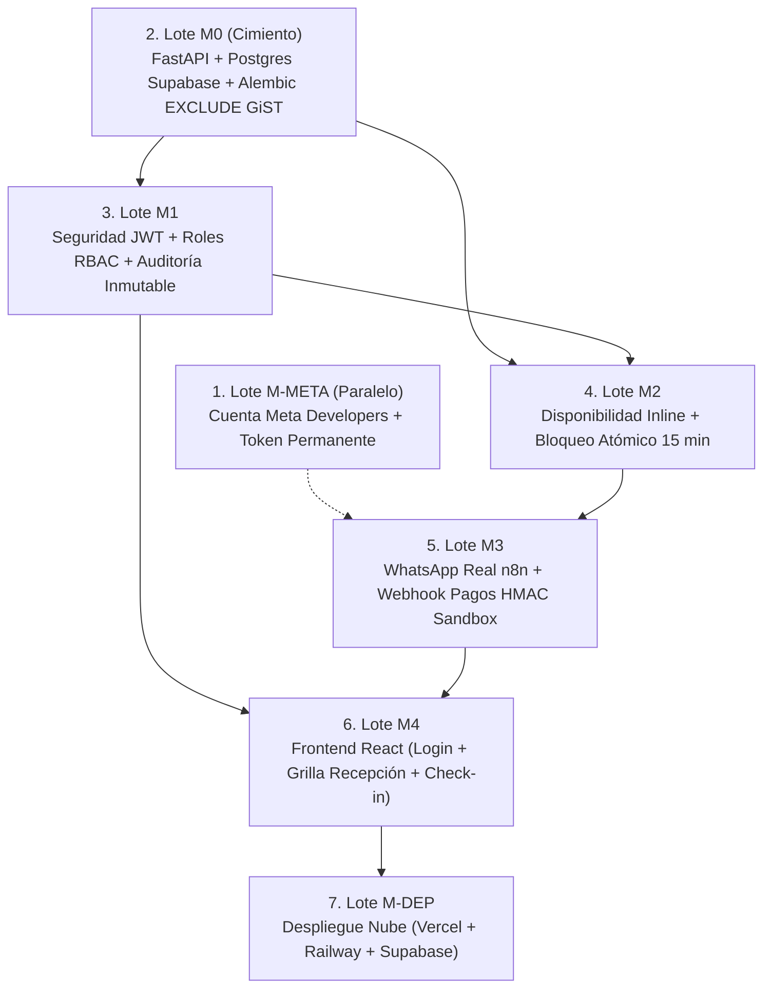

# Guía Maestra de Dominio Técnico, Criterios de Suficiencia y Plan de Ejecución: SatoriPMS

**Autor / Perfil:** Ingeniero Telemático  
**Proyecto:** Torre Satori PMS (Hotel boutique en Sevilla, Valle del Cauca, 9 habitaciones)  
**Meta:** Proveer el marco conceptual completo, analogías de redes/protocolos, **criterios de suficiencia ("semáforo verde")** para no estudiar de más, y el **plan de ejecución exacto** (archivos, comandos e instrucciones para modo AGY) para cada lote del Sprint 5.

---

## 0. Mentalidad del Ingeniero Telemático en el Desarrollo de Software

Como ingeniero telemático, tu formación está centrada en **capas de comunicación, protocolos, puertos, paquetes, flujos de estado y concurrencia física**. Muchos desarrolladores de software ven el backend como "cajas negras" o librerías mágicas; tú lo entenderás como una **arquitectura de red cliente-servidor con persistencia y control de concurrencia**.

### La Regla de Oro del Proyecto
> **No necesitas convertirte en un programador senior full-stack de 5 años de experiencia.**  
> Solo necesitas entender y defender tres fronteras críticas:
> 1. **La Frontera de Protocolos:** Cómo entran los datos (HTTP, JSON, Webhooks, JWT, HMAC).
> 2. **La Frontera de Concurrencia:** Cómo se evita la colisión de fechas en la base de datos sin Redis (`EXCLUDE USING gist`).
> 3. **La Frontera de Estados:** Cómo transiciona una reserva (`BLOQUEADA_TEMPORAL` -> `CONFIRMADA` -> `EN_CURSO`).

---

## MÓDULO 0: Infraestructura, PostgreSQL 16 y Restricción GiST (Lote M0)

### 1. El Puente Mental Telemático
* **PostgreSQL:** No lo veas como un simple archivador de tablas. Es un **servicio daemon escuchando en el puerto TCP 5432**, con un motor relacional transaccional (ACID).
* **Restricción `EXCLUDE USING gist` (RN-02):** Es exactamente igual a la **Multiplexación por División de Tiempo (TDM) o asignación de canales de frecuencia**. En un enlace inalámbrico, dos señales no pueden ocupar la misma frecuencia al mismo tiempo porque colisionan. En SatoriPMS, dos reservas no pueden ocupar la misma habitación (`room_id WITH =`) en el mismo intervalo de tiempo (`daterange WITH &&`).
* **Alembic:** Es el "control de versiones de protocolo" de tu base de datos. Cada archivo en `alembic/versions/` es un parche con dos funciones: `upgrade()` (aplica cambios) y `downgrade()` (revierte cambios).

### 2. Qué Estudiar y Dónde (Tiempo estimado: 35 minutos)
1. **Tipos de Rangos en PostgreSQL (15 min):**
   * Lee qué es un `daterange` y por qué se usa la notación matemática `[)` (inclusiva al inicio, exclusiva al final).
   * *Concepto clave:* Si un huésped sale el 15 de noviembre a las 11:00 am (`[2026-11-10, 2026-11-15)`) y otro entra el 15 de noviembre a las 3:00 pm (`[2026-11-15, 2026-11-20)`), el día 15 está excluido del primer rango e incluido en el segundo. **Por definición matemática, los rangos NO se intersecan.** No hay colisión.
   * *Lectura:* [PostgreSQL Docs - Range Types](https://www.postgresql.org/docs/current/rangetypes.html).
2. **Restricciones de Exclusión GiST (10 min):**
   * Lee cómo funciona `EXCLUDE USING gist`. Entiende por qué requiere la extensión `CREATE EXTENSION IF NOT EXISTS btree_gist;` (permite mezclar operadores escalares `=` con operadores de rango `&&`).
   * *Lectura:* [PostgreSQL Docs - Exclusion Constraints](https://www.postgresql.org/docs/current/ddl-constraints.html#DDL-CONSTRAINTS-EXCLUSION).
3. **Mecánica básica de Alembic (10 min):**
   * Qué hace el comando `alembic revision --autogenerate -m "descripcion"` y qué hace `alembic upgrade head`.

### 3. Criterio de Suficiencia ("Semáforo Verde — ¿Sé lo suficiente para avanzar?")
Estás listo para ejecutar M0 si puedes responder afirmativamente a estos 3 puntos sin dudar:
* [x] **Check 1:** ¿Entiendo por qué la restricción GiST incluye `WHERE (status IN ('BLOQUEADA_TEMPORAL', 'CONFIRMADA', 'EN_CURSO'))`? (Respuesta: porque cuando una reserva pasa a `CANCELADA` o `EXPIRADA`, sale del filtro del índice y el rango queda libre en la base de datos de inmediato).
* [x] **Check 2:** ¿Puedo explicar la diferencia entre verificar disponibilidad con una consulta `SELECT` previa vs. proteger la inserción con `EXCLUDE gist`? (Respuesta: el `SELECT` previo tiene condición de carrera; dos peticiones simultáneas pueden leer "libre" al tiempo. La restricción `EXCLUDE` adquiere un cerrojo a nivel de índice de PostgreSQL y serializa físicamente la inserción).
* [x] **Check 3:** ¿Sé cómo verificar que la extensión `btree_gist` existe en Supabase? (Respuesta: ejecutando la consulta SQL `SELECT * FROM pg_extension WHERE extname = 'btree_gist';`).

### 4. Plan de Ejecución Inmediato (Lote M0)

#### A. Archivos a crear/modificar en el repositorio:
1. `apps/api/pyproject.toml` (o `requirements.txt`): Dependencias (`fastapi`, `uvicorn`, `sqlalchemy[asyncio]`, `asyncpg`, `psycopg2-binary`, `alembic`, `pydantic-settings`, `pytest`).
2. `apps/api/core/config.py`: Variables de entorno cargadas con Pydantic (`DATABASE_URL`, `PORT`, `CORS_ORIGINS`).
3. `apps/api/core/database.py`: Creación del engine asíncrono de SQLAlchemy (`create_async_engine`) y sesión `AsyncSession`.
4. `apps/api/models/`: Modelos `Room` (con catálogo de 9 habitaciones), `Guest`, `Booking` (con constraint GiST) y `AuditLog`.
5. `alembic/` y `alembic.ini`: Configuración para soportar modelos asíncronos y migración inicial `001_initial_schema.py`.
6. `apps/api/main.py`: Instancia FastAPI con endpoint `/api/v1/health`.

#### B. Instrucción precisa para modo AGY:
> *"Implementa el Lote M0: Configura FastAPI con SQLAlchemy 2.0 asíncrono en `apps/api/`. Crea los modelos `Room`, `Guest`, `Booking` y `AuditLog` en `apps/api/models/`. En el modelo `Booking`, define la restricción de exclusión PostgreSQL con `ExcludeConstraint(Column('room_id'), Column('daterange(...)'), using='gist', where=...)`. Configura Alembic y genera la migración inicial que asegure la extensión `btree_gist`. Expón `/api/v1/health` retornando estado 200 y conectividad a base de datos. No agregues lógica de autenticación ni reservas todavía."*

#### C. Comandos de Verificación en Consola:
```bash
# 1. Levantar Postgres local
docker compose up -d postgres

# 2. Aplicar migraciones
cd apps/api && alembic upgrade head

# 3. Probar el endpoint de salud
uvicorn apps.api.main:app --port 8080 &
curl -i http://localhost:8080/api/v1/health  # Debe retornar 200 OK con {"status": "ok", "db": "connected"}

# 4. Probar colisión GiST en pytest
pytest tests/test_concurrency_rn02.py  # Debe validar que la segunda reserva solapada lanza IntegrityError / 409
```

---

## MÓDULO 1: Identidad, Seguridad RBAC y JWT (Lote M1)

### 1. El Puente Mental Telemático
* **JWT (JSON Web Token):** Es como un **paquete firmado con checksum criptográfico que viaja en la cabecera HTTP**. El cliente hace login con usuario y contraseña (handshake inicial). El servidor responde entregándole un token. Ese token contiene 3 partes codificadas en Base64URL: `Header.Payload.Signature`.
* **Stateless (Sin Estado):** El servidor **no guarda sesiones en memoria ni en Redis**. Cuando llega una petición con `Authorization: Bearer <token>`, el servidor simplemente toma el Header + Payload, aplica el hash HMAC-SHA256 con su `JWT_SECRET` local y compara la firma. Si coincide matemáticamente y no ha expirado (`exp`), el usuario es legítimo.
* **RBAC (Role-Based Access Control):** Es una regla de firewall a nivel de aplicación. En el Payload viaja `"role": "Recepcionista"`. Un interceptor/dependencia de FastAPI comprueba: si la ruta exige `Administrador` y el token trae `Recepcionista`, descarta la trama con código HTTP 403 Forbidden.

### 2. Qué Estudiar y Dónde (Tiempo estimado: 30 minutos)
1. **Estructura del JWT (10 min):**
   * Entra a [jwt.io](https://jwt.io/), pega un token de ejemplo y observa los claims (`sub`, `role`, `exp`). Entiende por qué Base64 **no es cifrado, sino codificación visible**, pero la firma impide que alguien cambie su rol de recepcionista a admin.
2. **Inyección de Dependencias de Seguridad en FastAPI (15 min):**
   * Lee cómo `OAuth2PasswordBearer` y `Depends(get_current_user)` extraen la cabecera `Authorization` automáticamente.
   * *Lectura:* [FastAPI - Security Tutorial](https://fastapi.tiangolo.com/tutorial/security/oauth2-jwt/).
3. **Hashing de Contraseñas (5 min):**
   * Comprende por qué nunca se compara `if user.password == password` sino `bcrypt.verify(password, user.password_hash)`.

### 3. Criterio de Suficiencia ("Semáforo Verde — ¿Sé lo suficiente para avanzar?")
* [x] **Check 1:** ¿Puedo explicar qué pasa si un atacante altera el payload del JWT para ponerse `"role": "Administrador"`? (Respuesta: la firma criptográfica se rompe porque el atacante no conoce el `JWT_SECRET` del servidor, y FastAPI rechaza la petición con HTTP 401).
* [x] **Check 2:** ¿Sé cuál es la diferencia entre HTTP 401 Unauthorized (no presentaste credenciales válidas) y HTTP 403 Forbidden (sé quién eres, pero tu rol no tiene permisos para esta ruta)?
* [x] **Check 3:** ¿Entiendo qué se guarda en la tabla `audit_log`? (Respuesta: registro inmutable con `timestamp`, `actor_username`, `action`, `entity` y `details_json` para tener trazabilidad legal de cada acción del personal).

### 4. Plan de Ejecución Inmediato (Lote M1)

#### A. Archivos a crear/modificar:
1. `apps/api/core/security.py`: Funciones `hash_password`, `verify_password`, `create_access_token` y `decode_access_token`.
2. `apps/api/dependencies/auth.py`: Funciones de dependencia `get_current_user` y `require_role(role_name)`.
3. `apps/api/routers/auth.py`: Endpoints `POST /api/v1/auth/login` (recibe credenciales, retorna JWT) y `GET /api/v1/auth/me` (retorna perfil del usuario logueado).
4. `apps/api/services/audit_service.py`: Función `record_audit(db, actor, action, entity, entity_id, details)`.

#### B. Instrucción precisa para modo AGY:
> *"Implementa el Lote M1: Seguridad JWT y RBAC en `apps/api/`. Crea en `apps/api/core/security.py` las funciones criptográficas con `passlib[bcrypt]` y `python-jose`. Define el router de autenticación en `apps/api/routers/auth.py` con `POST /api/v1/auth/login` y `GET /api/v1/auth/me`. Implementa la dependencia `require_role(['Administrador', 'Recepcionista'])` en `apps/api/dependencies/auth.py`. Añade el servicio de auditoría inmutable en `apps/api/services/audit_service.py` que inserte registros en `audit_log`. Cubre con tests en pytest: login correcto entrega token, login fallido da 401, y usuario recepcionista accediendo a función admin recibe 403."*

#### C. Comandos de Verificación en Consola:
```bash
# Probar tests de autenticación
pytest tests/test_auth.py -v
```

---

## MÓDULO 2: Motor de Disponibilidad y Bloqueo Temporal (Lote M2)

### 1. El Puente Mental Telemático
* **Disponibilidad:** Imagina una grilla de conmutación de canales. Tienes 9 canales físicos (las 9 habitaciones). Un canal está ocupado si existe una trama en curso cuyo intervalo de tiempo solapa con el intervalo solicitado.
* **El Desacoplamiento del Job:** Muchos sistemas fallan porque dependen de un proceso periódico en background para liberar recursos vencidos. Si el job falla, la habitación queda bloqueada artificialmente. En SatoriPMS aplicamos el **principio de expiración en tiempo real (inline filtering)**:
  La consulta de disponibilidad filtra directamente con:
  ```sql
  WHERE status IN ('CONFIRMADA', 'EN_CURSO')
     OR (status = 'BLOQUEADA_TEMPORAL' AND expires_at > NOW())
  ```
  Si un candado tiene `expires_at = 14:15` y son las `14:16`, la consulta SQL **lo ignora inmediatamente**, considerándolo libre aunque ningún job haya cambiado el texto en la base de datos.
* **Transacción de Bloqueo Atómico:** Cuando un huésped solicita bloquear una habitación:
  1. Abre transacción SQL (`BEGIN`).
  2. Actualiza bloqueos vencidos de esa habitación a `EXPIRADA` (`UPDATE booking SET status='EXPIRADA' WHERE room_id = :id AND status='BLOQUEADA_TEMPORAL' AND expires_at <= NOW()`).
  3. Inserta el nuevo bloqueo con `expires_at = NOW() + INTERVAL '15 minutes'`.
  4. Cierra transacción (`COMMIT`).
  Si otro usuario intenta insertar en el mismo instante, la restricción `EXCLUDE USING gist` de Postgres hace que el motor aborte la segunda transacción y devuelva error de concurrencia.

### 2. Qué Estudiar y Dónde (Tiempo estimado: 30 minutos)
1. **Operadores de Solapamiento de Rangos en PostgreSQL (15 min):**
   * Aprende el operador `&&` (intersección de rangos) en PostgreSQL: `daterange('2026-11-15', '2026-11-18') && daterange('2026-11-17', '2026-11-20')` retorna `TRUE`.
2. **Cálculo de Tarifas y Recargos (RN-01) (15 min):**
   * Capacidad base vs. capacidad máxima. Si la habitación tiene capacidad base de 2 adultos y viajan 3, el precio total es: `(noches * precio_base) + (noches * extra_guest_price * personas_adicionales)`.

### 3. Criterio de Suficiencia ("Semáforo Verde — ¿Sé lo suficiente para avanzar?")
* [x] **Check 1:** ¿Puedo explicar por qué un bloqueo vencido no impide que otra persona reserve, incluso si el servidor estuvo apagado durante 2 horas? (Respuesta: porque la consulta SQL descarta los bloqueos cuyo `expires_at < NOW()` dinámicamente en tiempo de ejecución).
* [x] **Check 2:** ¿Sé qué código HTTP debe responder la API cuando dos solicitudes intentan bloquear la misma habitación al mismo milisegundo? (Respuesta: una responde HTTP 200 con el token de bloqueo; la otra responde HTTP 409 Conflict informando que la habitación no está disponible).
* [x] **Check 3:** ¿Entiendo por qué el consentimiento de Ley 1581 (RN-12) se valida en este paso? (Respuesta: porque antes de guardar los datos personales del huésped titular en la tabla `guest`, se verifica que el flag booleano de aceptación esté en `true`).

### 4. Plan de Ejecución Inmediato (Lote M2)

#### A. Archivos a crear/modificar:
1. `apps/api/schemas/room.py`: DTOs de habitaciones y capacidades.
2. `apps/api/schemas/booking.py`: DTOs de solicitud de bloqueo (`LockRequest`), respuesta (`LockResponse`), disponibilidad y desbloqueo.
3. `apps/api/services/room_service.py`: Lógica de consulta de disponibilidad con filtros de fechas, adultos, niños y mascotas.
4. `apps/api/services/booking_service.py`: Lógica de creación de bloqueo atómico de 15 minutos con expiración previa en la misma transacción y cálculo tarifario (RN-01).
5. `apps/api/routers/rooms.py`: Endpoint `GET /api/v1/rooms/availability`.
6. `apps/api/routers/bookings.py`: Endpoints `POST /api/v1/bookings/lock` y `POST /api/v1/bookings/unlock`.

#### B. Instrucción precisa para modo AGY:
> *"Implementa el Lote M2: Motor de habitaciones, disponibilidad y bloqueo temporal atómico en `apps/api/`. Crea los endpoints `GET /api/v1/rooms/availability` y `POST /api/v1/bookings/lock` en sus respectivos routers. La consulta de disponibilidad debe filtrar en PostgreSQL ignorando reservas con `expires_at <= NOW()`. La creación de bloqueo debe: validar capacidad y recargo (RN-01), validar consentimiento Ley 1581 (RN-12), expirar atómicamente candados vencidos de esa habitación e insertar la fila `BLOQUEADA_TEMPORAL` con `expires_at = NOW() + 15 min`. Si la restricción GiST lanza violación de exclusión, captura el error y retorna HTTP 409 Conflict. Cubre con tests de concurrencia en pytest."*

#### C. Comandos de Verificación en Consola:
```bash
# Probar disponibilidad y bloqueo
pytest tests/test_rooms_availability.py tests/test_booking_lock.py -v
```

---

## MÓDULO 3: Meta Cloud API, WhatsApp Real y n8n (Lotes M-META y M3)

### 1. El Puente Mental Telemático
* **Arquitectura de Webhook:** Un webhook no es más que una **llamada HTTP asíncrona hacia adelante (Push Notification)**. Meta no mantiene un socket TCP abierto permanente con tu servidor. Cada vez que un usuario presiona "Enviar" en su WhatsApp, los servidores de Meta empaquetan el mensaje en un JSON y hacen un `POST` HTTP hacia la URL pública HTTPS que registraste en n8n.
* **El Rol de n8n (Gateway de Frontera):** n8n actúa como un **Proxy Inverso / Demultiplexor de Mensajería**. Su función es:
  1. Responder el desafío inicial de Meta (`hub.challenge`) para establecer la confianza del canal.
  2. Parsear el árbol complejo de Meta y normalizarlo a una trama simple (`{ wa_id: "57310...", text: "Quiero reservar" }`).
  3. Hacer la llamada HTTP a FastAPI enviando una cabecera de autenticación fija de backend a backend (`X-Service-Key`).
* **Persistencia de Sesión sin Redis:** En lugar de guardar variables de chat en Redis, n8n llama a `GET /api/v1/conversations/session/{wa_id}` en FastAPI. FastAPI consulta la tabla `conversation` en PostgreSQL, lee la columna `session_data` (tipo `JSONB`) y le devuelve a n8n en qué paso del flujo va el huésped (ej. `step: "AWAITING_ROOM_SELECTION"`). Cero Redis, 100% transaccional.

### 2. Qué Estudiar y Dónde (Tiempo estimado: 40 minutos)
1. **Configuración de WhatsApp Cloud API en Meta Developers (20 min):**
   * Aprende dónde se crea la App de tipo "Business", cómo se activa el producto "WhatsApp", dónde se obtienen el `Phone Number ID` y el `WhatsApp Business Account ID`.
   * Entiende qué es un **System User** en Meta Business Suite: un usuario de servicio que permite generar un token que no vence cada 24 horas.
   * *Lectura:* [Meta Developers - WhatsApp Cloud API Getting Started](https://developers.facebook.com/docs/whatsapp/cloud-api/get-started).
2. **Nodos de n8n requeridos para el Camino Feliz (20 min):**
   * **Webhook Node:** Escucha peticiones HTTP de Meta (modo GET para verificación de webhook y POST para mensajes entrantes).
   * **Switch / If Node:** Evalúa el contenido del mensaje o el estado conversacional.
   * **HTTP Request Node:** Hace llamadas REST con autenticación a FastAPI.
   * **WhatsApp Send Message Node:** Envía la respuesta de texto con botones al usuario.

### 3. Criterio de Suficiencia ("Semáforo Verde — ¿Sé lo suficiente para avanzar?")
* [x] **Check 1:** ¿Sé cómo responder al handshake de verificación de Meta (`hub.mode=subscribe`, `hub.verify_token`, `hub.challenge`)? (Respuesta: el webhook de n8n debe devolver en el body directamente el valor numérico recibido en `hub.challenge`).
* [x] **Check 2:** ¿Sé cuáles son las limitaciones del número de prueba de Meta? (Respuesta: máximo 5 números de celular autorizados previamente en el portal de desarrolladores, y ventana de 24 horas para responder mensajes libres).
* [x] **Check 3:** ¿Puedo dibujar el camino feliz completo de 5 pasos en WhatsApp? (Respuesta: 1. Saludo -> 2. Consulta fechas -> 3. Selección habitación -> 4. Bloqueo 15m y link sandbox -> 5. Mensaje con voucher de confirmación).

### 4. Plan de Ejecución Inmediato (Lotes M-META y M3)

#### A. Pasos Manuales en Meta for Developers (Lote M-META — 11 de Noviembre):
1. Inicia sesión en [developers.facebook.com](https://developers.facebook.com/) con tu cuenta.
2. Crea una aplicación de tipo **Business** y nómbrala `Torre Satori PMS`.
3. Añade el producto **WhatsApp**.
4. En "API Setup", copia tu **Phone Number ID** temporal y tu número de prueba.
5. En "To" (Destinatarios), registra tu número móvil personal de WhatsApp y confírmalo con el código SMS que Meta te enviará.
6. En Meta Business Suite -> Configuración del Negocio -> Usuarios del Sistema: crea un usuario de sistema admin y genera un token con permiso `whatsapp_business_messaging`. Guárdalo en tu archivo `.env`.

#### B. Adaptación de n8n en el Repositorio (Lote M3):
1. `apps/api/routers/conversations.py`: Endpoints `/api/v1/conversations/session/{wa_id}` para leer y actualizar el estado conversacional en PostgreSQL (columna JSONB `session_data`).
2. `flows/n8n/V8_ChatbotReservas.json`: Reemplazar los 5 nodos obsoletos de Redis por nodos HTTP Request que consulten los endpoints de sesión de FastAPI.

#### C. Comandos de Verificación en Consola:
```bash
# Probar endpoint de sesión conversacional en FastAPI
curl -X GET http://localhost:8080/api/v1/conversations/session/573117778888 \
  -H "X-Service-Key: tu_clave_secreta"
```

---

## MÓDULO 4: Webhook de Pagos Sandbox e Idempotencia (Lote M3)

### 1. El Puente Mental Telemático
* **Por qué no confiar en el cliente:** En una arquitectura web, el frontend nunca le dice al servidor "el pago fue exitoso, confírmalo". Un atacante con abrir las herramientas de desarrollo del navegador podría alterar la respuesta de red.
* **Integridad por HMAC SHA-256:** La pasarela de pagos (Wompi, MercadoPago o Sandbox) procesa la transacción y envía un webhook directamente desde su servidor al servidor de FastAPI (`POST /api/v1/payments/webhook`).
  Para asegurar que nadie suplante a la pasarela, esta envía una cabecera `X-Hub-Signature-256: sha256=<hash>`.
  FastAPI toma el body crudo (bytes), calcula `hmac_sha256(SECRET_KEY, raw_body)` y compara bit a bit. Si coinciden, el pago es 100% auténtico.
* **Idempotencia (Descarte de Paquetes Duplicados):** En redes con pérdida de paquetes o reintentos automáticos, la pasarela puede reenviar el mismo webhook 3 veces. Para evitar registrar cobros dobles, FastAPI guarda en la base de datos el `transaction_id`. Si llega un evento con un `transaction_id` ya registrado, responde HTTP 200 inmediatamente sin tocar la reserva.

### 2. Qué Estudiar y Dónde (Tiempo estimado: 25 minutos)
1. **Librería estándar `hmac` y `hashlib` en Python (15 min):**
   * Observa cómo se calcula la firma:
     ```python
     import hmac, hashlib
     def verify_signature(payload_bytes: bytes, signature_header: str, secret: str) -> bool:
         expected = hmac.new(secret.encode(), payload_bytes, hashlib.sha256).hexdigest()
         return hmac.compare_digest(f"sha256={expected}", signature_header)
     ```
   * *Concepto clave:* Se usa `hmac.compare_digest` para evitar ataques de temporización (timing attacks).
2. **Transición Atómica de Estado (10 min):**
   * Actualizar el registro de la habitación de `BLOQUEADA_TEMPORAL` a `CONFIRMADA`, asignar el código de grupo (ej. `SAT-8X92`) y registrar el evento en `audit_log`.

### 3. Criterio de Suficiencia ("Semáforo Verde — ¿Sé lo suficiente para avanzar?")
* [x] **Check 1:** ¿Puedo explicar qué pasa si envío una petición a `/payments/webhook` con una firma alterada o vacía? (Respuesta: FastAPI lanza una excepción HTTP 401 Unauthorized y la base de datos no sufre cambios).
* [x] **Check 2:** ¿Por qué la idempotencia exige responder HTTP 200 cuando llega un webhook repetido en lugar de dar error? (Respuesta: porque si respondes con error, la pasarela creerá que el servidor falló y continuará reintentando enviar el webhook indefinidamente).

### 4. Plan de Ejecución Inmediato (Lote M3)

#### A. Archivos a crear/modificar:
1. `apps/api/routers/payments.py`: Endpoint `POST /api/v1/payments/webhook`.
2. `apps/api/services/payment_service.py`: Lógica de validación de firma criptográfica, verificación de idempotencia y transición atómica de la reserva a `CONFIRMADA`.

#### B. Instrucción precisa para modo AGY:
> *"Implementa el webhook de pagos con validación criptográfica en `apps/api/routers/payments.py`. El endpoint `POST /api/v1/payments/webhook` debe recibir el payload raw en bytes, extraer la cabecera `X-Hub-Signature-256` y validar la firma con `hmac.compare_digest` usando `PAYMENT_WEBHOOK_SECRET`. Valida idempotencia verificando que `payment_id` no exista previamente. Al procesar un pago exitoso, transiciona la reserva de `BLOQUEADA_TEMPORAL` a `CONFIRMADA`, genera el código de reserva de 8 caracteres y registra el evento en `audit_log`. Cubre con tests en pytest: firma inválida retorna 401, firma válida confirma reserva, y webhook duplicado retorna 200 sin reprocesar."*

#### C. Comandos de Verificación en Consola:
```bash
# Probar webhook de pagos con pytest
pytest tests/test_payment_webhook.py -v
```

---

## MÓDULO 5: Integración Frontend Web y Despliegue en la Nube (Lotes M4 y M-DEP)

### 1. El Puente Mental Telemático
* **El Frontend React:** No es más que una **aplicación cliente que corre dentro del navegador del usuario**. No tiene base de datos propia; todos sus datos provienen de peticiones HTTP JSON hacia la API de FastAPI.
* **CORS (Cross-Origin Resource Sharing):** Como el frontend corre en `http://localhost:5173` (o `https://satori.vercel.app`) y la API en `http://localhost:8080` (o `https://satori.railway.app`), el navegador aplica la política de mismo origen. FastAPI debe incluir cabeceras HTTP `Access-Control-Allow-Origin: *` (o el dominio exacto) para que el navegador permita la comunicación.
* **Despliegue Multi-Nube:**
  * **Vercel:** Aloja los archivos estáticos de React (HTML, JS, CSS) en una red CDN distribuida globalmente.
  * **Railway:** Aloja el contenedor Docker con la API de FastAPI en ejecución continua.
  * **Supabase:** Aloja la base de datos PostgreSQL 16 con `btree_gist` activo.

### 2. Qué Estudiar y Dónde (Tiempo estimado: 25 minutos)
1. **Configuración de Variables de Entorno en Vite (10 min):**
   * En React con Vite, cualquier variable pública debe empezar por `VITE_` (ej. `VITE_API_URL`).
   * Observa [`apps/web/src/api/client.ts`](file:///home/jjarias/Documents/UNIVERSIDAD/8vo%20semestre/Integrador-ii/SatoriPMS/apps/web/src/api/client.ts) para ver cómo axios usa `baseURL: import.meta.env.VITE_API_URL`.
2. **Riesgo de Arranque en Frío (Cold Start) (15 min):**
   * Plataformas gratuitas como Railway o Render suspenden los contenedores que no reciben tráfico durante 15 minutos. La primera petición HTTP después de reposo tarda 30-50 segundos en levantar la instancia.
   * *Protocolo de mitigación para la sustentación:* Ejecutar un ping `curl https://satori-api.up.railway.app/api/v1/health` 5 minutos antes de la presentación para que el contenedor esté pre-calentado en memoria RAM.

### 3. Criterio de Suficiencia ("Semáforo Verde — ¿Sé lo suficiente para avanzar?")
* [x] **Check 1:** ¿Sé qué comando ejecutar en la carpeta `apps/web` para comprobar que no hay ningún error de tipos en TypeScript? (Respuesta: `npm run build`, el cual ejecuta `tsc && vite build`).
* [x] **Check 2:** ¿Puedo explicar cómo el frontend sabe si el usuario tiene rol de Recepcionista? (Respuesta: tras el login exitoso, el frontend recibe el token JWT, lo almacena en `localStorage` o memoria y lo adjunta en cada petición en la cabecera `Authorization: Bearer <token>`).

### 4. Plan de Ejecución Inmediato (Lotes M4 y M-DEP)

#### A. Archivos a crear/modificar:
1. `apps/web/src/pages/ReservasDebug.tsx`: Conectar la tabla de reservas activas al endpoint real `GET /api/v1/bookings/debug`.
2. `apps/web/src/pages/Login.tsx`: Formulario de login consumiendo `POST /api/v1/auth/login`.
3. Botón de **Check-in Manual**: En la fila de la reserva, botón que envía `POST /api/v1/bookings/{id}/check-in`, transiciona a `EN_CURSO` y refresca la grilla.

#### B. Instrucción precisa para modo AGY:
> *"Implementa el Lote M4: Conecta el frontend React existente en `apps/web` con los endpoints de FastAPI. Adapta `apps/web/src/api/client.ts` para que lea `VITE_API_URL`. En `ReservasDebug.tsx`, conecta la consulta de reservas con TanStack Query y añade la acción de 'Check-in' que invoque el endpoint de recepción registrando el evento en `audit_log`. Verifica que `npm run build` en `apps/web` compile limpiamente con 0 errores de TypeScript."*

#### C. Comandos de Verificación en Consola:
```bash
# Verificar compilación TypeScript en frontend
cd apps/web && npm run build
```

---

## 5. Resumen Consolidado del Plan de Ejecución y Dependencias



---

## 6. Las 3 Preguntas de Defensa del Jurado para tu Perfil Telemático

En tu sustentación, ten preparadas estas tres respuestas contundentes:

### Pregunta 1: *"¿Por qué eliminaron Redis para los bloqueos temporales si como telemático sabes que la RAM es más rápida que el disco?"*
> **Tu respuesta:** *"En un hotel de 9 habitaciones (~40 reservas al mes) el cuello de botella jamás es la latencia de memoria, sino la **consistencia transaccional estricta (ACID)**. Con Redis teníamos dos fuentes de verdad: el bloqueo en Redis y la reserva en PostgreSQL. Si ocurría un fallo de red o caída entre ambos servicios, se generaba inconsistencia (split-brain). PostgreSQL 16 con la extensión `btree_gist` resuelve el candado atómicamente a nivel de kernel de base de datos mediante la restricción `EXCLUDE USING gist`, eliminando un servicio completo, reduciendo la superficie de ataque y garantizando consistencia absoluta en menos de 5 milisegundos."*

### Pregunta 2: *"¿Cómo resuelven la sobreventa concurrente si dos usuarios en WhatsApp presionan 'Pagar' al mismo milisegundo?"*
> **Tu respuesta:** *"No confiamos en validaciones a nivel de aplicación con locks en Python, porque en un entorno distribuido o con múltiples workers habría condiciones de carrera. Lo delegamos al kernel de PostgreSQL 16 mediante un índice GiST sobre `room_id` y `daterange(check_in, check_out, '[)')`. PostgreSQL adquiere un cerrojo a nivel de índice de rango durante la transacción; la primera petición se inserta con éxito y la segunda genera inmediatamente un error `ExclusionViolation` en la base de datos, que nuestra API captura limpiamente y traduce en un código HTTP `409 Conflict` avisando al usuario que la habitación acaba de ser tomada."*

### Pregunta 3: *"¿Por qué desacoplan Meta de FastAPI poniendo n8n en el medio en lugar de recibir los webhooks directamente en FastAPI?"*
> **Tu respuesta:** *"Por el patrón arquitectural de Adaptador de Borde (Edge Adapter) y separación de responsabilidades. Meta Cloud API actualiza con frecuencia la estructura de sus payloads de WhatsApp y requiere mecánicas de plantillas y reintentos. n8n actúa como adaptador de transporte: recibe la trama HTTP de Meta, valida el handshake de verificación (`hub.challenge`), normaliza el mensaje a un JSON plano de negocio y lo entrega a FastAPI mediante una llamada HTTP autenticada con clave de servicio (`X-Service-Key`). De esta forma, si el proveedor de mensajería cambia mañana (por ejemplo, a Telegram o Twilio), nuestro backend transaccional de FastAPI no sufre ninguna modificación."*
