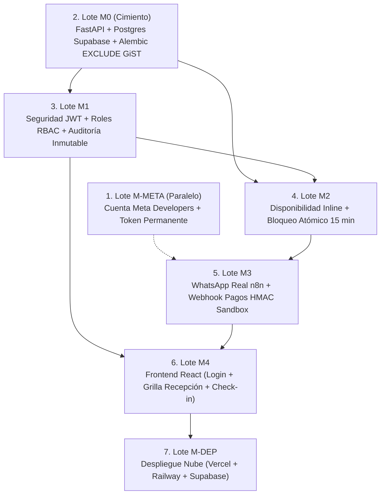

# Guía Maestra de Dominio Técnico, Criterios de Suficiencia y Plan de Ejecución: SatoriPMS

**Autor / Perfil:** Ingeniero Telemático  
**Proyecto:** Torre Satori PMS (Hotel boutique en Sevilla, Valle del Cauca, 9 habitaciones)  
**Meta:** Proveer el marco conceptual completo, analogías de redes/protocolos, **criterios de suficiencia ("semáforo verde")** para no estudiar de más, y el **plan de ejecución exacto** (archivos, comandos e instrucciones para modo AGY) para cada lote del Sprint 5.

---

## 0. Mentalidad del Ingeniero Telemático en el Desarrollo de Software

Como ingeniero telemático, tu formación está centrada en **capas de comunicación, protocolos, puertos, paquetes, flujos de estado y concurrencia física**. Muchos desarrolladores de software ven el backend como "cajas negras" o librerías mágicas; tú lo entenderás como una **arquitectura de red cliente-servidor con persistencia y control de concurrencia**.

### La Regla de Oro del Proyecto
> **No necesitas convertirte en un programador senior full-stack de 5 años de experiencia.**  
> Solo necesitas entender y defender tres fronteras críticas:
> 1. **La Frontera de Protocolos:** Cómo entran los datos (HTTP, JSON, Webhooks, JWT, HMAC).
> 2. **La Frontera de Concurrencia:** Cómo se evita la colisión de fechas en la base de datos sin Redis (`EXCLUDE USING gist`).
> 3. **La Frontera de Estados:** Cómo transiciona una reserva (`BLOQUEADA_TEMPORAL` -> `CONFIRMADA` -> `EN_CURSO`).

---

## 0.1 Investigación Fundamental: El Motor del Backend (FastAPI + ASGI + Pydantic)

### 1. ¿Qué es FastAPI bajo la óptica telemática?
FastAPI no es un monolito pesado como Spring Boot o Django; es un **servidor de aplicaciones asíncrono y modular** construido sobre dos pilares:
1. **Starlette (Capa de Transporte y Red):** Maneja el protocolo HTTP de bajo nivel, websockets, enrutamiento de peticiones y middlewares.
2. **Pydantic (Capa de Presentación / Protocolo de Datos):** Motor de validación de esquemas y tipos de datos compilado en Rust. Se encarga de verificar que los campos, formatos y tamaños de cada paquete JSON entrante cumplan el contrato del API antes de que lleguen a la lógica del hotel.

### 2. El Salto Arquitectónico: WSGI vs. ASGI (Sockets No Bloqueantes)
* **El modelo antiguo (WSGI — Flask / Django tradicional):** Asignaba un hilo del sistema operativo por cada socket TCP. Si 50 usuarios pedían disponibilidad al mismo tiempo, el servidor requería 50 hilos. Si la base de datos tardaba 100 ms en responder, los 50 hilos quedaban congelados esperando I/O (Input/Output).
* **El modelo de FastAPI (ASGI — Asynchronous Server Gateway Interface con Uvicorn):** Utiliza un **Event Loop asíncrono sobre llamadas al kernel (`epoll` en Linux / `kqueue` en macOS)**. Funciona igual que NGINX o Node.js: un solo hilo puede gestionar miles de conexiones TCP simultáneas. Cuando un endpoint ejecuta `await db.execute(...)`, el hilo no se bloquea; delega la espera de red al kernel y atiende inmediatamente otra petición.

### 3. El Ciclo de Vida de una Petición HTTP en FastAPI
Cuando un huésped o recepcionista interactúa con SatoriPMS, la trama viaja a través de las siguientes etapas:

```
[Cliente: WhatsApp o Web]
       │
       ▼ (1. Conexión TCP / TLS)
[Servidor ASGI: Uvicorn en Puerto 8080]
       │
       ▼ (2. Capa Middleware: CORS & Headers)
[Filtro CORS: Permite origen localhost:5173 o dominio Vercel]
       │
       ▼ (3. Enrutamiento: APIRouter)
[Router correspondiente: /api/v1/rooms o /bookings o /auth]
       │
       ▼ (4. Capa de Validación: Pydantic DTO)
[¿El JSON tiene checkIn, checkOut válidos? Si no -> Error 422 Unprocessable Entity]
       │
       ▼ (5. Inyección de Dependencias: Depends)
[get_db(): Abre socket a Postgres en Supabase]
[get_current_user(): Valida firma criptográfica de JWT si la ruta es protegida]
       │
       ▼ (6. Lógica de Dominio del Hotel)
[Consulta disponibilidad, expira bloqueos vencidos o inserta bloqueo temporal]
       │
       ▼ (7. Serialización y Respuesta)
[Convierte modelos SQLAlchemy a JSON y envía HTTP 200 OK]
```

### 4. Qué Estudiar de FastAPI y Dónde (Tiempo estimado: 35 minutos)
No necesitas leer toda la documentación; lee únicamente estas 4 secciones canónicas en orden:
1. **Primeros Pasos y Parámetros (10 min):**
   * Aprende la diferencia entre:
     - **Path Parameter (en la URL):** `GET /api/v1/rooms/{room_id}` (identifica un recurso específico).
     - **Query Parameter (tras el signo `?`):** `GET /api/v1/rooms/availability?check_in=2026-11-15&check_out=2026-11-18&adults=2` (filtros de búsqueda).
     - **Request Body (en el payload JSON):** `POST /api/v1/bookings/lock` con `{ "room_id": 1, ... }` (datos para crear o mutar recursos).
   * *Lectura:* [FastAPI Tutorial - First Steps](https://fastapi.tiangolo.com/tutorial/first-steps/) y [Path & Query Parameters](https://fastapi.tiangolo.com/tutorial/path-params/).
2. **Esquemas de Entrada y Salida con Pydantic (10 min):**
   * Observa cómo una clase como `class LockRequest(BaseModel): room_id: int, check_in: date, check_out: date` valida automáticamente tipos y descarta peticiones malformadas.
   * *Lectura:* [FastAPI - Request Body](https://fastapi.tiangolo.com/tutorial/body/).
3. **Inyección de Dependencias (`Depends`) (10 min):**
   * Es el concepto más potente de FastAPI. Permite inyectar sesiones de base de datos (`db: AsyncSession = Depends(get_db)`) asegurando que la conexión se abra al inicio y se cierre al final automáticamente, evitando fugas de conexiones en el pool.
   * *Lectura:* [FastAPI - Dependencies](https://fastapi.tiangolo.com/tutorial/dependencies/).
4. **Estructura Modular con `APIRouter` (5 min):**
   * Cómo dividir el sistema en submódulos limpios (`routers/rooms.py`, `routers/bookings.py`, `routers/auth.py`) y montarlos en `main.py` con `app.include_router(...)`.
   * *Lectura:* [FastAPI - Bigger Applications](https://fastapi.tiangolo.com/tutorial/bigger-applications/).

### 5. Criterio de Suficiencia de FastAPI ("Semáforo Verde")
Estás listo para entender y dirigir el código de FastAPI si puedes responder esto:
* [x] **Check 1:** ¿Sé qué diferencia hay entre `def mi_endpoint()` y `async def mi_endpoint()`? (Respuesta: `async def` permite usar `await` para llamadas no bloqueantes a PostgreSQL o Meta; si no se usa I/O de red, se puede usar `def` plano y FastAPI lo ejecuta en un threadpool externo).
* [x] **Check 2:** ¿Por qué la documentación interactiva en `/docs` (Swagger) se genera automáticamente sin programar HTML? (Respuesta: porque FastAPI lee directamente las anotaciones de tipo de Python y los modelos Pydantic, generando el estándar OpenAPI 3.1 en formato JSON).
* [x] **Check 3:** ¿Qué error devuelve FastAPI cuando un cliente envía un texto en lugar de un número en un campo entero? (Respuesta: HTTP 422 Unprocessable Entity indicando exactamente qué campo falló en la validación).

---

## MÓDULO 0: Infraestructura, PostgreSQL 16 y Restricción GiST (Lote M0)

### 1. El Puente Mental Telemático
* **PostgreSQL:** No lo veas como un simple archivador de tablas. Es un **servicio daemon escuchando en el puerto TCP 5432**, con un motor relacional transaccional (ACID).
* **Restricción `EXCLUDE USING gist` (RN-02):** Es exactamente igual a la **Multiplexación por División de Tiempo (TDM) o asignación de canales de frecuencia**. En un enlace inalámbrico, dos señales no pueden ocupar la misma frecuencia al mismo tiempo porque colisionan. En SatoriPMS, dos reservas no pueden ocupar la misma habitación (`room_id WITH =`) en el mismo intervalo de tiempo (`daterange WITH &&`).
* **Alembic:** Es el "control de versiones de protocolo" de tu base de datos. Cada archivo en `alembic/versions/` es un parche con dos funciones: `upgrade()` (aplica cambios) y `downgrade()` (revierte cambios).

### 2. Qué Estudiar y Dónde (Tiempo estimado: 35 minutos)
1. **Tipos de Rangos en PostgreSQL (15 min):**
   * Lee qué es un `daterange` y por qué se usa la notación matemática `[)` (inclusiva al inicio, exclusiva al final).
   * *Concepto clave:* Si un huésped sale el 15 de noviembre a las 11:00 am (`[2026-11-10, 2026-11-15)`) y otro entra el 15 de noviembre a las 3:00 pm (`[2026-11-15, 2026-11-20)`), el día 15 está excluido del primer rango e incluido en el segundo. **Por definición matemática, los rangos NO se intersecan.** No hay colisión.
   * *Lectura:* [PostgreSQL Docs - Range Types](https://www.postgresql.org/docs/current/rangetypes.html).
2. **Restricciones de Exclusión GiST (10 min):**
   * Lee cómo funciona `EXCLUDE USING gist`. Entiende por qué requiere la extensión `CREATE EXTENSION IF NOT EXISTS btree_gist;` (permite mezclar operadores escalares `=` con operadores de rango `&&`).
   * *Lectura:* [PostgreSQL Docs - Exclusion Constraints](https://www.postgresql.org/docs/current/ddl-constraints.html#DDL-CONSTRAINTS-EXCLUSION).
3. **Mecánica básica de Alembic (10 min):**
   * Qué hace el comando `alembic revision --autogenerate -m "descripcion"` y qué hace `alembic upgrade head`.

### 3. Criterio de Suficiencia ("Semáforo Verde — ¿Sé lo suficiente para avanzar?")
Estás listo para ejecutar M0 si puedes responder afirmativamente a estos 3 puntos sin dudar:
* [x] **Check 1:** ¿Entiendo por qué la restricción GiST incluye `WHERE (status IN ('BLOQUEADA_TEMPORAL', 'CONFIRMADA', 'EN_CURSO'))`? (Respuesta: porque cuando una reserva pasa a `CANCELADA` o `EXPIRADA`, sale del filtro del índice y el rango queda libre en la base de datos de inmediato).
* [x] **Check 2:** ¿Puedo explicar la diferencia entre verificar disponibilidad con una consulta `SELECT` previa vs. proteger la inserción con `EXCLUDE gist`? (Respuesta: el `SELECT` previo tiene condición de carrera; dos peticiones simultáneas pueden leer "libre" al tiempo. La restricción `EXCLUDE` adquiere un cerrojo a nivel de índice de PostgreSQL y serializa físicamente la inserción).
* [x] **Check 3:** ¿Sé cómo verificar que la extensión `btree_gist` existe en Supabase? (Respuesta: ejecutando la consulta SQL `SELECT * FROM pg_extension WHERE extname = 'btree_gist';`).

### 4. Plan de Ejecución Inmediato (Lote M0)

#### A. Archivos a crear/modificar en el repositorio:
1. `apps/api/pyproject.toml` (o `requirements.txt`): Dependencias (`fastapi`, `uvicorn`, `sqlalchemy[asyncio]`, `asyncpg`, `psycopg2-binary`, `alembic`, `pydantic-settings`, `pytest`).
2. `apps/api/core/config.py`: Variables de entorno cargadas con Pydantic (`DATABASE_URL`, `PORT`, `CORS_ORIGINS`).
3. `apps/api/core/database.py`: Creación del engine asíncrono de SQLAlchemy (`create_async_engine`) y sesión `AsyncSession`.
4. `apps/api/models/`: Modelos `Room` (con catálogo de 9 habitaciones), `Guest`, `Booking` (con constraint GiST) y `AuditLog`.
5. `alembic/` y `alembic.ini`: Configuración para soportar modelos asíncronos y migración inicial `001_initial_schema.py`.
6. `apps/api/main.py`: Instancia FastAPI con endpoint `/api/v1/health`.

#### B. Instrucción precisa para modo AGY:
> *"Implementa el Lote M0: Configura FastAPI con SQLAlchemy 2.0 asíncrono en `apps/api/`. Crea los modelos `Room`, `Guest`, `Booking` y `AuditLog` en `apps/api/models/`. En el modelo `Booking`, define la restricción de exclusión PostgreSQL con `ExcludeConstraint(Column('room_id'), Column('daterange(...)'), using='gist', where=...)`. Configura Alembic y genera la migración inicial que asegure la extensión `btree_gist`. Expón `/api/v1/health` retornando estado 200 y conectividad a base de datos. No agregues lógica de autenticación ni reservas todavía."*

#### C. Comandos de Verificación en Consola:
```bash
# 1. Levantar Postgres local
docker compose up -d postgres

# 2. Aplicar migraciones
cd apps/api && alembic upgrade head

# 3. Probar el endpoint de salud
uvicorn apps.api.main:app --port 8080 &
curl -i http://localhost:8080/api/v1/health  # Debe retornar 200 OK con {"status": "ok", "db": "connected"}

# 4. Probar colisión GiST en pytest
pytest tests/test_concurrency_rn02.py  # Debe validar que la segunda reserva solapada lanza IntegrityError / 409
```

---

## MÓDULO 1: Identidad, Seguridad RBAC y JWT (Lote M1)

### 1. El Puente Mental Telemático
* **JWT (JSON Web Token):** Es como un **paquete firmado con checksum criptográfico que viaja en la cabecera HTTP**. El cliente hace login con usuario y contraseña (handshake inicial). El servidor responde entregándole un token. Ese token contiene 3 partes codificadas en Base64URL: `Header.Payload.Signature`.
* **Stateless (Sin Estado):** El servidor **no guarda sesiones en memoria ni en Redis**. Cuando llega una petición con `Authorization: Bearer <token>`, el servidor simplemente toma el Header + Payload, aplica el hash HMAC-SHA256 con su `JWT_SECRET` local y compara la firma. Si coincide matemáticamente y no ha expirado (`exp`), el usuario es legítimo.
* **RBAC (Role-Based Access Control):** Es una regla de firewall a nivel de aplicación. En el Payload viaja `"role": "Recepcionista"`. Un interceptor/dependencia de FastAPI comprueba: si la ruta exige `Administrador` y el token trae `Recepcionista`, descarta la trama con código HTTP 403 Forbidden.

### 2. Qué Estudiar y Dónde (Tiempo estimado: 30 minutos)
1. **Estructura del JWT (10 min):**
   * Entra a [jwt.io](https://jwt.io/), pega un token de ejemplo y observa los claims (`sub`, `role`, `exp`). Entiende por qué Base64 **no es cifrado, sino codificación visible**, pero la firma impide que alguien cambie su rol de recepcionista a admin.
2. **Inyección de Dependencias de Seguridad en FastAPI (15 min):**
   * Lee cómo `OAuth2PasswordBearer` y `Depends(get_current_user)` extraen la cabecera `Authorization` automáticamente.
   * *Lectura:* [FastAPI - Security Tutorial](https://fastapi.tiangolo.com/tutorial/security/oauth2-jwt/).
3. **Hashing de Contraseñas (5 min):**
   * Comprende por qué nunca se compara `if user.password == password` sino `bcrypt.verify(password, user.password_hash)`.

### 3. Criterio de Suficiencia ("Semáforo Verde — ¿Sé lo suficiente para avanzar?")
* [x] **Check 1:** ¿Puedo explicar qué pasa si un atacante altera el payload del JWT para ponerse `"role": "Administrador"`? (Respuesta: la firma criptográfica se rompe porque el atacante no conoce el `JWT_SECRET` del servidor, y FastAPI rechaza la petición con HTTP 401).
* [x] **Check 2:** ¿Sé cuál es la diferencia entre HTTP 401 Unauthorized (no presentaste credenciales válidas) y HTTP 403 Forbidden (sé quién eres, pero tu rol no tiene permisos para esta ruta)?
* [x] **Check 3:** ¿Entiendo qué se guarda en la tabla `audit_log`? (Respuesta: registro inmutable con `timestamp`, `actor_username`, `action`, `entity` y `details_json` para tener trazabilidad legal de cada acción del personal).

### 4. Plan de Ejecución Inmediato (Lote M1)

#### A. Archivos a crear/modificar:
1. `apps/api/core/security.py`: Funciones `hash_password`, `verify_password`, `create_access_token` y `decode_access_token`.
2. `apps/api/dependencies/auth.py`: Funciones de dependencia `get_current_user` y `require_role(role_name)`.
3. `apps/api/routers/auth.py`: Endpoints `POST /api/v1/auth/login` (recibe credenciales, retorna JWT) y `GET /api/v1/auth/me` (retorna perfil del usuario logueado).
4. `apps/api/services/audit_service.py`: Función `record_audit(db, actor, action, entity, entity_id, details)`.

#### B. Instrucción precisa para modo AGY:
> *"Implementa el Lote M1: Seguridad JWT y RBAC en `apps/api/`. Crea en `apps/api/core/security.py` las funciones criptográficas con `passlib[bcrypt]` y `python-jose`. Define el router de autenticación en `apps/api/routers/auth.py` con `POST /api/v1/auth/login` y `GET /api/v1/auth/me`. Implementa la dependencia `require_role(['Administrador', 'Recepcionista'])` en `apps/api/dependencies/auth.py`. Añade el servicio de auditoría inmutable en `apps/api/services/audit_service.py` que inserte registros en `audit_log`. Cubre con tests en pytest: login correcto entrega token, login fallido da 401, y usuario recepcionista accediendo a función admin recibe 403."*

#### C. Comandos de Verificación en Consola:
```bash
# Probar tests de autenticación
pytest tests/test_auth.py -v
```

---

## MÓDULO 2: Motor de Disponibilidad y Bloqueo Temporal (Lote M2)

### 1. El Puente Mental Telemático
* **Disponibilidad:** Imagina una grilla de conmutación de canales. Tienes 9 canales físicos (las 9 habitaciones). Un canal está ocupado si existe una trama en curso cuyo intervalo de tiempo solapa con el intervalo solicitado.
* **El Desacoplamiento del Job:** Muchos sistemas fallan porque dependen de un proceso periódico en background para liberar recursos vencidos. Si el job falla, la habitación queda bloqueada artificialmente. En SatoriPMS aplicamos el **principio de expiración en tiempo real (inline filtering)**:
  La consulta de disponibilidad filtra directamente con:
  ```sql
  WHERE status IN ('CONFIRMADA', 'EN_CURSO')
     OR (status = 'BLOQUEADA_TEMPORAL' AND expires_at > NOW())
  ```
  Si un candado tiene `expires_at = 14:15` y son las `14:16`, la consulta SQL **lo ignora inmediatamente**, considerándolo libre aunque ningún job haya cambiado el texto en la base de datos.
* **Transacción de Bloqueo Atómico:** Cuando un huésped solicita bloquear una habitación:
  1. Abre transacción SQL (`BEGIN`).
  2. Actualiza bloqueos vencidos de esa habitación a `EXPIRADA` (`UPDATE booking SET status='EXPIRADA' WHERE room_id = :id AND status='BLOQUEADA_TEMPORAL' AND expires_at <= NOW()`).
  3. Inserta el nuevo bloqueo con `expires_at = NOW() + INTERVAL '15 minutes'`.
  4. Cierra transacción (`COMMIT`).
  Si otro usuario intenta insertar en el mismo instante, la restricción `EXCLUDE USING gist` de Postgres hace que el motor aborte la segunda transacción y devuelva error de concurrencia.

### 2. Qué Estudiar y Dónde (Tiempo estimado: 30 minutos)
1. **Operadores de Solapamiento de Rangos en PostgreSQL (15 min):**
   * Aprende el operador `&&` (intersección de rangos) en PostgreSQL: `daterange('2026-11-15', '2026-11-18') && daterange('2026-11-17', '2026-11-20')` retorna `TRUE`.
2. **Cálculo de Tarifas y Recargos (RN-01) (15 min):**
   * Capacidad base vs. capacidad máxima. Si la habitación tiene capacidad base de 2 adultos y viajan 3, el precio total es: `(noches * precio_base) + (noches * extra_guest_price * personas_adicionales)`.

### 3. Criterio de Suficiencia ("Semáforo Verde — ¿Sé lo suficiente para avanzar?")
* [x] **Check 1:** ¿Puedo explicar por qué un bloqueo vencido no impide que otra persona reserve, incluso si el servidor estuvo apagado durante 2 horas? (Respuesta: porque la consulta SQL descarta los bloqueos cuyo `expires_at < NOW()` dinámicamente en tiempo de ejecución).
* [x] **Check 2:** ¿Sé qué código HTTP debe responder la API cuando dos solicitudes intentan bloquear la misma habitación al mismo milisegundo? (Respuesta: una responde HTTP 200 con el token de bloqueo; la otra responde HTTP 409 Conflict informando que la habitación no está disponible).
* [x] **Check 3:** ¿Entiendo por qué el consentimiento de Ley 1581 (RN-12) se valida en este paso? (Respuesta: porque antes de guardar los datos personales del huésped titular en la tabla `guest`, se verifica que el flag booleano de aceptación esté en `true`).

### 4. Plan de Ejecución Inmediato (Lote M2)

#### A. Archivos a crear/modificar:
1. `apps/api/schemas/room.py`: DTOs de habitaciones y capacidades.
2. `apps/api/schemas/booking.py`: DTOs de solicitud de bloqueo (`LockRequest`), respuesta (`LockResponse`), disponibilidad y desbloqueo.
3. `apps/api/services/room_service.py`: Lógica de consulta de disponibilidad con filtros de fechas, adultos, niños y mascotas.
4. `apps/api/services/booking_service.py`: Lógica de creación de bloqueo atómico de 15 minutos con expiración previa en la misma transacción y cálculo tarifario (RN-01).
5. `apps/api/routers/rooms.py`: Endpoint `GET /api/v1/rooms/availability`.
6. `apps/api/routers/bookings.py`: Endpoints `POST /api/v1/bookings/lock` y `POST /api/v1/bookings/unlock`.

#### B. Instrucción precisa para modo AGY:
> *"Implementa el Lote M2: Motor de habitaciones, disponibilidad y bloqueo temporal atómico en `apps/api/`. Crea los endpoints `GET /api/v1/rooms/availability` y `POST /api/v1/bookings/lock` en sus respectivos routers. La consulta de disponibilidad debe filtrar en PostgreSQL ignorando reservas con `expires_at <= NOW()`. La creación de bloqueo debe: validar capacidad y recargo (RN-01), validar consentimiento Ley 1581 (RN-12), expirar atómicamente candados vencidos de esa habitación e insertar la fila `BLOQUEADA_TEMPORAL` con `expires_at = NOW() + 15 min`. Si la restricción GiST lanza violación de exclusión, captura el error y retorna HTTP 409 Conflict. Cubre con tests de concurrencia en pytest."*

#### C. Comandos de Verificación en Consola:
```bash
# Probar disponibilidad y bloqueo
pytest tests/test_rooms_availability.py tests/test_booking_lock.py -v
```

---

## MÓDULO 3: Meta Cloud API, Flujo n8n V10 (Compañero en `main`), Sesiones en PostgreSQL y Pagos Wompi/HMAC (Lotes M-META y M3)

### 1. El Puente Mental Telemático: ¿Cómo funciona el flujo n8n `V10` de tu compañero?
* **Arquitectura de Webhook (Push HTTP):** Meta y Wompi no mantienen un socket abierto permanente. Cuando el huésped escribe en WhatsApp o paga en Wompi, sus servidores hacen un `POST` HTTP hacia n8n.
* **Anatomía del flujo `V10_ChatbotReservas.json` (91 nodos subidos por tu compañero a `origin/main`):**
  1. **3 Puertas de Entrada (Webhooks en n8n):**
     - `GET /webhook/whatsapp-webhook`: Responde automáticamente el reto `hub.challenge` cuando registras el webhook en Meta for Developers.
     - `POST /webhook/whatsapp-webhook`: Recibe cada mensaje entrante del huésped desde WhatsApp Cloud API.
     - `POST /webhook/wompi-events`: Recibe la notificación de pago desde **Wompi**, calcula en un nodo JavaScript el hash SHA-256 con `WOMPI_EVENTS_SECRET` y verifica que el pago esté `APPROVED`.
  2. **Rutas Conversacionales del Huésped:**
     - **Opción 1 (Reserva Guiada):** Pide fechas (`checkIn`, `checkOut`) ──► llama a `GET /api/rooms/availability` ──► bloquea habitación 15 min (`POST /api/bookings/lock`) ──► pide adultos/niños, aviso **Ley 1581**, nombre y documento ──► muestra desglose tarifa base + recargo (**RN-01**) ──► confirma (`POST /api/bookings/confirm` generando código `TS-XXXX`) y crea link de pago en **Wompi** (100% o abono 50%).
     - **Opción 2 (Asistente IA con Gemini):** El huésped envía todo en un solo mensaje libre; n8n invoca a Gemini Flash para extraer el JSON estructurado, pide confirmación y bloquea una o varias habitaciones.
     - **Opciones 3, 4 y 5:** Consulta de reserva (`GET /api/bookings/group/{code}`), pago del 50% restante (`POST .../pay-remaining`), cancelación con reembolso **RN-03** (`POST .../cancellation`) y escalamiento a humano (`POST /api/notifications/agent-request`).
* **Estrategia de Integración desde `origin/main` hacia `migracion-fastapi` (Checkout Selectivo, NO `git merge` global):**
  - En `origin/main` aún vive el backend Java legado en `apps/api/src/`. Si hiciéramos un `git merge origin/main` completo, mezclaríamos archivos Java con nuestro FastAPI.
  - Por eso aplicamos **integración selectiva (`git checkout origin/main -- <rutas>`)**: traemos únicamente los flujos `flows/n8n/V9_ChatbotReservas.json`, `flows/n8n/V10_ChatbotReservas.json`, `tests/chatbot/` y `docs/Guia_Configuracion_Entorno.md`, reemplazamos los **7 nodos Redis** del flujo por llamadas HTTP a nuestra tabla `conversation` en PostgreSQL 16 (cumpliendo cero Redis de `AGENTS.md`), y exponemos en FastAPI tanto las rutas `/api/v1/...` como los alias `/api/...` en `camelCase` que el flujo n8n espera.

### 2. Qué Estudiar y Dónde (Tiempo estimado: 35 minutos)
1. **Validación Criptográfica de Webhooks (HMAC SHA-256) e Idempotencia (15 min):**
   * Ni el chatbot ni la web confirman pagos por "pantalla de éxito": solo un webhook firmado criptográficamente (`X-Hub-Signature-256` con `hmac.compare_digest` o checksum SHA-256 de Wompi) confirma el pago.
   * **Idempotencia:** Si la pasarela reintenta el mismo `payment_id` / `transaction_id`, FastAPI detecta que ya fue procesado y devuelve `200 OK` sin duplicar cobros ni reservas.
2. **Persistencia de Sesión Conversacional en PostgreSQL (`conversation`) (10 min):**
   * Tabla `conversation` con `wa_id` único y columna `session_data` (`JSONB` / `Text`), expuesta vía `GET/PUT/DELETE /api/v1/conversations/session/{wa_id}`.
3. **Configuración de Meta for Developers (10 min):**
   * Si tu cuenta nueva de Facebook muestra el bloqueo temporal de 1 hora al crear el portfolio comercial, puedes esperar la hora o invitar en *Roles de la app* a la cuenta con antigüedad de tu compañero para que pulse *Continuar* en WhatsApp y obtenga `WHATSAPP_TOKEN` y `WHATSAPP_PHONE_ID`.

### 3. Criterio de Suficiencia ("Semáforo Verde — ¿Sé lo suficiente para avanzar?")
* [x] **Check 1:** ¿Por qué traemos los archivos de `flows/n8n/` y `apps/web/` con `git checkout origin/main -- ...` en vez de `git merge origin/main`? (Respuesta: para importar el 100% del trabajo de n8n y React de mi compañero sin arrastrar los archivos Java eliminados ni sobrescribir nuestro backend FastAPI).
* [x] **Check 2:** ¿Qué pasa si llega un webhook a `POST /api/v1/payments/webhook` con firma inválida vs. con un `payment_id` repetido? (Respuesta: firma inválida devuelve `401 Unauthorized`; `payment_id` repetido devuelve `200 OK` por idempotencia sin reprocesar).
* [x] **Check 3:** ¿Cómo conversa el flujo n8n `V10` con nuestro FastAPI sin cambiar la lógica que programó mi compañero? (Respuesta: FastAPI expone los endpoints compatibles `/api/rooms/availability`, `/api/bookings/lock`, `/api/bookings/unlock`, `/api/bookings/confirm`, `/api/bookings/group/{code}` y `/api/notifications/agent-request` traduciendo `camelCase` y delegando al candado GiST de PostgreSQL 16).

### 4. Plan de Ejecución Inmediato (Lote M3 Unificado: Sesiones + Pagos HMAC + Compatibilidad n8n V10)

#### A. Archivos a crear/modificar:
1. Importar selectivamente desde `origin/main`: `flows/n8n/V9_ChatbotReservas.json`, `flows/n8n/V10_ChatbotReservas.json`, `tests/chatbot/` y `docs/Guia_Configuracion_Entorno.md`, adaptando la sesión en `V10` a PostgreSQL (sin Redis).
2. `apps/api/models/conversation.py` y migración Alembic `003_conversations_and_payments.py`: Tabla `conversation` (`wa_id`, `sender_name`, `state`, `step`, `agent_active`, `session_json`, `updated_at`).
3. `apps/api/routers/conversations.py`: Endpoints `GET/PUT/DELETE /api/v1/conversations/session/{wa_id}`, `GET /api/conversations` y `POST /api/notifications/agent-request`.
4. `apps/api/routers/payments.py` y `apps/api/services/payment_service.py`: Endpoint `POST /api/v1/payments/webhook` con validación `X-Hub-Signature-256` (`hmac.compare_digest` con `PAYMENT_WEBHOOK_SECRET`), idempotencia por `payment_id`, transición de `BLOQUEADA_TEMPORAL` a `CONFIRMADA`, generación de código `TS-XXXX` y registro en `audit_log`.
5. `apps/api/routers/n8n_compat.py`: Endpoints compatibles con el flujo n8n `V10` (`/api/rooms/availability`, `/api/bookings/lock`, `/api/bookings/unlock`, `/api/bookings/confirm`, `/api/bookings/group/{code}`, `/cancellation` con **RN-03** y `/pay-remaining`).
6. `tests/test_payment_webhook.py` y `tests/test_n8n_integration.py`: Suite de pruebas automatizadas del Lote M3.

#### B. Instrucción precisa para modo AGY (Lote M3):
> *"Implementa el Lote M3 integrando el trabajo de n8n de `origin/main`: 1) Importa selectivamente `flows/n8n/V9_ChatbotReservas.json`, `flows/n8n/V10_ChatbotReservas.json`, `tests/chatbot/` y `docs/Guia_Configuracion_Entorno.md` desde `origin/main`, y adapta `V10_ChatbotReservas.json` para persistir sesiones en FastAPI/PostgreSQL en lugar de Redis. 2) Crea el modelo `Conversation` y la migración Alembic `003_conversations_and_payments.py`. 3) Implementa `POST /api/v1/payments/webhook` en `apps/api/routers/payments.py` validando la firma `X-Hub-Signature-256` con `hmac.compare_digest` (`PAYMENT_WEBHOOK_SECRET`), idempotencia por `payment_id`, transición a `CONFIRMADA` con código `TS-XXXX` y registro en `audit_log`. 4) Expón los endpoints compatibles con el flujo n8n V10 (`/api/rooms/availability`, `/api/bookings/lock`, `/api/bookings/unlock`, `/api/bookings/confirm`, `/api/bookings/group/{code}`, `/cancellation` RN-03, `/pay-remaining`, `/api/notifications/agent-request` y `/api/v1/conversations/session/{wa_id}`). 5) Cubre todo con tests en pytest (`tests/test_payment_webhook.py` y `tests/test_n8n_integration.py`)."*

#### C. Comandos de Verificación en Consola:
```bash
# Aplicar migración 003 y correr pruebas de webhook HMAC, sesiones y contratos n8n V10
cd apps/api && ../../.venv/bin/alembic upgrade head && cd ../..
.venv/bin/pytest tests/test_payment_webhook.py tests/test_n8n_integration.py -v
```

---

## MÓDULO 4: Integración del Frontend Web Completo de `origin/main` y Despliegue (Lotes M4 y M-DEP)

### 1. El Puente Mental Telemático
* **Integración de las Pantallas React de `origin/main`:** En `origin/main`, tu compañero construyó 12 pantallas completas en `apps/web/src/screens/`:
  - `Login.tsx` (Autenticación de personal)
  - `Dashboard.tsx` (Dashboard financiero y KPIs de ocupación/ingresos)
  - `Reservas.tsx` y `CalendarView.tsx` (Calendario interactivo de las 9 habitaciones y gestión de reservas)
  - `Operacion.tsx` (Check-in / Check-out en mostrador y cobro de consumos)
  - `Rooms.tsx` (CRUD dinámico de las 9 habitaciones)
  - `Restaurante.tsx` y `Tienda.tsx` (Salgados Café y cargos al folio de la habitación)
  - `Eventos.tsx` (Tarifas dinámicas y ferias turísticas)
  - `Resenas.tsx` (Reseñas de huéspedes y Google Reviews)
  - `Chatbot.tsx` (Bandeja de conversaciones WhatsApp y escalamiento a agente humano)
  - `Admin.tsx` (Usuarios, roles RBAC y bitácora de auditoría `audit_log`)
* **Cómo se integra en `migracion-fastapi`:** Traemos `apps/web/` desde `origin/main` mediante `git checkout origin/main -- apps/web` y exponemos en FastAPI los endpoints REST que alimentan esas pantallas (`rooms`, `bookings`, `conversations`, `restaurant/menu` y `orders`, `events`, `reviews`, `auth`), verificando que `npm run build` compile con 0 errores de TypeScript.

### 2. Qué Estudiar y Dónde (Tiempo estimado: 25 minutos)
1. **Variables de Entorno y CORS en Vite (`VITE_API_URL`) (10 min):**
   * El navegador en `http://localhost:5173` consume FastAPI en `http://localhost:8080`.
2. **Arranque en Frío (Cold Start) y Plan B de Demo (15 min):**
   * Ejecutar `curl /api/v1/health` 5 minutos antes de la sustentación y tener `/docs` (Swagger UI) listo como Plan B.

### 3. Criterio de Suficiencia ("Semáforo Verde — ¿Sé lo suficiente para avanzar?")
* [x] **Check 1:** ¿Sé qué comando ejecutar en `apps/web` para comprobar que las 12 pantallas de React compilan sin errores? (Respuesta: `cd apps/web && npm run build`).
* [x] **Check 2:** ¿Cómo se registra el Check-in o cambio de estado manual desde la web? (Respuesta: la petición viaja con el JWT del recepcionista/administrador, actualiza la reserva a `EN_CURSO` o `CONFIRMADA` en PostgreSQL 16 y deja un registro inmutable en `audit_log`).

### 4. Plan de Ejecución Inmediato (Lote M4)

#### A. Archivos a crear/modificar:
1. Importar selectivamente `apps/web/` desde `origin/main` (`git checkout origin/main -- apps/web`).
2. `apps/api/routers/web_operations.py` (y modelos de apoyo para CRUD de habitaciones, Salgados Café, eventos y reseñas): Endpoints consumidos por `apps/web/src/store.tsx` y las 12 pantallas de `apps/web/src/screens/`.
3. `tests/test_web_operations.py`: Pruebas de endpoints web (check-in con auditoría, CRUD habitaciones, Salgados Café, eventos y debug de reservas).

#### B. Instrucción precisa para modo AGY (Lote M4):
> *"Implementa el Lote M4 integrando el frontend completo de `origin/main`: 1) Trae `apps/web/` desde `origin/main` (`git checkout origin/main -- apps/web`). 2) Inspecciona todas las llamadas HTTP que realiza `apps/web/src/` y expón en FastAPI los endpoints requeridos para Login, Dashboard, Calendario, Check-in/Check-out con registro en `audit_log`, CRUD de Habitaciones, Salgados Café, Eventos Especiales, Reseñas y Bandeja de Chatbot. 3) Cubre los endpoints de operación web con tests en `tests/test_web_operations.py` y verifica que `cd apps/web && npm run build` compile limpiamente con 0 errores."*

#### C. Comandos de Verificación en Consola:
```bash
# 1. Probar endpoints de operación web en pytest
.venv/bin/pytest tests/test_web_operations.py -v

# 2. Verificar compilación de producción del frontend React + TypeScript
cd apps/web && npm run build
```

---

## 5. Resumen Consolidado del Plan de Ejecución y Dependencias



---

## 6. Las 3 Preguntas de Defensa del Jurado para tu Perfil Telemático

En tu sustentación, ten preparadas estas tres respuestas contundentes:

### Pregunta 1: *"¿Por qué eliminaron Redis para los bloqueos temporales si como telemático sabes que la RAM es más rápida que el disco?"*
> **Tu respuesta:** *"En un hotel de 9 habitaciones (~40 reservas al mes) el cuello de botella jamás es la latencia de memoria, sino la **consistencia transaccional estricta (ACID)**. Con Redis teníamos dos fuentes de verdad: el bloqueo en Redis y la reserva en PostgreSQL. Si ocurría un fallo de red o caída entre ambos servicios, se generaba inconsistencia (split-brain). PostgreSQL 16 con la extensión `btree_gist` resuelve el candado atómicamente a nivel de kernel de base de datos mediante la restricción `EXCLUDE USING gist`, eliminando un servicio completo, reduciendo la superficie de ataque y garantizando consistencia absoluta en menos de 5 milisegundos."*

### Pregunta 2: *"¿Cómo resuelven la sobreventa concurrente si dos usuarios en WhatsApp presionan 'Pagar' al mismo milisegundo?"*
> **Tu respuesta:** *"No confiamos en validaciones a nivel de aplicación con locks en Python, porque en un entorno distribuido o con múltiples workers habría condiciones de carrera. Lo delegamos al kernel de PostgreSQL 16 mediante un índice GiST sobre `room_id` y `daterange(check_in, check_out, '[)')`. PostgreSQL adquiere un cerrojo a nivel de índice de rango durante la transacción; la primera petición se inserta con éxito y la segunda genera inmediatamente un error `ExclusionViolation` en la base de datos, que nuestra API captura limpiamente y traduce en un código HTTP `409 Conflict` avisando al usuario que la habitación acaba de ser tomada."*

### Pregunta 3: *"¿Por qué desacoplan Meta de FastAPI poniendo n8n en el medio en lugar de recibir los webhooks directamente en FastAPI?"*
> **Tu respuesta:** *"Por el patrón arquitectural de Adaptador de Borde (Edge Adapter) y separación de responsabilidades. Meta Cloud API actualiza con frecuencia la estructura de sus payloads de WhatsApp y requiere mecánicas de plantillas y reintentos. n8n actúa como adaptador de transporte: recibe la trama HTTP de Meta, valida el handshake de verificación (`hub.challenge`), normaliza el mensaje a un JSON plano de negocio y lo entrega a FastAPI mediante una llamada HTTP autenticada con clave de servicio (`X-Service-Key`). De esta forma, si el proveedor de mensajería cambia mañana (por ejemplo, a Telegram o Twilio), nuestro backend transaccional de FastAPI no sufre ninguna modificación."*

---

## 7. Plan Maestro de Cierre para Entrega a Producción (`v1.0.0`)

Plan paso a paso acordado tras la auditoría de las Fases 0 y 1 para entregar **Torre Satori PMS** al hotel cliente (9 habitaciones numeradas `1–9`, pasarela **Wompi** tras puerto sandbox, **WhatsApp Cloud API directo** vía n8n/PostgreSQL, 12 pantallas web persistentes y CI completo) antes de realizar el merge final a `main` como **`v1.0.0`**.

> **Regla de ejecución en Fase 3:** después de cada paso (`P0`..`P10`) se ejecutan `.venv/bin/pytest -v` y `cd apps/web && npm run build`, se entrega el checklist manual (máx. 5 puntos) y se **pausa hasta recibir `"OK"`** para hacer 1 commit en español y push exclusivo a `migracion-fastapi`. Cada lote deja nota en `docs/aprendizaje/<ID>.md`.

### Índice de Pasos

| ID | Paso | Modo | Estado |
| :--- | :--- | :--- | :--- |
| `P0` | Aislamiento DB de pruebas (`satoripms_test`) y variables `.env` Wompi/Google | `AGY` | [x] |
| `P1` | Migración Alembic `004`: cuartos `1–9`, tarifas reales y tablas operativas | `AGY` | [x] |
| `P2` | RBAC estricto con JWT y clave interna `X-Service-Key` en todos los routers | `AGY` | [x] |
| `P3` | Habitaciones `1–9` editables sin colisión `Room.id` vs `Room.number` | `AGY` | [x] |
| `P4` | Scheduler 60 s (`APScheduler`), puerto Wompi sandbox y SSE tiempo real (`HU-03`) | `AGY` | [x] |
| `P5` | Google Places API real + CRUD DB Tienda, Café, Eventos, Egresos, Usuarios y Excel | `AGY` | [x] |
| `P6` | Integración completa de las 12 pantallas React (sin `INITIAL_*` ni auth mock) | `AGY` | [ ] |
| `P7` | Reconciliación flujo n8n `V10` (Wompi `ec8eace` sin Redis) y prueba Meta live | `AGY` | [ ] |
| `P8` | Suite E2E Frontend con Playwright, ampliación `pytest` y CI Postgres 16 | `AGY` | [ ] |
| `P9` | Docker prod (Nginx HTTPS, R2 `pg_dump`, Sentry) y limpieza del repositorio | `AGY` | [ ] |
| `P10` | Respaldo `origin/main`, merge `--no-ff` de `migracion-fastapi` a `main` y tag `v1.0.0` | `AGY` | [ ] |

---

### `P0` — Aislamiento DB de pruebas (`satoripms_test`) y variables `.env` Wompi/Google (`AGY`)
- **Objetivo:** evitar que `pytest` borre reservas reales de `satoripms` y declarar en `.env.example` / `config.py` las variables definitivas (`WOMPI_*`, `GOOGLE_PLACES_API_KEY`, `GOOGLE_PLACE_ID`, `GOOGLE_REVIEWS_URL`, `N8N_INTERNAL_API_KEY`), retirando `MERCADOPAGO_*`.
- **Archivos afectados:** `tests/conftest.py`, `apps/api/core/config.py`, `.env.example`, `.env`, `docs/aprendizaje/P0.md`.
- **Criterio de aceptación:** `pytest` corre completo contra `satoripms_test` sin tocar filas de `satoripms`, y `Settings` carga todas las nuevas llaves sin valores hardcodeados inseguros en prod.
- **Comandos:**
  ```bash
  sudo docker exec satori_postgres psql -U satori -d postgres -c "CREATE DATABASE satoripms_test;"
  .venv/bin/pytest -v
  cd apps/web && npm run build
  ```
- **Checklist manual:**
  1. Confirmar que tras correr `pytest`, `satoripms` conserva intactas sus reservas previas.
  2. Verificar que `.env` tiene las claves `WOMPI_*` y `GOOGLE_*` listas (sin valores en git).
- **Casilla:** `[x]` Completado y verificado.
- **Pausa:** Esperar `"OK"` del dueño antes de commit/push a `migracion-fastapi`.

---

### `P1` — Migración Alembic `004`: cuartos `1–9`, tarifas reales y tablas operativas (`AGY`)
- **Objetivo:** migrar las 9 habitaciones de `101..303` a `'1'..'9'` con los nombres y tarifas vigentes de `store.tsx`, crear las tablas relacionales de Tienda (`product`, `folio_charge`), Salgados Café (`cafe_menu`, `cafe_order`), Eventos (`special_event`) y Egresos (`expense`), y retirar el obsoleto `db/seed/dev_seed.sql`.
- **Archivos afectados:** `apps/api/alembic/versions/004_rooms_1_to_9_and_operations.py`, `apps/api/models/` (nuevos modelos), `db/seed/dev_seed.sql`, `docs/aprendizaje/P1.md`.
- **Criterio de aceptación:** `alembic upgrade head` ejecuta sin errores en `satoripms` y `satoripms_test`; `room` queda con `'1'..'9'`, tarifas `$170.000–$380.000` y 0 tablas faltantes.
- **Comandos:**
  ```bash
  cd apps/api && ../../.venv/bin/alembic upgrade head
  ../../.venv/bin/pytest -v
  cd ../web && npm run build
  ```
- **Checklist manual:**
  1. Consultar `SELECT id, number, name, price_per_night FROM room ORDER BY id;` y validar `1..9`.
  2. Confirmar que `alembic downgrade -1` revierte limpio en `satoripms_test`.
- **Casilla:** `[x]` Completado y verificado.
- **Pausa:** Esperar `"OK"` del dueño antes de commit/push a `migracion-fastapi`.

---

### `P2` — RBAC estricto con JWT y clave interna `X-Service-Key` en todos los routers (`AGY`)
- **Objetivo:** proteger con `Depends(require_role(...))` todos los endpoints administrativos y operativos de `web_operations.py` y `rooms.py`, exigir `X-Service-Key` en rutas internas consumidas por n8n (`/api/bookings/confirm`, `/lock`, `/unlock`, `/conversations/*`) y eliminar `/api/bookings/test-paid` y endpoints demo abiertos.
- **Archivos afectados:** `apps/api/dependencies/auth.py`, `apps/api/routers/web_operations.py`, `apps/api/routers/rooms.py`, `apps/api/routers/bookings.py`, `apps/api/routers/n8n_compat.py`, `apps/api/routers/conversations.py`, `tests/test_auth.py`, `docs/aprendizaje/P2.md`.
- **Criterio de aceptación:** peticiones web sin JWT devuelven `401`; Recepcionista recibe `403` en rutas de Administrador (CRUD cuartos, eventos, egresos, usuarios, auditoría); n8n sin `X-Service-Key` recibe `401`.
- **Comandos:**
  ```bash
  .venv/bin/pytest tests/test_auth.py tests/test_web_operations.py -v
  cd apps/web && npm run build
  ```
- **Checklist manual:**
  1. Probar en `/docs` (Swagger) que `GET /api/v1/auth/audit` y `POST /api/v1/rooms` rechazan sin Bearer token.
  2. Iniciar sesión con rol `Recepcionista` y confirmar `403` al intentar editar tarifas o crear egresos.
- **Casilla:** `[x]` Completado y verificado.
- **Pausa:** Esperar `"OK"` del dueño antes de commit/push a `migracion-fastapi`.

---

### `P3` — Habitaciones `1–9` editables sin colisión `Room.id` vs `Room.number` (`AGY`)
- **Objetivo:** eliminar la búsqueda ambigua `or_(Room.number == ref, Room.id == int(ref))`, resolver siempre por `Room.id`, habilitar `POST /api/v1/rooms` y edición de `number` en `PUT /api/v1/rooms/{room_id}` (con `409 Conflict` si el número ya existe), ordenar numéricamente `1..9` y desbloquear el campo número en `Rooms.tsx`.
- **Archivos afectados:** `apps/api/routers/web_operations.py`, `apps/api/services/room_service.py`, `apps/api/schemas/room.py`, `apps/web/src/screens/Rooms.tsx`, `apps/web/src/store.tsx`, `tests/test_rooms_availability.py`, `tests/test_web_operations.py`, `docs/aprendizaje/P3.md`.
- **Criterio de aceptación:** un Administrador puede cambiar el número de la habitación `id=1` sin alterar `id=2` ni romper sus reservas vinculadas por `room_id`, y recibe `409` al intentar duplicar un número existente.
- **Comandos:**
  ```bash
  .venv/bin/pytest tests/test_rooms_availability.py tests/test_web_operations.py -v
  cd apps/web && npm run build
  ```
- **Checklist manual:**
  1. En **Habitaciones** (Admin), editar el número de un cuarto disponible, guardar y recargar la página (`F5`) validando persistencia.
  2. Intentar asignar un número ya ocupado por otra habitación y confirmar mensaje de error `409`.
- **Casilla:** `[x]` Completado y verificado.
- **Pausa:** Esperar `"OK"` del dueño antes de commit/push a `migracion-fastapi`.

---

### `P4` — Scheduler 60 s (`APScheduler`), puerto Wompi sandbox y SSE tiempo real (`HU-03`) (`AGY`)
- **Objetivo:** incorporar `APScheduler` en `main.py` ejecutando cada 60 s la expiración de `BLOQUEADA_TEMPORAL` vencidas + notificación a n8n; consolidar adaptador **Wompi** tras puerto de pasarela con validación HMAC/checksum e idempotencia; exponer flujo SSE (`/api/v1/events/stream`) para actualización en tiempo real de calendario y reservas.
- **Archivos afectados:** `apps/api/requirements.txt`, `apps/api/main.py`, `apps/api/services/payment_service.py`, `apps/api/routers/payments.py`, `apps/api/routers/events_stream.py` (nuevo), `tests/test_payment_webhook.py`, `tests/test_booking_lock.py`, `docs/aprendizaje/P4.md`.
- **Criterio de aceptación:** tras vencer `expires_at`, el job marca `EXPIRADA` en <= 60 s y emite evento SSE; el webhook de Wompi rechaza firmas inválidas con `401` e ignora duplicados con `200`.
- **Comandos:**
  ```bash
  .venv/bin/pytest -v
  cd apps/web && npm run build
  ```
- **Checklist manual:**
  1. Abrir dos pestañas en **Calendario / Reservas**, confirmar una reserva en una pestaña y observar actualización automática en la otra sin recargar.
  2. Enviar webhook de prueba sin firma válida al endpoint de pagos y verificar rechazo `401`.
- **Casilla:** `[x]` Completado y verificado.
- **Pausa:** Esperar `"OK"` del dueño antes de commit/push a `migracion-fastapi`.

---

### `P5` — Google Places API real + CRUD DB Tienda, Café, Eventos, Egresos, Usuarios y Excel (`AGY`)
- **Objetivo:** retirar listas RAM en `web_operations.py`; implementar cliente `httpx` para Google Places API con caché TTL y `?refresh=true` (retornando `placesApiConfigured: false` real si falta `GOOGLE_PLACES_API_KEY`); implementar CRUD completo en PostgreSQL para Tienda (`product`), Cargos al folio (`folio_charge`), Salgados Café (`cafe_menu`/`cafe_order`), Eventos (`special_event` + cálculo descuento `HU-12`), Egresos (`expense`), Usuarios (`system_users`) y exportación `.xlsx` real con `openpyxl`.
- **Archivos afectados:** `apps/api/requirements.txt`, `apps/api/services/reviews_service.py` (nuevo), `apps/api/routers/web_operations.py`, `apps/api/routers/finance_reports.py` (nuevo), `apps/api/routers/auth.py`, `tests/test_web_operations.py`, `docs/aprendizaje/P5.md`.
- **Criterio de aceptación:** reiniciar `satori_api` no borra comandas, ventas, eventos, egresos ni usuarios; `GET /api/v1/reports/export.xlsx` descarga un `.xlsx` válido; `/api/v1/reviews/summary` nunca inventa reseñas mock.
- **Comandos:**
  ```bash
  .venv/bin/pytest -v
  cd apps/web && npm run build
  ```
- **Checklist manual:**
  1. Crear un egreso, una comanda y un producto en API, reiniciar `satori_api` y confirmar que permanecen.
  2. Abrir **Reseñas Google** con y sin `GOOGLE_PLACES_API_KEY` y verificar estado real + descarga de `.xlsx` en **Reportes**.
- **Casilla:** `[x]` Completado y verificado.
- **Pausa:** Esperar `"OK"` del dueño antes de commit/push a `migracion-fastapi`.

---

### `P6` — Integración completa de las 12 pantallas React (sin `INITIAL_*` ni auth mock) (`GUIADO`)
- **Objetivo:** eliminar `INITIAL_*`, credenciales prellenadas y `localStorage` auth fake de `Login.tsx` y `store.tsx`; conectar `api/client.ts` con token JWT (Bearer) e interceptores 401; migrar todas las referencias `'101'..'303'` en UI a `'1'..'9'`; conectar las 12 pantallas (`Login`, `Dashboard`, `Rooms`, `CalendarView`, `Reservas`, `Operacion`, `Tienda`, `Restaurante`, `Eventos`, `Resenas`, `Chatbot`→`/api/v1/conversations` con escalamiento real, `Admin`→`/audit`, usuarios, egresos, KPIs y `.xlsx` real) + cambio de contraseña real en `AccountSettingsModal`.
- **Archivos afectados:** `apps/web/src/api/client.ts`, `apps/web/src/store.tsx`, `apps/web/src/App.tsx`, `apps/web/src/screens/*.tsx`, `apps/web/src/pages/Conversations.tsx`, `apps/web/src/pages/ReservasDebug.tsx`, `docs/aprendizaje/P6.md`.
- **Criterio de aceptación:** 0 datos ficticios al iniciar con DB vacía (salvo las 9 habitaciones semilla); `F5` conserva exactamente lo guardado en PostgreSQL; Recepcionista nunca ve ni puede ejecutar acciones de Administrador.
- **Comandos:**
  ```bash
  .venv/bin/pytest -v
  cd apps/web && npm run build
  ```
- **Checklist manual:**
  1. Iniciar sesión en `http://localhost:5173` como `admin` y como `recepcion` con JWT real.
  2. Recargar (`F5`) tras crear una reserva manual, cargar una bebida de Tienda a la hab. `1`, hacer check-in y exportar `.xlsx`.
  3. Verificar en **WhatsApp & Bot** las sesiones reales de PostgreSQL y el botón de escalamiento humano.
- **Casilla:** `[ ]` Completado y verificado.
- **Pausa:** Esperar `"OK"` del dueño antes de commit/push a `migracion-fastapi`.

---

### `P7` — Reconciliación flujo n8n `V10` (Wompi `ec8eace` sin Redis) y prueba Meta live (`AGY`)
- **Objetivo:** incorporar en `flows/n8n/V10_ChatbotReservas.json` las mejoras Wompi (`pending_payment`, confirmación externa y rollback ante fallo de `ec8eace` en `origin/main`) adaptadas 100% a FastAPI/PostgreSQL (0 nodos Redis) con cabecera `X-Service-Key` y habitaciones `1–9`; actualizar `tests/chatbot/` y validar flujo vivo con Meta Cloud API + Cloudflare Tunnel.
- **Archivos afectados:** `flows/n8n/V10_ChatbotReservas.json`, `flows/n8n/V9_ChatbotReservas.json`, `apps/api/routers/n8n_compat.py`, `tests/test_n8n_integration.py`, `tests/chatbot/*.js`, `docs/aprendizaje/P7.md`.
- **Criterio de aceptación:** `verify_n8n_flow_integrity.py` reporta 0 errores, `test_n8n_v10_workflow_has_zero_redis_nodes` pasa, y un mensaje real de WhatsApp o prueba de panel Meta completa consulta de disponibilidad `1–9` + bloqueo temporal visible en el calendario web.
- **Comandos:**
  ```bash
  python3 tests/chatbot/verify_n8n_flow_integrity.py
  .venv/bin/pytest tests/test_n8n_integration.py -v
  cd apps/web && npm run build
  ```
- **Checklist manual:**
  1. Reimportar `V10_ChatbotReservas.json` en n8n (`:5678`) y pulsar **Publish**.
  2. Probar flujo en Meta (`Probar` en `messages` o app publicada) y verificar nueva sesión + reserva en el panel web.
- **Casilla:** `[ ]` Completado y verificado.
- **Pausa:** Esperar `"OK"` del dueño antes de commit/push a `migracion-fastapi`.

---

### `P8` — Suite E2E Frontend con Playwright, ampliación `pytest` y CI Postgres 16 (`GUIADO`)
- **Objetivo:** instalar `@playwright/test` en `apps/web`, escribir pruebas E2E contra API + PostgreSQL real (`satoripms_test`) cubriendo Login JWT, RBAC multi-rol, colisión `409`, edición número `1–9`, cargo a folio y descarga `.xlsx`; ampliar `pytest` con todos los endpoints nuevos; actualizar `.github/workflows/ci.yml` con servicio `postgres:16` efímero, `alembic upgrade head`, `pytest`, `npm run build` y Playwright.
- **Archivos afectados:** `apps/web/package.json`, `apps/web/playwright.config.ts`, `apps/web/tests/e2e/*.spec.ts`, `tests/test_*.py`, `.github/workflows/ci.yml`, `docs/aprendizaje/P8.md`.
- **Criterio de aceptación:** 100% de `pytest` y Playwright E2E pasan localmente con 0 saltos ni mocks ficticios en flujos críticos, y el workflow de CI contempla `migracion-fastapi` y `main`.
- **Comandos:**
  ```bash
  .venv/bin/pytest -v
  cd apps/web && npm run build && npx playwright test
  ```
- **Checklist manual:**
  1. Ejecutar `npx playwright test` y revisar reporte sin errores de consola ni 500 de API.
  2. Verificar que ningún test dejó basura en `satoripms`.
- **Casilla:** `[ ]` Completado y verificado.
- **Pausa:** Esperar `"OK"` del dueño antes de commit/push a `migracion-fastapi`.

---

### `P9` — Docker prod (Nginx HTTPS, R2 `pg_dump`, Sentry) y limpieza del repositorio (`AGY`)
- **Objetivo:** añadir configuración Docker de producción (`apps/web/Dockerfile` + Nginx reverse proxy HTTPS unificando `/` y `/api`), `env_file`, `healthcheck` y usuario no-root en `apps/api/Dockerfile`, `depends_on: api` en `n8n`, integración Sentry (`sentry-sdk`) y script/cron `pg_dump` cifrado diario 3:00 a. m. hacia Cloudflare R2; limpiar raíz moviendo/retirando entregables sueltos de Actividad 5 y actualizando `docs/Guia_Configuracion_Entorno.md`.
- **Archivos afectados:** `docker-compose.yml`, `docker-compose.prod.yml` (o perfil `prod`), `apps/api/Dockerfile`, `apps/web/Dockerfile`, `infra/nginx/default.conf`, `scripts/backup_pg_r2.sh`, `docs/Guia_Configuracion_Entorno.md`, archivos raíz de Actividad 5, `docs/aprendizaje/P9.md`.
- **Criterio de aceptación:** `docker compose up -d --build` levanta `postgres`, `api`, `web` y `n8n` saludables; script de backup valida exportación cifrada y `Guia_Configuracion_Entorno.md` ya no referencia Java/Redis/Flyway.
- **Comandos:**
  ```bash
  sudo docker compose config --quiet
  .venv/bin/pytest -v
  cd apps/web && npm run build
  ```
- **Checklist manual:**
  1. Abrir la app servida vía contenedor `web` / proxy y confirmar que `/api/v1/health` y las 12 pantallas responden en el mismo origen.
  2. Verificar raíz del repo limpia antes del release.
- **Casilla:** `[ ]` Completado y verificado.
- **Pausa:** Esperar `"OK"` del dueño antes de commit/push a `migracion-fastapi`.

---

### `P10` — Respaldo `origin/main`, merge `--no-ff` de `migracion-fastapi` a `main` y tag `v1.0.0` (`MÍO`)
- **Objetivo:** cerrar el proyecto con `migracion-fastapi` 100% verificada en CI, sincronizar `main` con `origin/main` creando tag anotado de respaldo adicional (`backup-main-v9-pre-v1`, manteniendo `legacy-java-backup` en `d0b17ad`), hacer `git merge --no-ff migracion-fastapi` en `main`, etiquetar **`v1.0.0`** y publicar release final.
- **Archivos afectados:** Ramas `migracion-fastapi` y `main`, tags `backup-main-v9-pre-v1` y `v1.0.0`, `docs/aprendizaje/P10.md`.
- **Criterio de aceptación:** CI verde en `main`, `legacy-java-backup` y `backup-main-v9-pre-v1` preservados en `origin`, y tag `v1.0.0` apuntando al commit de merge en `main`.
- **Comandos:**
  ```bash
  git checkout main && git pull origin main
  git tag -a backup-main-v9-pre-v1 -m "Respaldo de main (V9) previo a release FastAPI v1.0.0"
  git merge --no-ff migracion-fastapi -m "release(v1.0.0): consolidar migracion FastAPI + PostgreSQL 16 + React para produccion"
  git tag -a v1.0.0 -m "Torre Satori PMS v1.0.0 - Entrega a produccion"
  git push origin main backup-main-v9-pre-v1 v1.0.0
  ```
- **Checklist manual:**
  1. Verificar en GitHub que `CI — Lint, Tests & Build` pasa en verde sobre `main` y `v1.0.0`.
  2. Probar despliegue limpio en servidor destino con tag `v1.0.0`.
- **Casilla:** `[ ]` Completado y verificado.
- **Pausa:** Confirmación explícita del dueño antes de ejecutar cualquier push a `main`.
