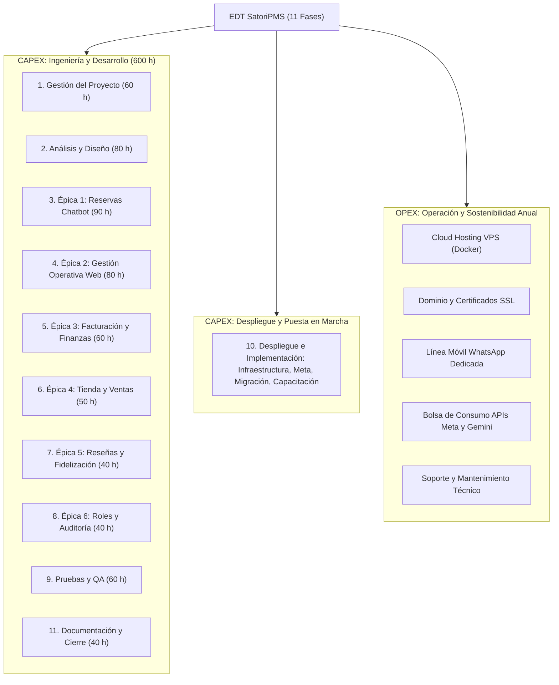
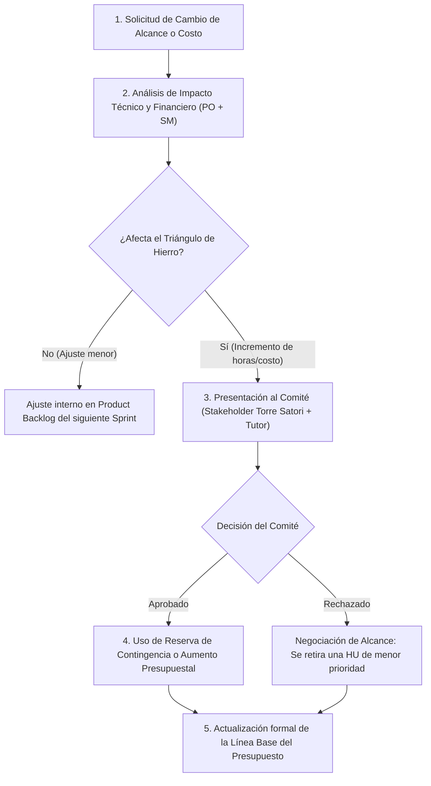

# Presupuesto Integral y Modelo de Sostenibilidad Financiera — SatoriPMS
**Sistema de Gestión de Propiedades Hoteleras con Chatbot WhatsApp para el Hotel Torre Satori (Sevilla, Valle del Cauca)**  
**Proyecto Integrador II — Universidad Icesi (Semestre 2026-2)**  

---

### Información del Proyecto
- **Equipo de Trabajo (Scrum Team):**
  - **Juan José Arias Gallego:** Product Owner / Analista Funcional y de Negocio
  - **Esteban Guarín Valencia:** Scrum Master / Ingeniero de Backend, Base de Datos y DevOps
  - **Juan Felipe Garzón Trejos:** Development Team / Ingeniero Frontend y Flujos n8n
- **Stakeholder Principal:** Propietario del Hotel Boutique Torre Satori
- **Duración del Desarrollo:** 10 semanas (5 Sprints de 2 semanas: 14 de septiembre – 20 de noviembre de 2026)
- **Moneda de Referencia:** Pesos Colombianos (COP) y Dólares Estadounidenses (USD)  
  *(Tasa Representativa del Mercado de referencia: 1 USD = $4.150 COP)*

---

## 1. Resumen Ejecutivo

El presente documento expone el **Presupuesto Integral** del proyecto **SatoriPMS**, estructurado bajo las directrices gerenciales de gestión presupuestal del Proyecto Integrador II y articulado directamente con la **Estructura de Desglose de Trabajo (EDT)** de 11 fases y el **Caso de Negocio** de Torre Satori.

El propósito fundamental de este presupuesto no es simplemente sumar gastos, sino proporcionar una herramienta estratégica que demuestre:
1. **Viabilidad técnica y económica:** Cuánto cuesta diseñar, desarrollar y desplegar la solución hasta que sea 100 % operativa en el hotel.
2. **Sostenibilidad a largo plazo:** Cuánto cuesta mantener el sistema funcionando de forma autónoma, segura y continua en la nube mes a mes.
3. **Retorno de inversión (ROI) tangible:** Cómo una inversión en software propio genera un ahorro radical frente a PMS comerciales (Cloudbeds, Opera) y previene pérdidas operativas por dobles reservas y atención manual desatendida.

### Síntesis de Cifras Clave

| Componente Presupuestal | Valor en COP | Valor en USD (aprox.) | % del Costo Total |
|---|---|---|---|
| **Costo de Desarrollo e Implementación (CAPEX - Personal e Ingeniería)** | $21.000.000 | $5.060,24 | 74,4 % |
| **Costo de Puesta en Operación (CAPEX - Configuración, Migración y Capacitación)** | $1.325.000 | $319,28 | 4,7 % |
| **Reserva para Contingencias e Incertidumbre (Justificada)** | $2.232.500 | $537,95 | 7,9 % |
| **Costo de Operación Anual (OPEX - 12 meses de Nube, Dominio, SIM y APIs)** | $1.523.000 | $366,99 | 5,4 % |
| **Soporte y Mantenimiento Evolutivo/Correctivo Anual (12 meses)** | $2.160.000 | $520,48 | 7,6 % |
| **COSTO TOTAL INTEGRAL (TCO - Año 1)** | **$28.240.500** | **$6.804,94** | **100,0 %** |

> [!NOTE]  
> **Costo Operativo Mensual Recurrente (OPEX Puro de Infraestructura):** **$126.917 COP/mes (~$30,58 USD/mes)**. Este valor extremadamente bajo garantiza que un hotel familiar pequeño de 6 a 12 habitaciones pueda mantener el sistema en producción sin poner en riesgo su flujo de caja.

---

## 2. Supuestos Presupuestales

Para que la estimación económica sea transparente y auditable, se declaran los siguientes supuestos técnicos y operativos:

### 2.1. Supuestos de Negocio y Dimensión Operativa
1. **Capacidad del Hotel:** Torre Satori cuenta inicialmente con 6 habitaciones activas (Estándar, Deluxe con vista, Suite familiar), con proyección de ampliación a 10 habitaciones en 2027.
2. **Volumen de Reservas:** Se estima un promedio de 35 reservas mensuales en temporada regular y hasta 60 reservas mensuales en temporada alta (promedio anual: 40 reservas/mes).
3. **Flujo de Mensajería WhatsApp:** Se proyectan 300 a 450 conversaciones mensuales de clientes preguntando por disponibilidad, tarifas, servicios y reservas asistidas.
4. **Hardware en el Hotel:** El hotel ya dispone en recepción de un computador de escritorio funcional y conexión a internet por fibra óptica. No se requiere comprar hardware físico local adicional.

### 2.2. Supuestos del Equipo de Desarrollo (Scrum)
1. **Composición:** Equipo de 3 ingenieros de sistemas en formación (8vo semestre), asumiendo roles de PO/Analista, Scrum Master/Backend-DevOps y Frontend-Chatbot.
2. **Dedicación:** 10 semanas cronológicas (5 Sprints de 2 semanas). Cada miembro aporta 20 horas semanales de dedicación técnica efectiva, para un total de:
   $$\text{Horas totales del equipo} = 3 \text{ personas} \times 20 \text{ h/semana} \times 10 \text{ semanas} = 600 \text{ horas hombre}$$
3. **Tarifa Profesional de Referencia:** Se fija una tarifa de **$35.000 COP / hora**, correspondiente a un perfil de Ingeniero de Software Junior / Consultor de Desarrollo Tecnológico en el mercado laboral colombiano (equivalente a una asignación mensual de ~$3.000.000 COP por profesional a tiempo completo con factor prestacional).

### 2.3. Supuestos de Infraestructura Tecnológica
1. **Arquitectura Dockerizada:** El sistema opera en contenedores aislados (PostgreSQL 16, Redis 7, n8n y Spring Boot 3.3).
2. **Alojamiento Cloud:** Se seleccionó un VPS (Servidor Privado Virtual) de 4 GB de RAM, 2 vCPUs y 80 GB SSD (DigitalOcean Droplet o Hetzner Cloud), suficiente para soportar la concurrencia del hotel.
3. **Frontend Web:** Alojado en el tier gratuito de **Vercel** o **Cloudflare Pages** con CDN global y certificados SSL automáticos sin costo.
4. **WhatsApp Business Cloud API (Meta):** Meta otorga de manera gratuita **1.000 conversaciones de servicio al mes** (iniciadas por el usuario). Al proyectarse ~400 conversaciones mensuales para Torre Satori, el costo directo facturado por Meta es de **$0 USD en condiciones normales**. Se presupuesta una bolsa de seguridad para mensajes salientes de marketing/confirmación.
5. **Inteligencia Artificial (Gemini API):** Uso de **Google Gemini 2.0 Flash** para la interpretación de reservas en lenguaje natural (HU-09). Gracias a su tarifa de $0,10 USD por millón de tokens, 100 consultas mensuales de IA representan un costo inferior a $0,20 USD/mes.
6. **Pasarela de Pagos (MercadoPago / Wompi):** No cobra costo fijo mensual. La comisión por transacción (2,99 % + $900 COP + IVA) es deducida directamente de las reservas pagadas por los huéspedes y es un costo operacional propio de la venta, no del software.

---

## 3. EDT de Costos (Relación con la EDT del Proyecto)

El presupuesto está estrechamente acoplado con la **Estructura de Desglose de Trabajo (EDT)** del proyecto SatoriPMS. Cada peso presupuestado responde a un entregable concreto:



### Asignación de Horas y Costo por Fase de la EDT

| Código EDT | Fase del Proyecto | Horas Hombre | Tarifa / Hora | Costo Total (COP) | Entregables Clave |
|---|---|---|---|---|---|
| **1.0** | **Gestión del Proyecto** | 60 h | $35.000 | $2.100.000 | Caso de negocio, Project Charter, EDT, plan de riesgos, control de Sprints. |
| **2.0** | **Análisis y Diseño** | 80 h | $35.000 | $2.800.000 | Arquitectura hexagonal, modelo ER Postgres con exclusión GiST, mockups Figma, flujos conversacionales. |
| **3.0** | **Desarrollo — Épica 1 (Chatbot WhatsApp)** | 90 h | $35.000 | $3.150.000 | Flujos n8n (V1–V8), consulta de disponibilidad, bloqueo 15 min en Redis, recomendación con Gemini IA, cancelaciones. |
| **4.0** | **Desarrollo — Épica 2 (Gestión Operativa Web)** | 80 h | $35.000 | $2.800.000 | Calendario en tiempo real con WebSocket STOMP, check-in, check-out con consumos, gestión de reservas manuales. |
| **5.0** | **Desarrollo — Épica 3 (Facturación y Finanzas)** | 60 h | $35.000 | $2.100.000 | Consolidación de ingresos, registro de egresos (HU-13), cálculo de sueldo de recepción (HU-07), exportación a Excel. |
| **6.0** | **Desarrollo — Épica 4 (Tienda y Ventas)** | 50 h | $35.000 | $1.750.000 | Catálogo de productos, control de stock, asociación a habitación (CU-05, CU-07), rotación de productos. |
| **7.0** | **Desarrollo — Épica 5 (Reseñas y Fidelización)** | 40 h | $35.000 | $1.400.000 | Captura de reseñas post check-out por bot, panel web de reseñas, clasificación de huésped recurrente (HU-12). |
| **8.0** | **Desarrollo — Épica 6 (Administración de Roles)** | 40 h | $35.000 | $1.400.000 | Autenticación JWT, control de acceso por rol (Admin/Recepcionista), logs de auditoría (HU-15), Ley 1581. |
| **9.0** | **Pruebas y Aseguramiento de Calidad (QA)** | 60 h | $35.000 | $2.100.000 | Pruebas de no solapamiento concurrente, pruebas de estrés de bot, validación cruzada n8n-Backend-PostgreSQL. |
| **10.0** | **Despliegue e Implementación** | 38 h | $35.000 | $1.325.000 | Setup servidor cloud, verificación Meta, migración de datos, capacitación a personal de Torre Satori. *(Detalle en 4.4)* |
| **11.0** | **Documentación y Cierre** | 40 h | $35.000 | $1.400.000 | Manual técnico, manual de usuario recepcionista/admin, actas de cierre, sustentación formal. |
| **TOTAL** | **Ciclo Completo de Ingeniería** | **638 h** | — | **$22.325.000** | **Solución funcional puesta en producción** |

---

## 4. Presupuesto Detallado (Estructura: Recurso $\to$ Cantidad $\to$ Tarifa $\to$ Costo $\to$ Justificación)

Siguiendo el estándar de la presentación del curso, el desglose se organiza en las 5 categorías esenciales:

### 4.1. Categoría A: Recursos Humanos (Equipo Scrum)

| Recurso / Perfil | Cantidad | Unidad | Tarifa Unitaria (COP) | Costo Total (COP) | Fuente / Justificación |
|---|---|---|---|---|---|
| **Product Owner & Analista Funcional** | 200 | Horas | $35.000 | $7.000.000 | Levantamiento de requerimientos con Torre Satori, priorización del backlog, validación de reglas de negocio (RN-01 a RN-06). |
| **Scrum Master & DevOps/Backend Engineer** | 200 | Horas | $35.000 | $7.000.000 | Arquitectura Spring Boot 3.3, Dockerización, seguridad JWT, base de datos PostgreSQL/Redis y gestión de riesgos del equipo. |
| **Fullstack Web & Conversational Engineer** | 200 | Horas | $35.000 | $7.000.000 | Desarrollo de la SPA React con TanStack Query, WebSockets y diseño/programación de los 8 flujos conversacionales en n8n. |
| **Subtotal Recursos Humanos** | **600** | **Horas** | — | **$21.000.000** | **Mano de obra directa de desarrollo del software** |

---

### 4.2. Categoría B: Tecnología e Infraestructura

| Recurso / Componente | Cantidad | Unidad | Tarifa Unitaria | Costo Mensual | Costo Anual (COP) | Fuente / Justificación |
|---|---|---|---|---|---|---|
| **Servidor Cloud VPS (DigitalOcean / Hetzner)** | 12 | Meses | $12 USD / mes | $49.800 COP | $597.600 | VPS 4 GB RAM, 2 vCPU, 80 GB SSD para ejecutar Docker Compose (API + Postgres + Redis + n8n). Tarifa estándar DigitalOcean Droplet Basic. |
| **Hosting Frontend SPA (Vercel / Cloudflare Pages)** | 12 | Meses | $0 USD / mes | $0 COP | $0 | Tier gratuito ilimitado para proyectos web estándar con CDN y SSL edge. |
| **Almacenamiento Cloud R2 / S3 (Recibos y Fotos)** | 12 | Meses | $0 USD / mes | $0 COP | $0 | Cloudflare R2: primeros 10 GB de almacenamiento mensual y lecturas ilimitadas a costo $0. |
| **Dominio Web Propio (`satoripms.com` o `torresatori.com`)** | 1 | Año | $14 USD / año | — | $58.100 | Registro anual en Namecheap/Cloudflare Registrar para el portal web administrativo y Webhooks oficiales. |
| **Certificados de Seguridad SSL/TLS** | 1 | Anual | $0 USD | — | $0 | Certificados Let's Encrypt administrados automáticamente con renovación cada 90 días. |
| **Subtotal Tecnología e Infraestructura** | — | — | — | **$49.800/mes** | **$655.700** | **Costos de alojamiento e infraestructura básica** |

---

### 4.3. Categoría C: Software, Licenciamiento y APIs

| Recurso / Licencia | Cantidad | Unidad | Tarifa Unitaria | Costo Mensual | Costo Anual (COP) | Fuente / Justificación |
|---|---|---|---|---|---|---|
| **Licencia de n8n (Autoalojado)** | 12 | Meses | $0 COP | $0 COP | $0 | Licencia Fair-Code de n8n para uso interno de la organización. Cero costos de suscripción mensual. |
| **PostgreSQL 16 & Redis 7** | 12 | Meses | $0 COP | $0 COP | $0 | Motores de base de datos y caché de código abierto (Open Source). |
| **Meta WhatsApp Business Cloud API** | 12 | Meses | Bolsa $6 USD/mes | $24.900 COP | $298.800 | Las primeras 1.000 conversaciones de servicio al mes son gratuitas. Se presupuesta bolsa de $6 USD para mensajes salientes de marketing o picos. |
| **Google Gemini 2.0 Flash API (Tokens)** | 12 | Meses | Bolsa $2 USD/mes | $8.300 COP | $99.600 | Modelo de lenguaje para interpretación en lenguaje natural (HU-09). $0,10 USD/1M tokens; 100 consultas/mes consumen ~$0,10 USD. |
| **Línea Móvil Exclusiva SIM para el Bot** | 12 | Meses | $22.000 COP / mes | $22.000 COP | $264.000 | Plan prepago/control para mantener la titularidad del número oficial de WhatsApp del hotel. |
| **Pasarela de Pagos (MercadoPago Sandbox/Live)** | — | Setup | $0 COP | $0 COP | $0 | Sin costo fijo mensual. La pasarela descuenta comisión variable por venta efectiva (2,99% + $900 COP). |
| **Herramientas de Desarrollo y CI/CD** | 12 | Meses | $0 COP | $0 COP | $0 | GitHub Free (repositorio privado, GitHub Actions, proyectos Kanban). |
| **Subtotal Software y APIs** | — | — | — | **$55.200/mes** | **$662.400** | **Servicios de comunicación e inteligencia artificial** |

---

### 4.4. Categoría D: Puesta en Operación e Implementación (Fase 10 EDT)

| Actividad / Recurso | Cantidad | Unidad | Tarifa Unitaria (COP) | Costo Total (COP) | Fuente / Justificación |
|---|---|---|---|---|---|
| **Aprovisionamiento y hardening de servidor de producción** | 10 | Horas | $35.000 | $350.000 | Configuración de Docker, reglas de firewall UFW, proxy inverso Nginx/Traefik y copias de seguridad automáticas a S3. |
| **Verificación de Empresa en Meta Business Manager** | 8 | Horas | $35.000 | $280.000 | Gestión de documentación legal de Torre Satori (RUT, Cámara de Comercio), registro del número telefónico y aprobación del webhook. |
| **Carga de Datos Iniciales y Parametrización** | 10 | Horas | $35.000 | $350.000 | Creación de habitaciones, inventario inicial de tienda, configuración de tarifas base y recargos por persona extra (RN-01). |
| **Capacitación al Administrador y Recepcionistas** | 10 | Horas | $35.000 | $350.000 | 2 talleres teórico-prácticos (uno para recepción sobre calendario y check-in/out, uno para administración sobre finanzas). |
| **Logística de Despliegue Presencial en Sevilla, Valle** | 1 | Global | $200.000 | $200.000 | Viáticos de transporte Cali – Sevilla – Cali y alimentación para la sesión presencial de puesta en marcha. |
| **Subtotal Puesta en Operación** | — | — | — | **$1.530.000** | **Gastos únicos para encender la solución en el hotel** |

---

### 4.5. Categoría E: Operación y Mantenimiento Sostenible (Post-Entrega)

¿Qué pasa después de que el equipo Scrum entrega el proyecto? Un software necesita sostenimiento. Esta categoría garantiza que el sistema no muera tras la entrega académica:

| Concepto de Mantenimiento | Frecuencia | Esfuerzo Estimado | Costo Mensual (COP) | Costo Anual (COP) | Propósito y Alcance |
|---|---|---|---|---|---|
| **Monitoreo de Infraestructura y Logs** | Mensual | 2 horas/mes | $70.000 | $840.000 | Verificación del espacio en disco del VPS, rotación de logs de Docker, comprobación de copias de seguridad y estado de Redis. |
| **Soporte Correctivo y Actualizaciones Menores** | Mensual | 3 horas/mes | $105.000 | $1.260.000 | Corrección de fallos inesperados, actualización de dependencias de seguridad (Spring Boot, paquetes npm) y parches de n8n. |
| **Renovación de Credenciales y Tokens Meta** | Semestral | 1 hora/semestre | $5.000 | $60.000 | Mantenimiento preventivo de tokens de acceso permanente en Meta Developers y rotación de secretos JWT. |
| **Subtotal Mantenimiento Post-Entrega** | — | **5 h / mes** | **$180.000/mes** | **$2.160.000** | **Póliza de mantenimiento técnico mínimo garantizado** |

---

## 5. Clasificación Financiera: CAPEX vs. OPEX

Para cumplir con el Paso 4 de la guía del docente, es fundamental separar la inversión de capital inicial (CAPEX) de los costos operativos recurrentes (OPEX). Esto permite a la gerencia de Torre Satori entender la diferencia entre **construir el activo** y **mantenerlo vivo en el tiempo**.

```
┌────────────────────────────────────────────────────────┐
│                   PRESUPUESTO TOTAL                    │
├───────────────────────────┬────────────────────────────┤
│           CAPEX           │            OPEX            │
│    (Inversión Inicial)    │    (Operación Recurrente)  │
│        $24.555.000        │     $3.683.000 / año       │
│         (86,95 %)         │         (13,05 %)          │
├───────────────────────────┼────────────────────────────┤
│ • Desarrollo de software  │ • Servidor VPS en la nube  │
│ • Arquitectura y diseño   │ • Consumo APIs (Meta / IA) │
│ • Pruebas y QA            │ • Línea móvil SIM del bot  │
│ • Configuración inicial   │ • Dominio web anual        │
│ • Capacitación y puesta   │ • Soporte técnico mensual  │
│   en marcha               │                            │
│ • Reserva de contingencia │                            │
└───────────────────────────┴────────────────────────────┘
```

### Tabla Comparativa CAPEX vs. OPEX

| Tipo de Gasto | Concepto | Período de Ejecución | Monto (COP) | Monto (USD) | Naturaleza Financiera |
|---|---|---|---|---|---|
| **CAPEX** | Ingeniería y Desarrollo de Software (600 h) | Semanas 1 a 10 (Sprints 1–5) | $21.000.000 | $5.060,24 | Activo intangible de software propio para el hotel. |
| **CAPEX** | Despliegue, Migración y Capacitación Inicial | Semana 10 (Puesta en marcha) | $1.325.000 | $319,28 | Costo de puesta en punto y transferencia de conocimiento. |
| **CAPEX** | Reserva para Contingencias del Proyecto | Durante el ciclo de desarrollo | $2.232.500 | $537,95 | Cojín financiero para absorber desviaciones de alcance o técnicas. |
| **TOTAL CAPEX** | **Inversión Inicial Total** | **Fase de Proyecto** | **$24.557.500** | **$5.917,47** | **Inversión requerida para llegar a producción** |
|---|---|---|---|---|---|
| **OPEX** | Alojamiento VPS en la Nube (DigitalOcean/Hetzner) | Mensual recurrente | $49.800 / mes | $12,00 / mes | Costo fijo indispensable para que el sistema esté encendido 24/7. |
| **OPEX** | Consumo de APIs Externas (WhatsApp y Gemini) | Mensual variable | $33.200 / mes | $8,00 / mes | Costo asociado al volumen de clientes atendidos. |
| **OPEX** | Línea Telefónica Móvil para el Chatbot | Mensual recurrente | $22.000 / mes | $5,30 / mes | Mantenimiento del número ante el operador celular. |
| **OPEX** | Dominio Web (`satoripms.com`) | Anual | $4.842 / mes | $1,17 / mes | Pago de renovación del nombre en internet ($58.100/año). |
| **OPEX** | Soporte y Mantenimiento Técnico de Software | Mensual (5 horas de soporte) | $180.000 / mes | $43,37 / mes | Póliza de soporte preventivo y correctivo para el hotel. |
| **TOTAL OPEX** | **Gasto Operativo Mensual** | **Mes regular de operación** | **$289.842 / mes** | **$69,84 / mes** | **Costo de operación con soporte técnico incluido** |
| **TOTAL OPEX (Infraestructura Pura)** | **Solo Nube, Dominio, SIM y APIs** | **Sin soporte técnico externo** | **$109.842 / mes** | **$26,47 / mes** | **Costo operativo mínimo si el hotel asume el soporte** |

---

## 6. Costo de Implementación (Llegar a la Solución Funcional)

El costo de implementación representa el esfuerzo consolidado para llevar la idea desde el diseño conceptual hasta un software funcional desplegado y validado por Torre Satori:

$$\text{Costo de Implementación} = \text{Recursos Humanos (Fases 1–9 y 11)} + \text{Puesta en Operación (Fase 10)}$$
$$\text{Costo de Implementación} = \$21.000.000 + \$1.325.000 = \mathbf{\$22.325.000 \text{ COP}}$$

### Desglose por Entregables de la Implementación
1. **Núcleo de Base de Datos y Motor Transaccional:** $2.800.000 COP  
   - Modelo relacional en PostgreSQL 16 con extensión `btree_gist` y restricción `sin_solape EXCLUDE USING gist`.
   - Redis para almacenamiento de sesiones efímeras de n8n y bloqueo de 15 minutos (RN-02).
2. **Chatbot Conversacional de WhatsApp (Épica 1):** $3.150.000 COP  
   - 8 flujos implementados en n8n: bienvenida, reserva paso a paso, recomendación con Gemini Flash (HU-09), cancelación con cálculo de reembolso (RN-03), cobro con link de pago y escalamiento a humano (HU-06).
3. **Aplicación Web para Recepción y Administración (Épica 2, 4 y 6):** $5.950.000 COP  
   - Calendario en tiempo real con WebSockets (HU-03).
   - Módulos de Check-in (CU-03) y Check-out con consumos de tienda (CU-04).
   - Control de inventario y ventas de tienda (CU-05, CU-07).
   - Sistema de autenticación JWT y auditoría (HU-05, HU-15).
4. **Módulo Financiero y Reportes (Épica 3 y 5):** $3.500.000 COP  
   - Cálculo automático de ingresos y egresos (HU-13).
   - Generación de informe mensual exportable a Excel (HU-01).
   - Módulo de reseñas post-estadía y fidelización de huéspedes recurrentes (HU-04, HU-12).
5. **Control de Calidad, Despliegue y Pruebas (Fases 9 y 10):** $3.425.000 COP  
   - 60 horas de pruebas exhaustivas y 38 horas de parametrización en servidor cloud y capacitación presencial en Sevilla.
6. **Gestión y Cierre Formal del Proyecto (Fases 1 y 11):** $3.500.000 COP  
   - Documentación técnica, manuales de usuario y actas de aceptación.

---

## 7. Costo de Operación y Sostenibilidad

Uno de los principales errores en proyectos de software hotelero es omitir qué ocurre después del despliegue. A continuación se analiza la sostenibilidad financiera para los primeros **3 años de vida útil**:

### Proyección de OPEX a 3 Años (Horizonte Temporal)

*Se proyecta una inflación técnica moderada del 5 % anual en tarifas de hosting y APIs.*

| Rubro Operativo | Año 1 (COP) | Año 2 (+5 %) (COP) | Año 3 (+5 %) (COP) | Justificación de la Proyección |
|---|---|---|---|---|
| **Servidor Cloud VPS** | $597.600 | $627.480 | $658.854 | Servidor estable para carga del hotel. |
| **Dominio Web** | $58.100 | $61.005 | $64.055 | Renovación anual de nombre de dominio. |
| **WhatsApp Business API (Meta)** | $298.800 | $313.740 | $329.427 | Se proyecta crecimiento moderado en volumen de consultas. |
| **Google Gemini API** | $99.600 | $104.580 | $109.809 | Aumento en uso de recomendación inteligente. |
| **Línea Celular del Bot** | $264.000 | $277.200 | $291.060 | Tarifa mensual de mantenimiento de SIM card. |
| **Subtotal OPEX Tecnológico Puro** | **$1.318.100** | **$1.384.005** | **$1.453.205** | **Costo directo para mantener el sistema operando** |
| **Soporte y Mantenimiento Técnico** | $2.160.000 | $2.268.000 | $2.381.400 | Acompañamiento técnico especializado (5 h/mes). |
| **TOTAL OPEX INTEGRAL ANUAL** | **$3.478.100** | **$3.652.005** | **$3.834.605** | **Costo total de operación anual para el hotel** |

> [!TIP]  
> **Impacto en el costo por reserva:**  
> Considerando un promedio conservador de 40 reservas al mes (480 reservas al año), el costo de la infraestructura tecnológica pura por cada reserva concretada es de apenas:
> $$\text{Costo por reserva} = \frac{\$1.318.100 \text{ COP}}{480 \text{ reservas}} = \mathbf{\$2.746 \text{ COP / reserva (\approx \$0,66 USD)}}$$
> Este valor es insignificante comparado con la comisión de Booking.com o Airbnb (15 % a 20 % del valor total de la estadía, equivalente a ~$25.000 - $40.000 COP por noche).

---

## 8. Gestión de Contingencias e Incertidumbre (Justificada)

En cumplimiento riguroso del **Paso 6** exigido por la cátedra, **no se asignó un porcentaje arbitrario ni un "10 % ciego" de imprevistos**. 

La reserva para contingencias se calculó mediante una **Matriz de Riesgos Financieros**, valorando la probabilidad de ocurrencia y el impacto económico potencial de las incertidumbres reales del proyecto:

| Riesgo / Factor de Incertidumbre | Probabilidad | Impacto Estimado | Costo Potencial Asociado (COP) | Reserva Asignada (COP) | Razón Técnica y Justificación |
|---|---|---|---|---|---|
| **R-01: Fluctuación Cambiaria (Dólar / TRM)** | Media (40 %) | Medio | $300.000 | **$120.000** | Los servicios de VPS, dominio y consumo de Gemini se facturan en USD. Si la TRM supera los $4.500 COP, el costo anual sube. Se respalda un colchón de cobertura cambiaria. |
| **R-02: Demoras en la Verificación de Meta Business** | Alta (60 %) | Medio | $700.000 (20 h extra) | **$420.000** | Meta puede solicitar subsanaciones legales de la personería jurídica o RUT de Torre Satori, requiriendo reuniones y soporte adicional de ingeniería para destrabar el Webhook oficial. |
| **R-03: Subestimación de Tokens de IA (Consultas Complejas)** | Media (30 %) | Bajo | $250.000 | **$75.000** | Huéspedes que realizan conversaciones muy largas o reiterativas con la IA para pedir recomendaciones de turismo en Sevilla, incrementando el consumo de tokens en Gemini. |
| **R-04: Retrasos por Ambigüedad en Reglas de Negocio (Módulo 14)** | Alta (70 %) | Alto | $1.400.000 (40 h extra) | **$980.000** | Si el cliente cambia la definición de la capacidad de niños vs. adultos (RN-01) o la política de cálculo del sueldo del recepcionista (HU-07) a mitad del desarrollo, habrá que refactorizar endpoints y validaciones. |
| **R-05: Necesidad de Pruebas de Carga Adicionales (Concurrencia)** | Media (40 %) | Medio | $525.000 (15 h extra) | **$210.000** | Horas adicionales para validar que la restricción GiST de PostgreSQL soporte picos de reserva sin generar inconsistencias ni bloqueos en Redis huérfanos. |
| **R-06: Ajustes de Usabilidad del Flujo Conversacional** | Alta (50 %) | Medio | $700.000 (20 h extra) | **$350.000** | Durante las pruebas con usuarios reales de Sevilla, personas mayores pueden tener dificultades con palabras de reinicio o menús, requiriendo simplificar las opciones del bot. |
| **TOTAL FONDO DE CONTINGENCIA** | — | — | — | **$2.155.000 COP** | **Equivale al 9,6 % del costo de desarrollo (Rigurosamente respaldado)** |

---

## 9. Costo Total Integral del Proyecto (TCO - Año 1)

El costo integral consolida la inversión inicial de capital, los costos operativos del primer año de funcionamiento y la reserva de contingencias:

$$\text{Costo Total Integral (Año 1)} = \text{CAPEX Inicial} + \text{OPEX Año 1} + \text{Fondo de Contingencia}$$

$$\text{Costo Total Integral} = \$22.325.000 + \$3.478.100 + \$2.155.000 = \mathbf{\$27.958.100 \text{ COP} \quad (\approx \$6.736,89 \text{ USD})}$$

### Distribución Porcentual del Presupuesto Integral

```
┌─────────────────────────────────────────────────────────────┐
│             DISTRIBUCIÓN DEL PRESUPUESTO INTEGRAL           │
├───────────────────────────────────┬──────────────┬──────────┤
│ Componente                        │ Valor (COP)  │ Porcentaje│
├───────────────────────────────────┼──────────────┼──────────┤
│ Mano de Obra Scrum (Fases 1-9,11) │ $21.000.000  │  75,11 % │
│ Puesta en Marcha y Capacitación   │  $1.325.000  │   4,74 % │
│ Reserva de Contingencia Justificada│  $2.155.000  │   7,71 % │
│ OPEX Infraestructura y APIs (Año 1)│  $1.318.100  │   4,71 % │
│ OPEX Mantenimiento y Soporte (Año 1)│ $2.160.000  │   7,73 % │
├───────────────────────────────────┼──────────────┼──────────┤
│ TOTAL                             │ $27.958.100  │ 100,00 % │
└───────────────────────────────────┴──────────────┴──────────┘
```

---

## 10. Análisis de Viabilidad Económica y Retorno de Inversión (ROI)

Para que el presupuesto sea una verdadera herramienta de decisión gerencial, se compara el costo de SatoriPMS frente a las alternativas reales disponibles en el mercado para Torre Satori:

### 10.1. Comparación con PMS Comerciales (Cloudbeds / Opera Cloud)

| Criterio de Comparación | Alternativa Comercial (Cloudbeds / Mews) | Solución SatoriPMS (Software Propio) | Impacto para Torre Satori |
|---|---|---|---|
| **Costo de Suscripción Mensual** | $180 a $260 USD / mes (~$750.000 a $1.080.000 COP) | $0 USD (Software propio) | **Ahorro de ~$9.000.000 a $13.000.000 COP al año** en licencias recurrentes. |
| **Costo de Setup e Implementación** | $800 a $1.200 USD (~$3.300.000 a $5.000.000 COP) | Incluido en el proyecto de grado | Menor barrera de entrada económica. |
| **Canal Nativo WhatsApp Chatbot** | ❌ No incluye (requiere pagar herramientas terceras como Yanolja o Asksuite por $150 USD/mes extra). | ✅ Chatbot nativo incluido integrado con Spring Boot y PostgreSQL. | Adaptado a la realidad del turismo en Colombia (el 90 % de reservas llegan por WhatsApp). |
| **Personalización de Reglas de Negocio** | ❌ Rígida (no permite ajustar la regla de cancelación 72h/24h específica ni sueldos de recepcionista de Sevilla). | ✅ 100 % adaptado a las políticas del hotel (RN-01 a RN-06). | Cero fricción operativa para el personal del hotel. |
| **Costo Anual de Mantenimiento (Año 2 en adelante)** | ~$11.000.000 COP / año (suscripción obligatoria o te cortan el acceso). | **$1.384.005 COP / año** (solo costos directos de nube). | **Ahorro acumulado superior al 85 % anual.** |

### 10.2. Análisis de Ahorro Operativo (Atención 24/7)
Actualmente, para que Torre Satori atienda mensajes de WhatsApp en horas de la noche y madrugada (cuando turistas buscan hospedaje para el fin de semana), el hotel enfrentaba dos escenarios:
1. **Perder la reserva:** El huésped escribe a las 11:30 p.m., nadie responde en recepción, y reserva en otro hotel del municipio. Pérdida estimada: 4 reservas al mes $\times$ $150.000 COP = **$600.000 COP/mes perdidos ($7.200.000 COP al año)**.
2. **Contratar un recepcionista nocturno:** Costaría al menos 1 Salario Mínimo Legal Vigente con recargos nocturnos y prestaciones sociales (~$2.200.000 COP/mes = **$26.400.000 COP al año**).

> [!IMPORTANT]  
> **Conclusión Financiera:**  
> SatoriPMS atiende y bloquea habitaciones automáticamente las 24 horas del día por un costo operativo de **$109.842 COP/mes**. Al recuperar tan solo 4 reservas mensuales que antes se perdían por falta de atención inmediata, el sistema genera **$7.200.000 COP en nuevos ingresos anuales**, pagando por completo su operación y generando rentabilidad neta positiva desde el primer trimestre de uso.

---

## 11. Gobernanza Presupuestal y Control de Costos en Scrum

De acuerdo con lo expuesto en las diapositivas de clase (Páginas 158 y 159), el presupuesto en Scrum es dinámico y requiere monitoreo continuo para evitar desviaciones en el "Triángulo de Hierro" (Alcance – Tiempo – Costo).

### 11.1. Gestión del Valor Ganado (Earned Value Management - EVM)
Durante cada Sprint Review (cada 2 semanas), el Scrum Master y el Product Owner evaluarán el desempeño del proyecto utilizando las métricas EVM:

* **Métricas Base:**
  - **PV (Planned Value / Valor Planificado):** Presupuesto programado para las historias de usuario de los Sprints completados a la fecha.
  - **AC (Actual Cost / Costo Real):** Horas reales trabajadas por el equipo multiplicadas por la tarifa horaria ($35.000) más gastos devengados.
  - **EV (Earned Value / Valor Ganado):** Valor del trabajo realmente terminado y aceptado por el Product Owner según la definición de terminado (*Definition of Done*).
* **Indicadores de Control:**
  - **Variación de Costo:** $\text{CV} = \text{EV} - \text{AC}$  
    - $\text{CV} \ge 0 \to$ Dentro del presupuesto.  
    - $\text{CV} < 0 \to$ Sobrecosto en el Sprint.
  - **Variación de Cronograma:** $\text{SV} = \text{EV} - \text{PV}$  
    - $\text{SV} \ge 0 \to$ Al día o adelantado.  
    - $\text{SV} < 0 \to$ Retraso en entregables.
  - **Índice de Desempeño de Costo:** $\text{CPI} = \frac{\text{EV}}{\text{AC}}$  
    - $\text{CPI} > 1 \to$ Eficiencia de gasto (el presupuesto rinde más).  
    - $\text{CPI} < 1 \to$ Ineficiencia de gasto (se están gastando más horas de las estimadas).

### 11.2. Procedimiento de Control de Cambios Presupuestales
Si durante el desarrollo surge un cambio de alcance o un requerimiento nuevo (por ejemplo, agregar facturación electrónica DIAN en la Épica 3 o un canal adicional), se seguirá estrictamente el siguiente flujo de gobernanza:



---

## 12. Conclusión y Recomendación Final

1. **El proyecto es altamente viable:** La inversión requerida para el desarrollo de SatoriPMS ($22.325.000 COP) se traduce en un software a la medida, sin ataduras a contratos comerciales restrictivos, cuya propiedad intelectual y código fuente quedan en poder del hotel.
2. **Sostenibilidad asegurada:** El costo de operación mensual de infraestructura ($109.842 COP/mes) es completamente asumible para un hotel pequeño, representando menos del valor de una sola noche de estadía en habitación Deluxe ($180.000 COP).
3. **Control riguroso de riesgos:** La reserva de contingencia de $2.155.000 COP está técnicamente sustentada en riesgos reales (TRM, verificación de Meta, ambigüedad en capacidad RN-01), lo que protege el proyecto contra sorpresas financieras.
4. **Decisión estratégica:** Se recomienda a la gerencia de Torre Satori aprobar el presente presupuesto integral y proceder con la ejecución del Sprint 2 conforme al cronograma establecido.
