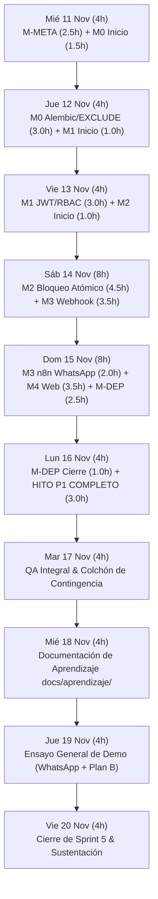

# Roadmap Cronológico Sprint 5: Torre Satori PMS

**Período:** 11 al 20 de Noviembre de 2026  
**Capacidad Total:** 48 horas (32 h laborables + 16 h fin de semana)  
**Meta:** MVP P1 con WhatsApp Real, FastAPI, PostgreSQL en Supabase y Despliegue en la Nube.  
**Referencia del Plan Maestro:** [docs/audit/05-plan-migracion.md](file:///home/jjarias/Documents/UNIVERSIDAD/8vo%20semestre/Integrador-ii/SatoriPMS/docs/audit/05-plan-migracion.md)

---

## 1. Cronograma Visual Día a Día



---

## 2. Asignación Diaria de Tareas y Entregables

| Día | Fecha | Horas | Lote / Actividad | Modo | Entregable Concreto y Verificable |
| :---: | :---: | :---: | :--- | :---: | :--- |
| **1** | Mié 11 Nov | 4.0 h | **M-META** (2.5 h) + **M0** (1.5 h) | GUIADO / AGY | App en Meta for Developers creada; System User con token permanente; Scaffolding inicial FastAPI + Docker Compose. |
| **2** | Jue 12 Nov | 4.0 h | **M0** (3.0 h) + **M1** (1.0 h) | **MÍO** / **MÍO** | Constraint `EXCLUDE USING gist` en Alembic aplicada; verificación en Supabase; endpoint `/api/v1/health`; inicio de modelo `User`. |
| **3** | Vie 13 Nov | 4.0 h | **M1** (3.0 h) + **M2** (1.0 h) | **MÍO** / GUIADO | Endpoints `/api/v1/auth/login` y `/auth/me`; dependencias `require_role`; tabla `audit_log`; inicio catálogo 9 habs. |
| **4** | Sáb 14 Nov | 8.0 h | **M2** (4.5 h) + **M3** (3.5 h) | **MÍO** / **MÍO** | Motor `GET /api/rooms/availability` (ignora vencidos inline); `POST /bookings/lock` atómico; webhook HMAC SHA-256 en FastAPI. |
| **5** | Dom 15 Nov | 8.0 h | **M3** (2.0 h) + **M4** (3.5 h) + **M-DEP** (2.5 h) | GUIADO | Flujo n8n WhatsApp real sin Redis completado; pantalla web de recepción React conectada con login y check-in; despliegue base Railway/Supabase. |
| **6** | Lun 16 Nov | 4.0 h | **M-DEP** (1.0 h) + **Hito P1** (3.0 h) | GUIADO | **HITO P1 CONCLUIDO:** Sistema 100% desplegado en Vercel + Railway + Supabase; prueba end-to-end de reserva y check-in en vivo. |
| **7** | Mar 17 Nov | 4.0 h | **QA Integral & Colchón** | AGY / GUIADO | Pruebas de estrés de concurrencia RN-02 con pytest; activación de P2 (Gemini HU-09) solo si no hubo desvíos. |
| **8** | Mié 18 Nov | 4.0 h | **Docs de Aprendizaje** | GUIADO | Redacción de `docs/aprendizaje/<ID>.md` (M0 a M-DEP) con las 3 preguntas y respuestas para la defensa ante el tribunal. |
| **9** | Jue 19 Nov | 4.0 h | **Ensayo General de Demo** | GUIADO | Ensayos cronometrados del flujo WhatsApp Real y del **Plan B (Swagger `/docs`)**; validación de mitigación cold start. |
| **10** | Vie 20 Nov | 4.0 h | **Cierre y Sustentación** | — | Entrega formal de Sprint 5, presentación con jurado evaluador y cierre de ciclo. |

---

## 3. Resumen de Capacidad

```
Capacidad Total Disponible (48.0 h):
├── Desarrollo P1 (Meta + Código + Despliegue): 29.0 h (Finaliza Lun 16 Nov)
├── Reserva Calidad, Docs Aprendizaje y Demo: 10.0 h
└── Colchón Neto de Imprevistos: 9.0 h (≥ 4.0 h CUMPLIDO)
```
