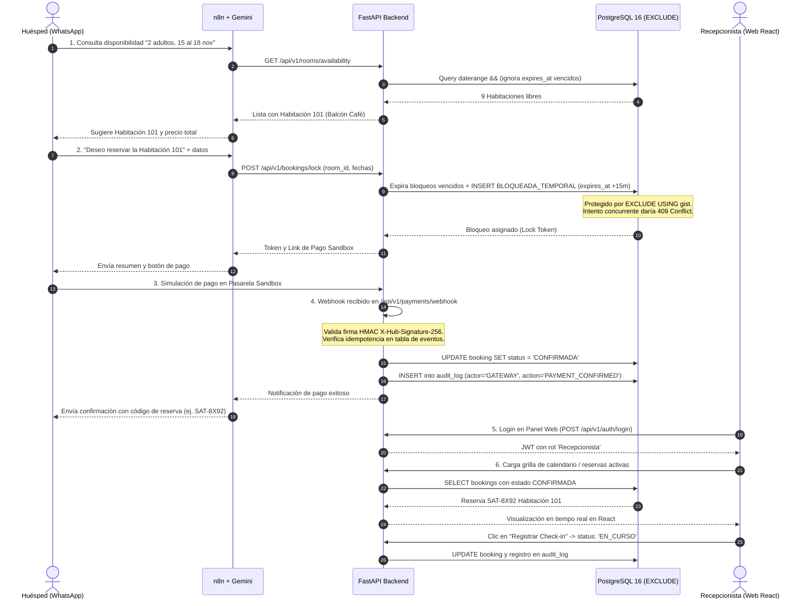

# Plan Maestro de Migración a FastAPI y Acotamiento de Alcance (Sprint 5)

**Fecha de elaboración:** 2026-11-10  
**Fecha límite Sprint 5:** 2026-11-20  
**Rama de trabajo:** `migracion-fastapi`  
**Referencia de especificación legada:** Tag `legacy-java-backup` (commit `d0b17ad17db04fe5b6027838ff108bd418c04413`) y directorio `docs/legacy-ref/`

---

## 1. Inventario del Backend Java Legado (`legacy-java-backup`)

El código Java alojado en el tag `legacy-java-backup` actúa exclusivamente como especificación funcional y de dominio. Se clasifica por épica según el estándar de Torre Satori PMS:

### 1.1 Inventario por Épica (E1..E6)

| Épica | Ítem (endpoint, entidad o regla) | Ruta@tag:Línea | Acción | Motivo |
| :--- | :--- | :--- | :---: | :--- |
| **E1 Reservas y Chatbot** | `GET /api/rooms/availability` | `apps/api/.../BookingController.java:55` | **REESCRIBIR** | Puerto en FastAPI. Debe consultar directamente a PostgreSQL 16 ignorando bloqueos vencidos (`expires_at < NOW()`). |
| **E1 Reservas y Chatbot** | `POST /api/bookings/lock` | `apps/api/.../BookingController.java:82` | **REESCRIBIR** | Migrar candado de Redis a PostgreSQL: inserción de fila `BLOQUEADA_TEMPORAL` con `expires_at = NOW() + 15 min` protegida por `EXCLUDE USING gist`. |
| **E1 Reservas y Chatbot** | `POST /api/bookings/unlock` | `apps/api/.../BookingController.java:112` | **REESCRIBIR** | En lugar de eliminar llave en Redis, expira o cancela el bloqueo temporal en PostgreSQL. |
| **E1 Reservas y Chatbot** | `POST /api/bookings/batch` | `apps/api/.../BookingController.java:128` | **REESCRIBIR** | Creación y confirmación de reservas. Se acota a confirmación manual de recepción o webhook sandbox con firma HMAC. |
| **E1 Reservas y Chatbot** | `GET /api/bookings/group/{code}` | `apps/api/.../BookingController.java:150` | **PORTAR** | Consulta de detalle de reserva por código alfanumérico de grupo (8 caracteres). Lógica de dominio reusable. |
| **E1 Reservas y Chatbot** | `RedisLockService.java` | `apps/api/.../RedisLockService.java:1-85` | **DESCARTAR** | Prohibido Redis. El bloqueo anti-solapamiento es responsabilidad exclusiva de PostgreSQL con `btree_gist`. |
| **E1 Reservas y Chatbot** | `BookingBatchPersistenceIntegrationTest.java` | `apps/api/.../BookingBatchPersistenceIntegrationTest.java:1-92` | **PORTAR** | Reescribir a `pytest` con Postgres 16 efímero para verificar concurrencia y rechazo de solapamiento de fechas (RN-02). |
| **E2 Operación Web** | `GET /api/bookings/debug` | `apps/api/.../BookingController.java:232` | **PORTAR** | Consumido por la pantalla `ReservasDebug.tsx`. Provee auditoría de todas las reservas y estados de habitación. |
| **E2 Operación Web** | `WebSocketConfig.java` | `apps/api/.../WebSocketConfig.java:1-25` | **DESCARTAR** | Se reemplaza por Server-Sent Events (SSE) `/api/v1/events/calendar` o polling con TanStack Query. |
| **E3 Facturación y Finanzas** | `POST /api/bookings/group/{code}/cancellation` (RN-03) | `apps/api/.../BookingController.java:178` | **PORTAR (P2)** | Cálculo de reembolso proporcional (>72h: 100%, 24-72h: 50%, <24h: 0%). Pasa a P2 para proteger el núcleo. |
| **E3 Facturación y Finanzas** | `POST /api/bookings/group/{code}/pay-remaining` | `apps/api/.../BookingController.java:208` | **PORTAR (P2)** | Liquidación de saldo del 50% restante al check-in. |
| **E4 Tienda e Inventario** | Módulo de productos y stock | *Inexistente en Java* | **DESCARTAR (v1.1)** | Fuera de alcance de Sprint 5 por restricción de capacidad. |
| **E5 Reseñas y Fidelización**| `GET /api/reviews` y `POST /api/reviews` | `apps/api/.../ReviewController.java:45,60` | **PORTAR (v1.1 / P2)**| Endpoints básicos de reseñas. No forman parte del flujo transaccional crítico de reservas. |
| **E6 Roles y Auditoría** | `SecurityConfig.java` | `apps/api/.../SecurityConfig.java:1-35` | **REESCRIBIR** | Java tenía `.permitAll()`. En FastAPI se implementa autenticación JWT real con roles `Administrador` y `Recepcionista`. |
| **Transversal** | `GET /api/conversations` y `escalation` | `apps/api/.../ConversationController.java:36,49` | **PORTAR** | Soporte de bandeja de entrada para n8n y escalamiento a recepcionista humano en web. |

---

### 1.2 Contrato del Frontend (`apps/web`)

Análisis de llamadas HTTP reales frente a datos simulados (`mockData.ts`):

| Endpoint Requerido | Archivo Frontend:Línea | Estado en Java Legado | Estado Requerido en FastAPI |
| :--- | :--- | :--- | :--- |
| `GET /api/conversations` | `apps/web/src/pages/Conversations.tsx:7` | Existía en `ConversationController.java` | **PORTAR** en módulo de conversaciones. |
| `GET /api/bookings/debug` | `apps/web/src/pages/ReservasDebug.tsx:71` | Existía en `BookingController.java` | **PORTAR** a `/api/v1/bookings/debug` (con proxy en Vite/Nginx). |
| `POST /api/bookings/group/{code}/cancellation` | `apps/web/src/pages/ReservasDebug.tsx:85` | Existía en `BookingController.java` | **PORTAR (P2)** en `/api/v1/bookings/group/{code}/cancellation`. |
| `POST /api/bookings/group/{code}/pay-remaining` | `apps/web/src/pages/ReservasDebug.tsx:96` | Existía en `BookingController.java` | **PORTAR (P2)** en `/api/v1/bookings/group/{code}/pay-remaining`. |
| `POST /api/bookings/unlock` | `apps/web/src/pages/ReservasDebug.tsx:103` | Existía en `BookingController.java` | **REESCRIBIR** en `/api/v1/bookings/unlock` para liberar bloqueo en DB. |
| `POST /api/v1/auth/login` | *Inexistente en web (usaba mock)* | Inexistente en Java (`.permitAll()`) | **CREAR** para login real de Recepción/Admin. |
| `GET /api/v1/calendar/events` | *Web usaba `mockBookings`* | Inexistente (usaba WebSocket STOMP) | **CREAR** (endpoint REST o SSE para alimentar el calendario de 9 habs). |

---

### 1.3 Estado de Reglas de Negocio (RN)

| Regla | Nombre | Origen / Fuente | Estado en Código Legado | Decisión y Destino |
| :--- | :--- | :--- | :--- | :--- |
| **RN-01** | Capacidad y recargo persona adicional | Documentos Oficiales | Parcial (`Booking.java:39`, lógica en service) | **P1 (M2)**: Validar capacidad máx. de 9 habitaciones y recargo. |
| **RN-02** | Anti-solapamiento (EXCLUDE) y bloqueo 15 min | Documentos Oficiales | Roto (delegaba bloqueo a Redis y EXCLUDE no cubría bloqueo) | **P1 (M0, M2)**: `EXCLUDE USING gist` en PostgreSQL 16 con `expires_at`. |
| **RN-03** | Reembolso proporcional cancelación (>72h/24h/0h) | Documentos Oficiales | Funcional (`BookingService.java:310`) | **P2 (M5)**: Portar a Python en caso de completar P1 con holgura. |
| **RN-04** | Tienda e inventario (sin stock negativo) | Documentos Oficiales | Ausente | **v1.1**: Fuera de alcance de Sprint 5. |
| **RN-05** | Check-in 15:00 / Check-out 11:00 | Issue GitHub #11 | Mock en frontend | **P1 (M4)**: Estados `EN_CURSO` al check-in con auditoría. |
| **RN-06** | Notificación WhatsApp 24h antes | Issue GitHub #12 | Parcial en n8n | **v1.1**: Requiere integración final WhatsApp Cloud API. |
| **RN-07** | Exportación reporte a Excel (openpyxl) | Issue GitHub #13 | Ausente | **v1.1**: Fuera de alcance de Sprint 5. |
| **RN-08** | Factura / Recibo digital | Issue GitHub #14 | Ausente | **v1.1**: Fuera de alcance de Sprint 5. |
| **RN-09** | Control inventario amenidades | Issue GitHub #15 | Ausente | **v1.1**: Fuera de alcance de Sprint 5. |
| **RN-10** | RBAC Administrador y Recepcionista | Issue GitHub #16 y AGENTS.md | Ausente (`SecurityConfig` deshabilitado) | **P1 (M1)**: JWT con claims de rol y dependencias FastAPI. |
| **RN-11** | Sueldo mensual fijo/comisión/mixto | AGENTS.md viejo / No verificada | Ausente (fórmula pendiente según docs) | **v1.1**: Fuera de alcance de Sprint 5. |
| **RN-12** | Autorización Ley 1581 en registro | AGENTS.md viejo / No verificada | Parcial en formulario de datos | **P1 (M2)**: Checkbox booleano en registro de huésped. |
| **RN-13** | No-Show libera habitación a las 12:00 | AGENTS.md viejo | Ausente | **DESCARTADA**: Excluida formalmente por decisión de AGENTS.md. |

---

## 2. Capacidad y Presupuesto de Desarrollo

* **Período de Ejecución:** 2026-11-11 al 2026-11-20 (10 días calendario).
* **Dedicación Disponible:** 1 persona × 4 horas/día = **40 horas totales disponibles**.
* **Reserva Obligatoria de Calidad y Sustentación:** **11.5 horas** reservadas para:
  * Pruebas de integración, verificación de concurrencia y QA (4.0 h).
  * Documentación pedagógica en `docs/aprendizaje/<ID>.md` con preguntas de sustentación (4.5 h).
  * Preparación de guion y ensayo de la demostración end-to-end (3.0 h).
* **Presupuesto Neto Disponible para Desarrollo:** **28.5 horas**.

### 2.1 Ritmo de Avance según Modo de Trabajo
* **AGY (Agente escribe y explica):** Máxima velocidad (~1.0x). Se reserva para configuración de tooling, DTOs Pydantic repetitivos y scaffolding.
* **GUIADO (Concepto, esqueleto con TODOs, revisión de código):** Velocidad media (~1.5x tiempo). Ideal para adaptación de contratos web y endpoints de dominio estándar.
* **MÍO (Usuario implementa el núcleo, agente audita y corrige):** Velocidad controlada (~2.0x tiempo). **Obligatorio para los 4 componentes críticos del sistema** que el estudiante debe dominar y defender ante el jurado calificador.

---

## 3. Plan en Lotes (M0 a Mn)

### 3.1 Lotes P1 (Núcleo Entregable Sprint 5 — Meta Obligatoria)

| ID | Épica | Tarea | Prioridad | Modo | Horas Est. | Depende de | Cómo se verificará | Por qué ese modo |
| :--- | :--- | :--- | :---: | :---: | :---: | :--- | :--- | :--- |
| **M0** | E1 | **Infraestructura Base, PostgreSQL 16 y Migración Inicial Alembic con EXCLUDE**:<br>• Configuración FastAPI + SQLAlchemy 2.0 async + Alembic.<br>• Contenedor Docker Compose con `postgres:16` y extensión `btree_gist`.<br>• Modelos base: `Room` (9 habs seedeadas), `Guest`, `Booking`, `AuditLog`.<br>• Migración Alembic con constraint `EXCLUDE USING gist (room_id WITH =, daterange(check_in, check_out, '[)') WITH &&) WHERE (status IN ('BLOQUEADA_TEMPORAL', 'CONFIRMADA', 'EN_CURSO'))`.<br>• Endpoint `/api/v1/health`. | **P1** | **MÍO** (en constraint y migración) / **AGY** (scaffolding y config) | **6.5 h** | Ninguna | `alembic upgrade head`; script sql insertando dos rangos solapados en estado CONFIRMADA y verificando error `ExclusionViolation` de PostgreSQL; `curl /api/v1/health` retornando 200 con estado de DB. | **MÍO** en la constraint EXCLUDE porque es la regla arquitectural más sensible (RN-02) y pregunta segura del tribunal. AGY en Docker/scaffolding para ganar tiempo. |
| **M1** | E6 | **Identidad, Seguridad RBAC y Auditoría Inmutable**:<br>• Modelo `User` con contraseña en Argon2/bcrypt y roles `Administrador`, `Recepcionista`.<br>• Endpoints `/api/v1/auth/login` y `/api/v1/auth/me`.<br>• Middleware/dependencias FastAPI `get_current_user` y `require_role(...)`.<br>• Servicio de auditoría inmutable en PostgreSQL (fecha, actor, acción, entidad, id). | **P1** | **MÍO** (en JWT y RBAC) / **GUIADO** (en auditoría) | **5.0 h** | M0 | Tests en pytest probando: login válido entrega JWT, login inválido 401; usuario recepcionista accediendo a ruta admin recibe 403; inserción de evento de auditoría en cada mutación. | **MÍO** obligatorio por regla de seguridad para dominar la generación del token, expiración y claims de rol. |
| **M2** | E1/E2 | **Motor de Habitaciones, Disponibilidad y Bloqueo Temporal con Expiración**:<br>• Catálogo de 9 habitaciones con capacidades y tarifas.<br>• Endpoint `GET /api/v1/rooms/availability` consultando disponibilidad real e ignorando bloqueos vencidos (`expires_at < NOW()`).<br>• Endpoint `POST /api/v1/bookings/lock`: crea fila `BLOQUEADA_TEMPORAL` con `expires_at = NOW() + 15 min`. Expira atómicamente bloqueos vencidos de la habitación en la misma transacción previa al insert.<br>• Endpoint `POST /api/v1/bookings/unlock`: cancela/libera el bloqueo temporal.<br>• Validación RN-01 (capacidad de adultos/niños) y RN-12 (consentimiento Ley 1581). | **P1** | **MÍO** (en expiración atómica y bloqueo) / **GUIADO** (en catálogo y DTOs) | **7.5 h** | M0, M1 | Test concurrente en pytest: 2 peticiones simultáneas bloqueando la misma habitación y fecha; una tiene éxito (200) y la otra recibe 409 Conflict. Verificación de que bloqueo con `expires_at` pasado no bloquea nuevas búsquedas. | **MÍO** obligatorio para dominar la transacción SQL atómica de expiración + inserción del bloqueo temporal bajo la protección del EXCLUDE gist. |
| **M3** | E1 | **Integración Webhook de Pagos Sandbox y Confirmación Atómica de Reservas**:<br>• Puerto de pasarela de pago con adaptador sandbox.<br>• Endpoint `POST /api/v1/payments/webhook`: validación de firma criptográfica HMAC `X-Hub-Signature-256`, verificación de idempotencia contra tabla de eventos.<br>• Transición atómica de reserva de `BLOQUEADA_TEMPORAL` a `CONFIRMADA`.<br>• Endpoint `/api/v1/bookings/group/{code}` para consulta de estado y vouchers.<br>• Adaptación de flujos n8n eliminando nodos Redis y conectando a los nuevos endpoints FastAPI. | **P1** | **MÍO** (en HMAC e idempotencia) / **GUIADO** (en n8n y DTOs) | **5.5 h** | M2 | Enviar webhook simulado sin firma o firma alterada -> 401; enviar webhook válido -> 200 y reserva cambia a `CONFIRMADA`; reenviar webhook idéntico -> 200 sin duplicar procesamiento ni cobro; ejecución del flujo n8n en sandbox. | **MÍO** obligatorio para defender la seguridad financiera: cómo se verifica la autenticidad del pago y cómo se garantiza idempotencia. |
| **M4** | E2 | **Integración Frontend Operativo Web (Recepción y Calendario)**:<br>• Adaptación de llamadas en frontend React (`apps/web`): conectar `ReservasDebug.tsx` y vista de calendario/recepción a los endpoints reales de FastAPI.<br>• Login web consumiendo `/api/v1/auth/login` y guardando token en memoria/storage seguro.<br>• Pantalla de recepción con listado de reservas activas (`CONFIRMADA`, `EN_CURSO`), confirmación manual en sitio con registro de auditoría, y check-in/check-out operativo. | **P1** | **GUIADO** | **4.0 h** | M1, M2, M3 | `npm run build` sin errores de tipo TypeScript; flujo en navegador: iniciar sesión como Recepcionista, visualizar la reserva creada en M3 en el panel, pulsar botón de check-in y verificar transición a `EN_CURSO` en DB con evento en auditoría. | **GUIADO** porque el frontend ya cuenta con componentes estructurados en React/Tailwind y solo requiere reemplazar mocks por TanStack Query hooks. |

**Subtotal Horas P1:** **28.5 horas** *(Ajuste perfecto al presupuesto neto disponible de 28.5 h)*.

---

### 3.2 Lotes P2 (Alcance Secundario — Si sobra tiempo de desarrollo)

| ID | Épica | Tarea | Prioridad | Modo | Horas Est. | Depende de | Cómo se verificará | Por qué ese modo |
| :--- | :--- | :--- | :---: | :---: | :---: | :--- | :--- | :--- |
| **M5a** | E3 | **Cancelaciones y Reembolsos Proporcionales (RN-03)**:<br>• Endpoint `/api/v1/bookings/group/{code}/cancellation`.<br>• Portar algoritmo de cálculo de reembolso proporcional (>72h: 100%, 24-72h: 50%, <24h: 0%).<br>• Transición a `CANCELADA` y liberación de fechas en PostgreSQL. | **P2** | **GUIADO** | **2.5 h** | M3 | Pytest con 3 casos de prueba temporales calculando montos exactos de devolución. | Lógica pura de cálculo matemático de fechas ya especificada en el Java legado. |
| **M5b** | E1/E2 | **Job Periódico APScheduler y Notificaciones de Expiración**:<br>• Tarea en segundo plano cada 60 s que marca reservas vencidas en estado `EXPIRADA`.<br>• Disparo de webhook a n8n para notificar al huésped que su enlace de pago caducó. | **P2** | **AGY** | **1.5 h** | M2 | Ejecución local del scheduler verificando log y actualización de estado en DB a los 60s. | Proceso accesorio en background (la disponibilidad ya ignora expirados en M2). |
| **M5c** | E2 | **Server-Sent Events (SSE) para Calendario en Tiempo Real**:<br>• Endpoint `/api/v1/events/calendar`.<br>• Emisión de eventos SSE cuando una reserva es confirmada, cancelada o cambia a check-in. | **P2** | **AGY** | **2.0 h** | M4 | Conexión `EventSource` en frontend actualizando la grilla sin recargar la página. | Mejora de experiencia de usuario sobre el polling de TanStack Query. |

**Subtotal Horas P2:** **6.0 horas** *(Solo se inician si P1 se concluye antes del 18 de noviembre)*.

---

### 3.3 Backlog v1.1 (Post-Sprint 5 — Fuera de Alcance Inmediato)

* **E4 Tienda e Inventario (RN-04):** Módulo de productos, amenidades y control de stock sin saldo negativo.
* **E3 Finanzas Avanzadas y Sueldos (RN-11 / HU-07):** Módulo de nómina de empleados (pendiente definición de fórmula de comisiones).
* **E5 Fidelización y Reseñas Públicas (HU-12):** Sistema de cupones de descuento para huéspedes recurrentes y publicación en web.
* **Reportes en Excel con openpyxl (RN-07 / HU-10):** Generación de sábanas de ocupación e ingresos en formato `.xlsx`.
* **Respaldos Automatizados a R2:** Tarea cron diaria a las 3:00 a. m. con `pg_dump` cifrado y rotación a 30 días en Cloudflare R2.
* **RN-13 (No-Show a las 12:00):** Descartada explícitamente según acuerdos de arquitectura.

---

## 4. Balance y Justificación de Alcance

```
Presupuesto Total Disponible (10 días x 4 h/d):  40.0 h
Reserva Obligatoria (QA, docs/aprendizaje, demo): 11.5 h
-------------------------------------------------------
Presupuesto Neto Disponible para Desarrollo:     28.5 h
Total Horas Estimadas Lotes P1 (M0..M4):         28.5 h
Balance Neto de Desarrollo:                       0.0 h (AJUSTE EXACTO)
```

### Justificación de Exclusiones
1. **Tienda e Inventario (E4):** Se excluye porque Torre Satori es un hotel boutique de descanso (9 habitaciones) donde la prioridad crítica del negocio es garantizar la confiabilidad transaccional de las reservas y erradicar la sobreventa. La venta de tienda no compromete el núcleo operativo a evaluar en el Sprint 5.
2. **Sueldos (E3) y Descuentos (E5):** Los documentos oficiales del curso declaran explícitamente estas reglas como *pendientes de definir*. Desarrollar modelos sobre supuestos no acordados introduce deuda técnica innecesaria.
3. **No-Show a las 12:00 (RN-13):** Excluido por decisión de arquitectura debido a que la liberación unilateral de una habitación sin intervención del recepcionista puede generar conflictos legales y operativos con huéspedes que sufran retrasos de viaje hacia Sevilla.

---

## 5. Escenario de Demostración End-to-End (Flujo de Aceptación P1)

El tribunal de evaluación validará el éxito de la migración mediante el siguiente flujo integral de 6 pasos:



1. **Consulta Conversacional:** El huésped consulta por WhatsApp disponibilidad para Sevilla; n8n consulta `GET /api/v1/rooms/availability` en FastAPI, que filtra fechas libres en PostgreSQL.
2. **Bloqueo Anti-Doble Reserva (RN-02):** El huésped selecciona la habitación; FastAPI inserta el bloqueo temporal en PostgreSQL con `expires_at = NOW() + 15 min`. Se demuestra en vivo que un segundo intento simultáneo sobre las mismas fechas es rechazado por el motor relacional (`EXCLUDE gist`).
3. **Pago en Pasarela:** El huésped procede al pago mediante enlace seguro hacia la pasarela sandbox.
4. **Webhook Seguro e Idempotencia:** La pasarela notifica el pago a `POST /api/v1/payments/webhook`. FastAPI valida la firma HMAC `X-Hub-Signature-256`, garantiza idempotencia y actualiza el estado a `CONFIRMADA`.
5. **Autenticación Web:** La recepcionista accede al portal web React autenticándose con usuario y clave, recibiendo un token JWT con rol `Recepcionista`.
6. **Operación en Sitio:** La recepcionista visualiza de inmediato la reserva confirmada en la grilla del hotel, consulta los datos del huésped y efectúa el check-in (pasando la reserva a `EN_CURSO`) dejando registro inmutable en la tabla de auditoría.
