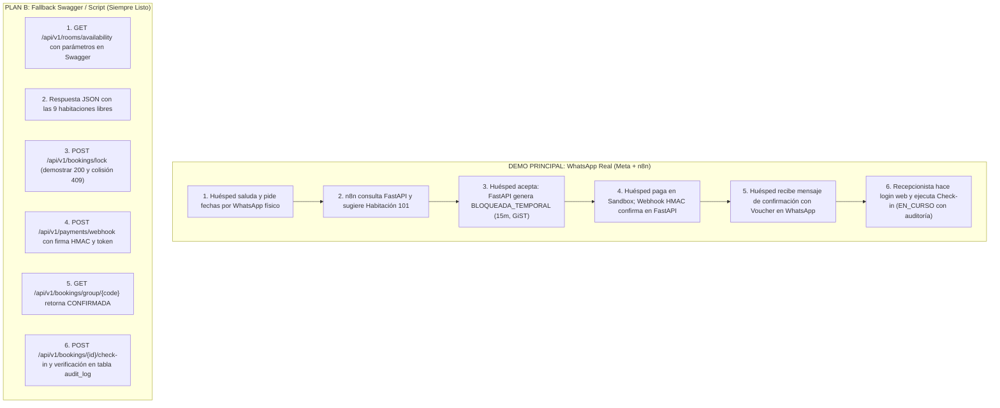

# Plan Maestro de Migración a FastAPI y Acotamiento de Alcance (Sprint 5)

**Fecha de elaboración:** 2026-11-10  
**Fecha de ajuste:** 2026-11-10 (Integración WhatsApp Real en P1, Meta Cloud API, Capacidad 48h y Plan B de Demo)  
**Fecha límite Sprint 5:** 2026-11-20  
**Rama de trabajo:** `migracion-fastapi` (NUNCA main)  
**Referencia de especificación legada:** Tag `legacy-java-backup` (commit `d0b17ad17db04fe5b6027838ff108bd418c04413`) y directorio `docs/legacy-ref/`

---

## 1. Inventario del Backend Java Legado (`legacy-java-backup`)

El código Java alojado en el tag `legacy-java-backup` actúa exclusivamente como especificación funcional y de dominio. Se clasifica por épica según el estándar de Torre Satori PMS:

### 1.1 Inventario por Épica (E1..E6)

| Épica | Ítem (endpoint, entidad o regla) | Ruta@tag:Línea | Acción | Motivo |
| :--- | :--- | :--- | :---: | :--- |
| **E1 Reservas y Chatbot** | `GET /api/rooms/availability` | `apps/api/.../BookingController.java:55` | **REESCRIBIR** | Puerto en FastAPI. Consulta PostgreSQL 16 ignorando bloqueos vencidos (`WHERE expires_at IS NULL OR expires_at > NOW()`). |
| **E1 Reservas y Chatbot** | `POST /api/bookings/lock` | `apps/api/.../BookingController.java:82` | **REESCRIBIR** | Migrar candado de Redis a PostgreSQL: inserción de fila `BLOQUEADA_TEMPORAL` con `expires_at = NOW() + 15 min` protegida por `EXCLUDE USING gist`. |
| **E1 Reservas y Chatbot** | `POST /api/bookings/unlock` | `apps/api/.../BookingController.java:112` | **REESCRIBIR** | En lugar de eliminar llave en Redis, expira o cancela el bloqueo temporal en PostgreSQL. |
| **E1 Reservas y Chatbot** | `POST /api/bookings/batch` | `apps/api/.../BookingController.java:128` | **REESCRIBIR** | Confirmación atómica de reservas por recepción física o vía webhook sandbox con firma HMAC. |
| **E1 Reservas y Chatbot** | `GET /api/bookings/group/{code}` | `apps/api/.../BookingController.java:150` | **PORTAR** | Consulta de detalle de reserva por código alfanumérico de grupo (8 caracteres). Lógica de dominio reusable. |
| **E1 Reservas y Chatbot** | `RedisLockService.java` | `apps/api/.../RedisLockService.java:1-85` | **DESCARTAR** | Prohibido Redis. El bloqueo anti-solapamiento es responsabilidad exclusiva de PostgreSQL con `btree_gist`. |
| **E1 Reservas y Chatbot** | `BookingBatchPersistenceIntegrationTest.java` | `apps/api/.../BookingBatchPersistenceIntegrationTest.java:1-92` | **PORTAR** | Reescribir a `pytest` local con Postgres 16 (Docker Compose) para verificar concurrencia y rechazo de solapamiento de fechas (RN-02). |
| **E2 Operación Web** | `GET /api/bookings/debug` | `apps/api/.../BookingController.java:232` | **PORTAR** | Consumido por la pantalla `ReservasDebug.tsx`. Provee auditoría de todas las reservas y estados de habitación. |
| **E2 Operación Web** | `WebSocketConfig.java` | `apps/api/.../WebSocketConfig.java:1-25` | **DESCARTAR** | Se reemplaza inicialmente por polling con TanStack Query y opcionalmente SSE `/api/v1/events/calendar`. |
| **E3 Facturación y Finanzas** | `POST /api/bookings/group/{code}/cancellation` (RN-03) | `apps/api/.../BookingController.java:178` | **PORTAR (P2)** | Cálculo de reembolso proporcional (>72h: 100%, 24-72h: 50%, <24h: 0%). Reubicado a P2 para proteger el núcleo. |
| **E3 Facturación y Finanzas** | `POST /api/bookings/group/{code}/pay-remaining` | `apps/api/.../BookingController.java:208` | **PORTAR (P2)** | Liquidación de saldo del 50% restante al check-in. Reubicado a P2. |
| **E4 Tienda e Inventario** | Módulo de productos y stock | *Inexistente en Java* | **DESCARTAR (v1.1)** | Fuera de alcance de Sprint 5 por capacidad. |
| **E5 Reseñas y Fidelización**| `GET /api/reviews` y `POST /api/reviews` | `apps/api/.../ReviewController.java:45,60` | **PORTAR (v1.1 / P2)**| Endpoints básicos de reseñas. Fuera del flujo transaccional crítico de reservas. |
| **E6 Roles y Auditoría** | `SecurityConfig.java` | `apps/api/.../SecurityConfig.java:1-35` | **REESCRIBIR** | Java tenía `.permitAll()`. En FastAPI se implementa autenticación JWT real con roles `Administrador` y `Recepcionista`. |
| **Transversal** | `GET /api/conversations` y `escalation` | `apps/api/.../ConversationController.java:36,49` | **PORTAR** | Soporte de bandeja de entrada para n8n y escalamiento a recepcionista humano en web. |

---

### 1.2 Contrato del Frontend (`apps/web`)

Análisis de llamadas HTTP reales frente a datos simulados (`mockData.ts`):

| Endpoint Requerido | Archivo Frontend:Línea | Estado en Java Legado | Estado Requerido en FastAPI |
| :--- | :--- | :--- | :--- |
| `GET /api/conversations` | `apps/web/src/pages/Conversations.tsx:7` | Existía en `ConversationController.java` | **PORTAR** en módulo de conversaciones. |
| `GET /api/bookings/debug` | `apps/web/src/pages/ReservasDebug.tsx:71` | Existía en `BookingController.java` | **PORTAR** a `/api/v1/bookings/debug` (con proxy en Vite/Nginx). |
| `POST /api/bookings/group/{code}/cancellation` | `apps/web/src/pages/ReservasDebug.tsx:85` | Existía en `BookingController.java` | **PORTAR (P2)** en `/api/v1/bookings/group/{code}/cancellation`. |
| `POST /api/bookings/group/{code}/pay-remaining` | `apps/web/src/pages/ReservasDebug.tsx:96` | Existía en `BookingController.java` | **PORTAR (P2)** en `/api/v1/bookings/group/{code}/pay-remaining`. |
| `POST /api/bookings/unlock` | `apps/web/src/pages/ReservasDebug.tsx:103` | Existía en `BookingController.java` | **REESCRIBIR** en `/api/v1/bookings/unlock` para liberar bloqueo en DB. |
| `POST /api/v1/auth/login` | *Inexistente en web (usaba mock)* | Inexistente en Java (`.permitAll()`) | **CREAR** para login real de Recepción/Admin. |
| `GET /api/v1/calendar/events` | *Web usaba `mockBookings`* | Inexistente (usaba WebSocket STOMP) | **CREAR** (endpoint REST para alimentar el calendario de 9 habs). |

---

### 1.3 Estado de Reglas de Negocio (RN)

| Regla | Nombre | Origen / Fuente | Estado en Código Legado | Decisión y Destino |
| :--- | :--- | :--- | :--- | :--- |
| **RN-01** | Capacidad y recargo persona adicional | Documentos Oficiales | Parcial (`Booking.java:39`, lógica en service) | **P1 (M2)**: Validar capacidad máx. de 9 habitaciones y recargo. |
| **RN-02** | Anti-solapamiento (EXCLUDE) y bloqueo 15 min | Documentos Oficiales | Roto (delegaba bloqueo a Redis y EXCLUDE no cubría bloqueo) | **P1 (M0, M2)**: `EXCLUDE USING gist` en PostgreSQL 16 con `expires_at`. |
| **RN-03** | Reembolso proporcional cancelación (>72h/24h/0h) | Documentos Oficiales | Funcional (`BookingService.java:310`) | **P2 (M5b)**: Portar a Python si hay margen de tiempo. |
| **RN-04** | Tienda e inventario (sin stock negativo) | Documentos Oficiales | Ausente | **v1.1**: Fuera de alcance de Sprint 5. |
| **RN-05** | Check-in 15:00 / Check-out 11:00 | Issue GitHub #11 | Mock en frontend | **P1 (M4)**: Estados `EN_CURSO` al check-in con auditoría. |
| **RN-06** | Notificación WhatsApp 24h antes | Issue GitHub #12 | Parcial en n8n | **v1.1**: Requiere integración final WhatsApp Cloud API comercial. |
| **RN-07** | Exportación reporte a Excel (openpyxl) | Issue GitHub #13 | Ausente | **v1.1**: Fuera de alcance de Sprint 5. |
| **RN-08** | Factura / Recibo digital | Issue GitHub #14 | Ausente | **v1.1**: Fuera de alcance de Sprint 5. |
| **RN-09** | Control inventario amenidades | Issue GitHub #15 | Ausente | **v1.1**: Fuera de alcance de Sprint 5. |
| **RN-10** | RBAC Administrador y Recepcionista | Issue GitHub #16 y AGENTS.md | Ausente (`SecurityConfig` deshabilitado) | **P1 (M1)**: JWT con claims de rol y dependencias FastAPI. |
| **RN-11** | Sueldo mensual fijo/comisión/mixto | AGENTS.md viejo / No verificada | Ausente (fórmula pendiente según docs) | **v1.1**: Fuera de alcance de Sprint 5. |
| **RN-12** | Autorización Ley 1581 en registro | AGENTS.md viejo / No verificada | Parcial en formulario de datos | **P1 (M2)**: Checkbox booleano en registro de huésped. |
| **RN-13** | No-Show libera habitación a las 12:00 | AGENTS.md viejo | Ausente | **DESCARTADA**: Excluida formalmente por decisión de AGENTS.md. |

---

## 2. Capacidad, Ajuste de Presupuesto y Creación del Colchón

* **Período de Ejecución:** 2026-11-11 al 2026-11-20 (10 días calendario).
* **Dedicación Disponible:**
  * 8 días laborables (11, 12, 13, 16, 17, 18, 19 y 20 nov) × 4 h/día = **32.0 horas**.
  * Fin de semana de alta dedicación (sábado 14 y domingo 15 nov) × 8 h/día = **16.0 horas**.
  * **Total Capacidad Bruta Disponible:** **48.0 horas**.
* **Reserva Obligatoria de Calidad y Sustentación:** **10.0 horas** reservadas para:
  * Pruebas de integración, verificación de concurrencia y QA (3.5 h).
  * Documentación pedagógica en `docs/aprendizaje/<ID>.md` con preguntas de sustentación (4.0 h).
  * Preparación de guion y ensayo de la demostración end-to-end con Plan B (2.5 h).
* **Presupuesto Neto Disponible para Desarrollo:** **38.0 horas**.
* **Horas Reales de Desarrollo P1:** **29.0 horas**.
* **Colchón Neto de Seguridad (Holgura P1):** **9.0 horas** (Supera ampliamente el mínimo de ≥4.0 h).

```
Presupuesto Total Disponible (48.0 h):
├── Reserva Calidad, Docs Aprendizaje y Demo: 10.0 h
├── Lotes de Desarrollo P1 (Núcleo + WhatsApp Real + Despliegue): 29.0 h
└── Colchón Neto de Imprevistos (Holgura P1): 9.0 h (≥ 4.0 h CUMPLIDO)
```

---

## 3. Plan en Lotes (M0 a Mn)

### 3.1 Lotes P1 (Núcleo Entregable Sprint 5 — Meta Obligatoria: 29.0 h)

| ID | Épica | Tarea | Prioridad | Modo | Horas Est. | Depende de | Cómo se verificará | Por qué ese modo |
| :--- | :--- | :--- | :---: | :---: | :---: | :--- | :--- | :--- |
| **M-META** | E1 | **Configuración Meta Cloud API, WhatsApp Real y Webhook n8n**:<br>• Cuenta en Meta for Developers y configuración de App con WhatsApp Cloud API.<br>• Generación de Token de Acceso Permanente (System User) y registro de número de prueba con destinatarios permitidos.<br>• Configuración del Webhook público HTTPS en n8n (`hub.verify_token`, `hub.challenge`).<br>• Verificación de límites oficiales (máx 5 destinatarios en test, ventana 24 h). | **P1** | **GUIADO** | **2.5 h** | Ninguna (arranca 11-nov en paralelo) | Envío y recepción de mensaje de texto real desde WhatsApp en teléfono físico hacia n8n con confirmación en log de n8n. | **GUIADO** porque requiere pasos en la consola de Meta donde el estudiante debe configurar sus propias credenciales. |
| **M0** | E1 | **Infraestructura Base, PostgreSQL 16 (Local y Supabase con `btree_gist`), Alembic Inicial con EXCLUDE y Pytest Concurrente**:<br>• FastAPI + SQLAlchemy 2.0 async + Alembic.<br>• Contenedor local con `postgres:16` y verificación de `CREATE EXTENSION btree_gist` en **Supabase**.<br>• Modelos base: `Room` (9 habs seedeadas), `Guest`, `Booking`, `AuditLog`.<br>• Migración Alembic con constraint `EXCLUDE USING gist (room_id WITH =, daterange(check_in, check_out, '[)') WITH &&) WHERE (status IN ('BLOQUEADA_TEMPORAL', 'CONFIRMADA', 'EN_CURSO'))`.<br>• Endpoint `/api/v1/health`.<br>• **Pytest local de concurrencia RN-02** con Docker Compose. | **P1** | **MÍO** (en constraint y migración) / **AGY** (scaffolding y config) | **4.5 h** | Ninguna | `alembic upgrade head`; script sql insertando dos rangos solapados en estado CONFIRMADA y verificando error `ExclusionViolation` de PostgreSQL; `pytest` local de concurrencia pasando en verde. | **MÍO** en la constraint EXCLUDE porque es la regla arquitectural más sensible (RN-02) y pregunta segura del tribunal. AGY en Docker/scaffolding para ganar tiempo. |
| **M1** | E6 | **Identidad, Seguridad RBAC y Auditoría de Reservas y Check-in/out**:<br>• Modelo `User` con contraseña en Argon2/bcrypt y roles `Administrador`, `Recepcionista`.<br>• Endpoints `/api/v1/auth/login` y `/api/v1/auth/me`.<br>• Dependencias FastAPI `get_current_user` y `require_role(...)`.<br>• Inserción inmutable en tabla `audit_log` para eventos críticos (login, confirmación de reserva y check-in/out). | **P1** | **MÍO** (en JWT y RBAC) / **GUIADO** (en auditoría) | **4.0 h** | M0 | Tests en pytest probando: login válido entrega JWT, login inválido 401; usuario recepcionista accediendo a ruta admin recibe 403; inserción de fila en `audit_log` comprobable en DB. | **MÍO** obligatorio por regla de seguridad para dominar la generación del token, expiración y claims de rol. |
| **M2** | E1/E2 | **Motor de Habitaciones, Disponibilidad y Bloqueo Temporal con Expiración**:<br>• Catálogo de 9 habitaciones con capacidades y tarifas.<br>• Endpoint `GET /api/v1/rooms/availability` consultando disponibilidad real e **ignorando bloqueos vencidos inline** (`WHERE expires_at IS NULL OR expires_at > NOW()`). **No depende del job de M5.**<br>• Endpoint `POST /api/v1/bookings/lock`: crea fila `BLOQUEADA_TEMPORAL` con `expires_at = NOW() + 15 min`. Expira atómicamente bloqueos vencidos de la habitación en la misma transacción previa al insert.<br>• Endpoint `POST /api/v1/bookings/unlock`: cancela/libera el bloqueo temporal.<br>• Validación RN-01 (capacidad) y RN-12 (consentimiento Ley 1581). | **P1** | **MÍO** (en expiración atómica y bloqueo) / **GUIADO** (en catálogo y DTOs) | **5.5 h** | M0, M1 | Test concurrente en pytest: 2 peticiones simultáneas bloqueando la misma habitación y fecha; una tiene éxito (200) y la otra recibe 409 Conflict. Verificación de que bloqueo con `expires_at` pasado no bloquea nuevas búsquedas sin necesidad de job en background. | **MÍO** obligatorio para dominar la transacción SQL atómica de expiración + inserción del bloqueo temporal bajo la protección del EXCLUDE gist. |
| **M3** | E1 | **Integración Webhook Sandbox, Confirmación Atómica y n8n con WhatsApp Real (Camino Feliz Completo)**:<br>• Puerto de pasarela de pago con adaptador sandbox.<br>• Endpoint `POST /api/v1/payments/webhook`: validación de firma criptográfica HMAC `X-Hub-Signature-256`, verificación de idempotencia contra tabla de eventos.<br>• Transición atómica de reserva de `BLOQUEADA_TEMPORAL` a `CONFIRMADA`.<br>• Endpoint `/api/v1/bookings/group/{code}` para consulta de voucher.<br>• **Camino feliz completo en n8n + WhatsApp Real:** Saludo inicial -> consulta disponibilidad -> selección habitación -> bloqueo temporal 15 min -> link de pago sandbox -> webhook de confirmación -> mensaje de voucher en WhatsApp. Contexto conversacional en FastAPI/PostgreSQL (tabla `conversation`), estrictamente sin Redis. | **P1** | **MÍO** (en HMAC e idempotencia) / **GUIADO** (en n8n y DTOs) | **5.5 h** | M-META, M2 | Enviar webhook simulado sin firma o firma alterada -> 401; enviar webhook válido -> 200 y reserva cambia a `CONFIRMADA`; recepción real del mensaje de confirmación con voucher en WhatsApp físico; flujo n8n sin nodos Redis. | **MÍO** obligatorio para defender la seguridad financiera: verificación criptográfica de la autenticidad del pago e idempotencia. |
| **M4** | E2 | **Integración Frontend Operativo Web (Recepción y Calendario)**:<br>• Adaptación de llamadas en frontend React (`apps/web`): conectar `ReservasDebug.tsx` y vista de grilla/calendario de recepción a FastAPI.<br>• Login web consumiendo `/api/v1/auth/login` y guardando token en memoria/storage seguro.<br>• Pantalla de recepción con listado de reservas activas (`CONFIRMADA`, `EN_CURSO`), confirmación manual en sitio y check-in operativo con auditoría (RN-05, RN-06). | **P1** | **GUIADO** | **3.5 h** | M1, M2, M3 | `npm run build` sin errores de tipo TypeScript; flujo en navegador: iniciar sesión como Recepcionista, visualizar la reserva creada en M3 en el panel, pulsar botón de check-in y verificar transición a `EN_CURSO` en DB con evento en auditoría. | **GUIADO** porque el frontend ya cuenta con componentes estructurados en React/Tailwind y solo requiere reemplazar mocks por TanStack Query hooks. |
| **M-DEP** | Transversal | **Despliegue MVP en la Nube (Opción 2 Simplificada)**:<br>• Frontend: Vercel desplegando `apps/web` con variable `VITE_API_URL`.<br>• Base de datos: PostgreSQL 16 con extensión `btree_gist` en **Supabase**.<br>• Backend: FastAPI en Railway desplegando desde la rama `migracion-fastapi` (NUNCA main). Migraciones de Alembic ejecutadas al arrancar (`alembic upgrade head`). Healthcheck `/api/v1/health`.<br>• Secretos exclusivamente vía variables de entorno en los paneles (sin credenciales en git).<br>• n8n: Desplegado en Railway (mismo proyecto) o local con túnel Cloudflare/ngrok para la demo.<br>• **Documentación de riesgo:** Mitigación del arranque en frío (cold start) en capas gratuitas. | **P1** | **GUIADO** | **3.5 h** | M0, M1, M2, M3, M4 | Ping HTTP exitoso a `/api/v1/health` en Railway; acceso público HTTPS al frontend en Vercel; creación de reserva completa vía WhatsApp real y webhook sandbox en producción. | **GUIADO** para asegurar que el estudiante configure y domine cada panel de despliegue sin errores de credenciales. |

**Subtotal Horas Desarrollo P1:** **29.0 horas**.

---

### 3.2 Lotes P2 (Alcance Secundario — Si sobra tiempo del colchón: 10.5 h)

| ID | Épica | Tarea | Prioridad | Modo | Horas Est. | Depende de | Cómo se verificará | Por qué ese modo |
| :--- | :--- | :--- | :---: | :---: | :---: | :--- | :--- | :--- |
| **M5a** | E1 | **Gemini 2.0 Flash (HU-09 - Recomendador Asistido de Habitaciones)**:<br>• Integración de nodo Gemini en n8n para responder preguntas en lenguaje natural sobre las 9 habitaciones.<br>• Regla estricta: Gemini solo recomienda amenidades, nunca confirma disponibilidad ni inventario en firme. | **P2** | **GUIADO** | **2.5 h** | M3 | Pruebas de preguntas conversacionales en WhatsApp (ej. "¿Tienen balcón con vista cafetera?") respondiendo con recomendación contextual. | Primer ítem de P2: aporta enriquecimiento conversacional pero no bloquea la reserva transaccional de P1. |
| **M5b** | E3 | **Cancelaciones y Reembolsos Proporcionales (RN-03)**:<br>• Endpoint `/api/v1/bookings/group/{code}/cancellation`.<br>• Portar algoritmo de cálculo de reembolso proporcional (>72h: 100%, 24-72h: 50%, <24h: 0%).<br>• Transición a `CANCELADA` y liberación de fechas en PostgreSQL. | **P2** | **GUIADO** | **2.0 h** | M3 | Pytest con 3 casos de prueba temporales calculando montos exactos de devolución. | Lógica pura de cálculo matemático de fechas ya especificada en el Java legado. |
| **M5c** | E1/E2 | **Job Periódico APScheduler y Notificaciones de Expiración**:<br>• Tarea en segundo plano cada 60 s que marca reservas vencidas en estado `EXPIRADA`.<br>• Disparo de webhook a n8n para notificar al huésped que su enlace de pago caducó. | **P2** | **AGY** | **1.5 h** | M2 | Ejecución local del scheduler verificando log y actualización de estado en DB a los 60s. | Proceso accesorio en background (la disponibilidad de M2 ya ignora expirados inline). |
| **M5d** | E2 | **Server-Sent Events (SSE) para Calendario en Tiempo Real**:<br>• Endpoint `/api/v1/events/calendar`.<br>• Emisión de eventos SSE cuando una reserva es confirmada, cancelada o cambia a check-in. | **P2** | **AGY** | **2.0 h** | M4 | Conexión `EventSource` en frontend actualizando la grilla sin recargar la página. | Mejora de experiencia de usuario sobre el polling de TanStack Query. |
| **M5e** | E6 | **Auditoría Global Genérica con Middleware Interceptor**:<br>• Interceptor que audita automáticamente toda mutación POST/PUT/DELETE en el sistema. | **P2** | **AGY** | **1.5 h** | M1 | Registro automático de llamadas administrativas no cubiertas por la auditoría directa de P1. | Generalización arquitectural de auditoría. |
| **M5f** | Transversal | **Pipeline CI Automatizado en GitHub Actions**:<br>• Workflow en `.github/workflows/ci.yml` levantando contenedor Postgres 16 con `btree_gist` efímero.<br>• Ejecución automatizada de `pytest` y validación de tipos `mypy`. | **P2** | **AGY** | **2.0 h** | M0, M-DEP | Ejecución en verde del commit en GitHub Actions. | Automatización de soporte técnico. |

**Subtotal Horas P2:** **11.5 horas** *(Solo se activan en orden de prioridad comenzando por Gemini M5a si P1 termina antes de tiempo)*.

---

### 3.3 Backlog v1.1 (Post-Sprint 5 — Fuera de Alcance Inmediato)

* **E4 Tienda e Inventario (RN-04):** Módulo de productos, amenidades y control de stock sin saldo negativo.
* **E3 Finanzas Avanzadas y Sueldos (RN-11 / HU-07):** Módulo de nómina de empleados (pendiente definición de fórmula de comisiones).
* **E5 Fidelización y Reseñas Públicas (HU-12):** Sistema de cupones de descuento para huéspedes recurrentes y publicación en web.
* **Reportes en Excel con openpyxl (RN-07 / HU-10):** Generación de sábanas de ocupación e ingresos en formato `.xlsx`.
* **Respaldos Automatizados a R2:** Tarea cron diaria a las 3:00 a. m. con `pg_dump` cifrado y rotación a 30 días en Cloudflare R2.
* **Infraestructura de Producción Definitiva:** Servidor VPS con Cloudflare Tunnel propio, verificación formal de negocio con Meta para WhatsApp Cloud API comercial sin restricciones y capacitación presencial en Sevilla.
* **RN-13 (No-Show a las 12:00):** Descartada explícitamente según acuerdos de arquitectura.

---

## 4. Decisiones Técnicas y Arquitectura de Integración

### 4.1 Recepción del Webhook de WhatsApp y Seguridad
* **Flujo y Responsabilidad:**
  ```
  Meta Cloud API  ──(Webhook HTTPS)──►  n8n  ──(HTTP + X-Service-Key)──►  FastAPI Backend  ──►  PostgreSQL
  ```
* **Justificación en una línea:** n8n actúa como adaptador visual y conversacional para normalizar los payloads de WhatsApp Cloud API, permitiendo a FastAPI enfocarse en la lógica transaccional pura y la persistencia de sesión sin acoplarse a los esquemas cambiantes de Meta.
* **Manejo de HMAC:** La firma HMAC `X-Hub-Signature-256` se valida en **FastAPI exclusivamente para el webhook de la pasarela de pagos**, garantizando integridad e idempotencia en la confirmación financiera. La comunicación entre n8n y FastAPI se protege mediante una clave de servicio pre-compartida (`X-Service-Key` en headers HTTP).

### 4.2 Elección de PostgreSQL Alojado: Supabase vs. Neon
* **Elección Definitiva:** **Supabase**.
* **Justificación en una línea:** Se elige Supabase porque incluye PostgreSQL 16 con la extensión `btree_gist` preinstalada y activa por defecto, pooler integrado (puerto 5432/6543) y visor de tablas intuitivo para verificar bloqueos en vivo.
* **Verificación en M0:** Durante M0 se conecta el cliente local a Supabase y se ejecuta `SELECT * FROM pg_extension WHERE extname = 'btree_gist';` asegurando que la restricción de exclusión `EXCLUDE USING gist` aplique sin errores.

### 4.3 Estrategia para n8n Alojado
* **Opción Principal:** n8n self-hosted en Railway dentro del mismo entorno de FastAPI, con SQLite persistente o Postgres.
  * *Justificación:* Ofrece una URL pública HTTPS fija requerida por Meta para registrar el webhook y opera 24/7 sin depender de la red wifi del alumno.
* **Opción Fallback (Costo $0):** n8n local en Docker expuesto mediante túnel Cloudflare Tunnel / ngrok gratuito durante los ensayos y la sustentación.

---

## 5. Matriz de Riesgos y Mitigaciones

| Riesgo Técnico | Impacto | Probabilidad | Estrategia de Mitigación |
| :--- | :---: | :---: | :--- |
| **Dependencia de Meta Cloud API:** Token temporal expira (24h), número de prueba limitado a 5 destinatarios registrados o ventana de 24h de Meta cerrada. | Alto | Media | 1. Generar **System User** en Meta Business Suite con token permanente (`whatsapp_business_messaging`).<br>2. Registrar con anticipación los números de celular del alumno y del evaluador en el portal de desarrolladores.<br>3. Disponer del **Plan B de Demo** listo en Swagger para ejecutar si Meta bloquea el tráfico. |
| **Arranque en Frío (Cold Start) en Capas Gratuitas:** Railway o Supabase suspenden instancias inactivas; la primera petición demora entre 30 y 50 segundos. | Medio | Alta | 1. Implementación de endpoint ultraligero `/api/v1/health` en FastAPI.<br>2. Protocolo de sustentación: ejecución de un ping preventivo (`curl https://satori-api.up.railway.app/api/v1/health`) 5 minutos antes de la sesión de demo para despertar los servicios. |
| **Caída de Conectividad / Red en Sustentación:** Falla de internet para alcanzar Vercel/Railway o Meta. | Crítico | Baja | El sistema puede ejecutarse localmente de inmediato mediante `./start-dev.sh` levantando PostgreSQL y FastAPI local en 30 segundos. |

---

## 6. Escenario de Demostración End-to-End: WhatsApp Real y Plan B Paralelo

Para la sustentación del Sprint 5, se dispone de un recorrido principal interactivo con WhatsApp físico y, en paralelo, un **Plan B de contingencia** ejecutable mediante Swagger UI (`/docs`) o script HTTP que garantiza que ningún fallo externo en Meta o la red impida demostrar el 100% de la funcionalidad del backend:



### Tabla Comparativa Paso a Paso: WhatsApp Real vs. Plan B

| Paso | Objetivo del Negocio | Demostración Principal (WhatsApp Real) | Plan B de Contingencia (Swagger UI `/docs` / Script) |
| :---: | :--- | :--- | :--- |
| **1** | **Consulta de Disponibilidad** | Huésped envía mensaje: *"Hola, deseo reservar del 15 al 18 de noviembre para 2 personas"*. n8n procesa y consulta `GET /api/v1/rooms/availability`. | Se ejecuta `GET /api/v1/rooms/availability?check_in=2026-11-15&check_out=2026-11-18&adults=2` en Swagger UI. Retorna código HTTP 200 con el catálogo de habitaciones disponibles. |
| **2** | **Selección y Cotización** | Bot responde con tarjeta interactiva mostrando Habitación 101 (Balcón Café), precio base y desglose de tarifas. Huésped confirma selección. | Se observa el objeto JSON de la Habitación 101 con tarifa por noche calculada según RN-01. |
| **3** | **Bloqueo Temporal Anti-Doble Reserva (RN-02)** | n8n llama a `POST /api/v1/bookings/lock`. FastAPI expira bloqueos vencidos e inserta `BLOQUEADA_TEMPORAL` con `expires_at = NOW() + 15 min`. Se envía link sandbox. | Se ejecuta `POST /api/v1/bookings/lock`. Retorna 200 con `lock_token`. Inmediatamente se ejecuta una segunda petición idéntica en otra pestaña: **recibe 409 Conflict por `EXCLUDE USING gist`**. |
| **4** | **Simulación de Pago y Webhook HMAC** | Huésped abre enlace sandbox y simula pago aprobado. Pasarela dispara `POST /api/v1/payments/webhook` hacia FastAPI con cabecera `X-Hub-Signature-256`. | Se envía payload de pago simulado a `POST /api/v1/payments/webhook` con firma HMAC calculada. FastAPI valida criptográficamente la firma, comprueba idempotencia y actualiza a `CONFIRMADA`. |
| **5** | **Entrega de Voucher al Huésped** | Huésped recibe mensaje automático en WhatsApp: *"¡Reserva confirmada! Código SAT-8X92 para Habitación 101"*. | Se ejecuta `GET /api/v1/bookings/group/SAT-8X92`. Retorna estado `CONFIRMADA`, monto pagado y datos del titular. |
| **6** | **Operación en Recepción y Check-in (RN-06)** | Recepcionista ingresa a `apps/web` (Vercel) con usuario/clave, recibe JWT con rol `Recepcionista`, ve la reserva en la grilla y pulsa *"Realizar Check-in"* (pasa a `EN_CURSO` y registra en `audit_log`). | Se hace login en `POST /api/v1/auth/login` obteniendo JWT. Se llama a `POST /api/v1/bookings/{id}/check-in`. Se consulta `SELECT * FROM audit_log` en Supabase mostrando actor, acción y fecha. |

---

## 7. Detalle del Lote M-META (Lanzamiento 11 de Noviembre en Paralelo)

Para garantizar que la integración con WhatsApp Cloud API no retrase el desarrollo de FastAPI, el lote **M-META** se ejecuta desde el primer día:

### 7.1 Pasos que Requieren Acción Manual del Usuario
1. **Crear App en Meta:** Ingresar a [developers.facebook.com](https://developers.facebook.com/), crear una app tipo "Business" y agregar el producto "WhatsApp".
2. **Generar Token Permanente:** En el panel de Meta Business Suite, crear un **System User** (Usuario del Sistema) con rol de administrador y generar un Access Token permanente asignándole el permiso `whatsapp_business_messaging`.
3. **Registrar Destinatarios de Prueba:** En la sección "API Setup" de WhatsApp en Meta, agregar los números de teléfono móviles autorizados (número del estudiante y del jurado/profesor) para recibir mensajes de prueba.
4. **Configurar Webhook:** En la configuración de WhatsApp en Meta, registrar la URL del Webhook de n8n (`https://<n8n-url>/webhook/whatsapp`) e ingresar el `WHATSAPP_VERIFY_TOKEN` definido.

### 7.2 Verificaciones Oficiales contra la Documentación de Meta
* **Límites de la Cuenta de Prueba:** Las cuentas de prueba gratuitas de Meta permiten enviar mensajes únicamente a un máximo de **5 números de teléfono pre-registrados** y verificados con código SMS.
* **Ventana de Atención al Cliente (Customer Service Window):** Meta permite enviar mensajes de formato libre solo dentro de una ventana de **24 horas** a partir del último mensaje enviado por el usuario. Si la ventana expira, solo se pueden enviar plantillas aprobadas (templates).
* **Vigencia de Tokens:** El token temporal otorgado en el "Graph API Explorer" caduca en 24 horas. Para la sustentación debe utilizarse estrictamente el token de System User que no expira.
