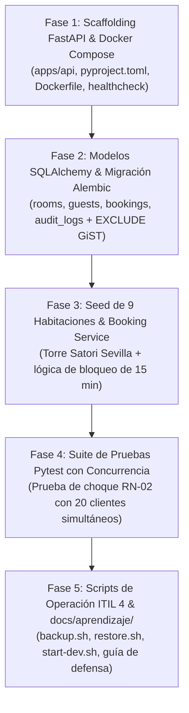

# Plan de Acción: Integración de la Transición del Servicio (Actividad 5) en la Solución SatoriPMS

**Fecha:** 2026-11-11  
**Rama:** `migracion-fastapi`  
**Objetivo:** Materializar en código ejecutable lo contemplado en el entregable ITIL 4 de la Actividad 5 y el Lote M0 del Roadmap (FastAPI + PostgreSQL 16 `btree_gist` + Alembic + Candado RN-02 + Healthcheck + Pytest Concurrente + Scripts de Operación).

---

## 1. Alcance Técnico de la Integración (¿Qué entra?)

| Dominio ITIL 4 | Entregable en la Solución | Ubicación en el Repositorio | Modo de Trabajo |
| :--- | :--- | :--- | :---: |
| **Infraestructura Base** | Scaffolding FastAPI (Python 3.12 ASGI, Pydantic v2, Uvicorn, Dockerfile) y orquestación con Docker Compose. | `apps/api/`, `docker-compose.yml`, `start-dev.sh` | **AGY** (Escribe y explica) |
| **Base de Datos y RN-02** | Extensión `btree_gist`, migración Alembic inicial con constraint `EXCLUDE USING gist` sobre `room_id + daterange` para estados activos (`BLOQUEADA_TEMPORAL`, `CONFIRMADA`, `EN_CURSO`) y `expires_at`. | `apps/api/alembic/`, `apps/api/src/models/` | **MÍO / GUIADO** (Revisión estricta) |
| **Semillero de Datos** | Seed de las 9 habitaciones reales del Hotel Torre Satori (Sevilla, Valle del Cauca) con capacidades, tipos y tarifas. | `db/seed/rooms_seed.sql` | **AGY** |
| **Diagnóstico y Salud** | Endpoint `/api/v1/health` con verificación en vivo de latencia y conectividad con PostgreSQL. | `apps/api/src/api/v1/health.py` | **AGY** |
| **Lógica del Candado (RN-02)** | Endpoint de cotización y bloqueo temporal (15 min). Expiración inline en la misma transacción antes de insertar. | `apps/api/src/services/booking_service.py` | **MÍO / GUIADO** |
| **Validación y Pruebas** | Suite `pytest` con prueba de concurrencia extrema (20 peticiones simultáneas sobre el mismo cuarto y rango de fechas con `asyncio.gather`). | `tests/test_concurrency_rn02.py`, `tests/test_health.py` | **AGY** |
| **Operación y Respaldo** | Scripts operacionales de respaldo preventivo (`backup.sh`) y recuperación ante desastres (`restore.sh` en < 3 min). | `scripts/backup.sh`, `scripts/restore.sh` | **AGY** |
| **Defensa y Aprendizaje** | Documento pedagógico con conceptos telemáticos, justificación de cada línea y 3 preguntas de sustentación. | `docs/aprendizaje/M0_INFRA_GIST.md` | **AGY** |

---

## 2. Plan de Acción Fase por Fase



### Fase 1: Scaffolding Backend FastAPI (`apps/api`)
* **POR QUÉ:** Proveer el runtime ASGI moderno en Python 3.12 libre de dependencias Java/Spring.
* **QUÉ:** 
  1. `apps/api/pyproject.toml` (o `requirements.txt`) con: `fastapi`, `uvicorn[standard]`, `pydantic-settings`, `sqlalchemy[asyncio]`, `asyncpg`/`psycopg[binary]`, `alembic`, `pytest`, `pytest-asyncio`, `httpx`.
  2. `apps/api/Dockerfile` optimizado multi-stage para Python 3.12.
  3. Estructura modular limpia: `src/core` (config y base de datos asíncrona), `src/models`, `src/schemas`, `src/api/v1`, `src/services`.
  4. Endpoint `GET /api/v1/health` que prueba en vivo la conexión a Postgres.
* **CÓMO SE VERIFICARÁ:** `docker compose up -d postgres api` y `curl http://localhost:8080/api/v1/health` respondiendo `{"status": "healthy", "database": "connected"}`.

### Fase 2: Modelos Relacionales y Migración Alembic con GiST (RN-02)
* **POR QUÉ:** Cumplir la regla de negocio nuclear RN-02 anti-sobreventa a nivel de motor PostgreSQL sin depender de Redis.
* **QUÉ:**
  1. Inicializar Alembic en `apps/api/alembic/`.
  2. Habilitar extensión PostgreSQL: `CREATE EXTENSION IF NOT EXISTS btree_gist;`.
  3. Definir modelos `Room`, `Guest`, `Booking`, `AuditLog` con estados en español:
     - `BLOQUEADA_TEMPORAL`, `CONFIRMADA`, `EN_CURSO`, `EXPIRADA`, `CANCELADA`.
  4. Migración `0001_initial_gist.py` con la restricción de exclusión GiST exacta:
     ```sql
     ALTER TABLE bookings ADD CONSTRAINT no_overlapping_active_bookings
     EXCLUDE USING gist (
       room_id WITH =,
       daterange(check_in, check_out, '[)') WITH &&
     ) WHERE (status IN ('BLOQUEADA_TEMPORAL', 'CONFIRMADA', 'EN_CURSO'));
     ```
* **CÓMO SE VERIFICARÁ:** `alembic upgrade head` sin errores en PostgreSQL 16.

### Fase 3: Semillero de Torre Satori y Servicio de Bloqueo
* **POR QUÉ:** El hotel cuenta con 9 habitaciones específicas en Sevilla, Valle del Cauca.
* **QUÉ:**
  1. Script SQL y función seed con las 9 habitaciones (Estándar, Superior, Suite Balcón, etc.).
  2. Implementación de `BookingService.create_lock(...)`:
     - En la misma transacción: expira bloqueos vencidos (`status = 'BLOQUEADA_TEMPORAL' AND expires_at < NOW()`).
     - Inserta nueva reserva con `status = 'BLOQUEADA_TEMPORAL'` y `expires_at = NOW() + INTERVAL '15 minutes'`.
     - Si hay cruce con reserva activa, PostgreSQL arroja `IntegrityError` (ExclusionViolation) y FastAPI responde HTTP 409 Conflict.
* **CÓMO SE VERIFICARÁ:** Inserción de prueba y verificación de expiración automática.

### Fase 4: Batería de Pruebas Pytest con Concurrencia Extrema
* **POR QUÉ:** Evidenciar empíricamente la garantía ITIL 4 de cero sobreventa demostrada en la presentación (TC-01, TC-02 y prueba GiST).
* **QUÉ:**
  1. `tests/test_health.py`: Verifica que `/api/v1/health` retorne estado íntegro.
  2. `tests/test_concurrency_rn02.py`: Lanza 20 peticiones concurrentes simultáneas (`asyncio.gather`) intentando bloquear la Habitación 101 para las mismas fechas exactas. Verifica que exactamente 1 tiene éxito (HTTP 201) y 19 son rechazadas con HTTP 409 sin corromper la base de datos.
* **CÓMO SE VERIFICARÁ:** `pytest -v tests/test_concurrency_rn02.py` pasando 100% en verde.

### Fase 5: Scripts Operacionales ITIL 4 y Documento de Aprendizaje
* **POR QUÉ:** Satisfacer los requerimientos de Disaster Recovery (< 3 min) y el principio pedagógico de sustentación de `AGENTS.md`.
* **QUÉ:**
  1. `scripts/backup.sh` (ejecuta `pg_dump` con compresión `.sql.gz`).
  2. `scripts/restore.sh` (restauración limpia de base de datos probada en cronómetro).
  3. `start-dev.sh` actualizado para levantar todo el entorno con un solo comando.
  4. `docs/aprendizaje/M0_INFRA_GIST.md` con explicación de cada línea y 3 preguntas de defensa con respuesta.
* **CÓMO SE VERIFICARÁ:** Ejecución completa de respaldo y restauración simulando desastre.

---

## 3. Criterios de Aceptación para Dar por Concluida la Integración
1. `docker compose up -d` levanta `postgres` y `api` en verde.
2. Endpoint `GET http://localhost:8080/api/v1/health` responde HTTP 200 con estado de base de datos.
3. Migración Alembic con GiST aplicada en PostgreSQL 16.
4. Las 9 habitaciones cargadas en base de datos.
5. Suite de pytest (`test_concurrency_rn02.py`) ejecutada y pasando en verde.
6. Guía `docs/aprendizaje/M0_INFRA_GIST.md` generada para defensa.
