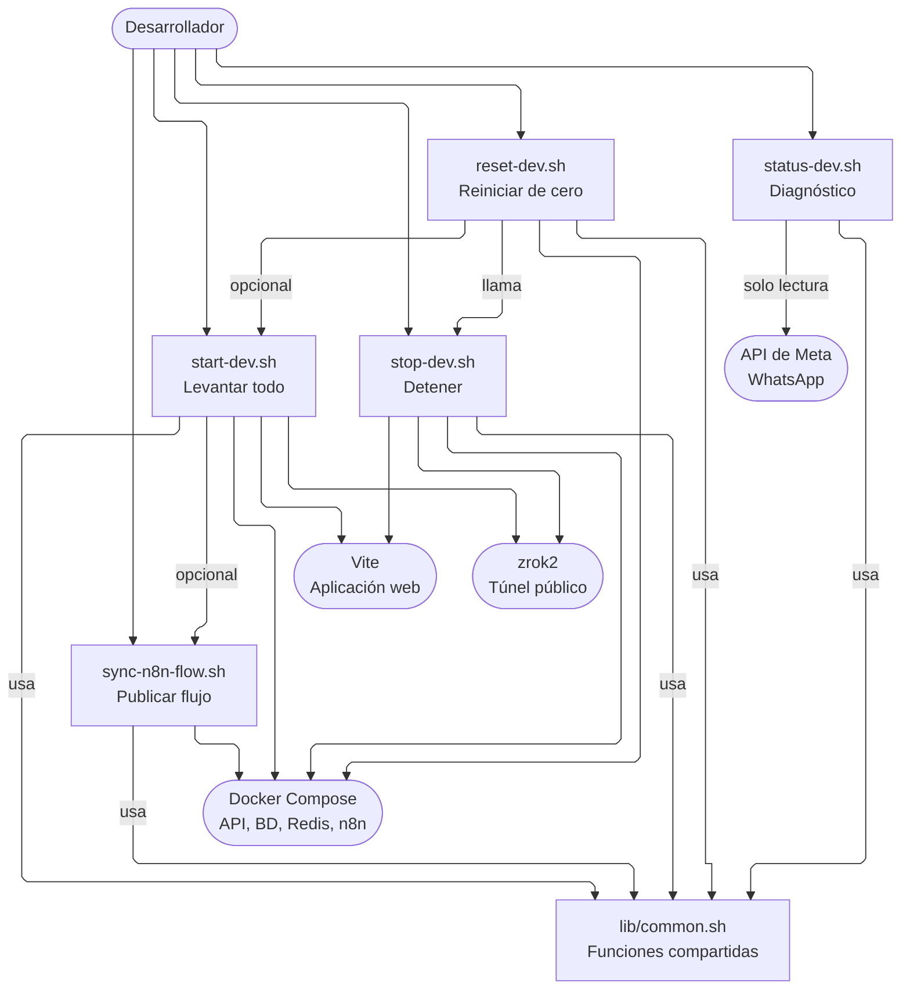

# Scripts de Desarrollo y Operación Local — Torre Satori

Este directorio contiene los asistentes de línea de comandos que levantan, detienen, reinician y diagnostican el entorno local de **SatoriPMS**: contenedores (PostgreSQL, Redis, servidor central y n8n), túnel público del chatbot y aplicación web.

Cada script tiene una sola responsabilidad y todos comparten una librería común, de modo que el comportamiento (colores, lectura del `.env`, espera de servicios, manejo de procesos) es idéntico en todos.

---

## Estructura del Directorio

```text
scripts/
├── lib/
│   └── common.sh              # Librería compartida: rutas, mensajes, Docker Compose, .env, esperas y procesos
├── start-dev.sh               # Levanta toda la infraestructura y muestra los enlaces de acceso
├── stop-dev.sh                # Detiene web, túnel y contenedores conservando los datos
├── reset-dev.sh               # Borra contenedores y datos para empezar desde cero (con confirmación)
├── status-dev.sh              # Diagnóstico de solo lectura: servicios, túnel y WhatsApp en Meta
└── sync-n8n-flow.sh           # Importa y publica el flujo V9 en n8n
```

---

## Tecnologías y Estándares

| Tecnología / Herramienta | Rol en los Scripts | Versión / Estándar |
| :--- | :--- | :--- |
| Bash | Lenguaje de todos los asistentes (`set -Eeuo pipefail`) | >= 4.x |
| Docker y Docker Compose | Levantar, detener y borrar contenedores y volúmenes | Docker 24+ / Compose 2.20+ |
| Node.js y npm | Servidor de desarrollo de la aplicación web (Vite) | >= 20 LTS |
| zrok2 | Túnel público de n8n para recibir mensajes de WhatsApp y eventos de Wompi | Opcional |
| curl | Comprobación de salud de servicios y consultas a la API de Meta | Cualquiera |
| Python 3 | Verificación de integridad del flujo y análisis de respuestas de Meta | >= 3.10 |
| ShellCheck | Análisis estático de los scripts (sin avisos al momento de escribir este documento) | 0.10 |

---

## Arquitectura de los Scripts



---

## Referencia de Scripts

Todos aceptan `-h` o `--help` y se ejecutan desde cualquier carpeta del repositorio. Ninguno debe ejecutarse como `root`.

### `start-dev.sh` — Levantar el entorno completo

```bash
./scripts/start-dev.sh
```

Pasos que ejecuta, en orden:

1. **Herramientas:** verifica `curl`, `setsid`, Docker con Compose y, si se inicia la web, Node.js y npm.
2. **Archivo `.env`:** si no existe, lo crea desde `.env.example` y se detiene para que se completen los secretos. Si existe, exige que `JWT_SECRET` tenga al menos 32 caracteres y que `SATORI_SERVICE_KEY` esté definida; de lo contrario aborta con el motivo.
3. **Contenedores:** `docker compose up -d --build --wait`, y luego espera a que el servidor central (`/api-docs`) y n8n (`/healthz`) respondan.
4. **Túnel público:** si n8n está activo y `N8N_PUBLIC_URL` es de zrok, abre el túnel con `zrok2` salvo que ya esté funcionando.
5. **Aplicación web:** instala las dependencias si hacen falta e inicia Vite en segundo plano.
6. **Flujo n8n (opcional):** con `--sync-flow`, publica el flujo V9.
7. **Enlaces:** muestra las direcciones de acceso con su estado.

| Opción | Efecto |
| :--- | :--- |
| `--no-frontend` | No inicia la aplicación web. |
| `--frontend-only` | Solo inicia la aplicación web, sin Docker ni túnel. |
| `--no-tunnel` | No abre el túnel público de n8n. |
| `--no-build` | No reconstruye la imagen del servidor central (más rápido si el código no cambió). |
| `--sync-flow` | Importa y publica el flujo V9 en n8n al terminar. |

Las opciones antiguas siguen funcionando por compatibilidad: `-u` equivale a la construcción por defecto, `-d` redirige a `stop-dev.sh` y `-D` redirige a `reset-dev.sh`.

Enlaces que muestra al finalizar:

| Servicio | Dirección |
| :--- | :--- |
| Aplicación web | `http://localhost:5173` |
| Servidor central (API) | `http://localhost:8080` |
| Documentación de la API | `http://localhost:8080/docs` |
| n8n (editor local) | `http://localhost:5678` |
| n8n (público) y webhooks | `N8N_PUBLIC_URL`, con `/webhook/whatsapp-webhook` y `/webhook/wompi-events` |

### `stop-dev.sh` — Detener sin perder datos

```bash
./scripts/stop-dev.sh
```

Detiene la aplicación web y el túnel que inició `start-dev.sh` y da de baja los contenedores. Los volúmenes (base de datos, Redis y n8n) **se conservan**.

| Opción | Efecto |
| :--- | :--- |
| `--pause` | Solo pausa los contenedores (`docker compose stop`); se reanudan más rápido con `./scripts/start-dev.sh --no-build`. |
| `--keep-tunnel` | No cierra el túnel zrok2. |
| `--web-only` | Solo detiene la aplicación web. |

### `reset-dev.sh` — Reiniciar desde cero

```bash
./scripts/reset-dev.sh
```

Elimina contenedores y volúmenes. **Es destructivo:** antes de borrar muestra qué se perderá y exige escribir `RESET`. El túnel no se cierra porque no guarda datos.

| Se borra | Volumen |
| :--- | :--- |
| Reservas, huéspedes, habitaciones y usuarios | `<proyecto>_postgres_data` |
| Sesiones del chatbot, bloqueos y enlaces de Wompi | `<proyecto>_redis_data` |
| Cuenta de n8n, credenciales, flujos e historial | `<proyecto>_n8n_data` (se conserva con `--keep-n8n`) |

| Opción | Efecto |
| :--- | :--- |
| `--keep-n8n` | Conserva los datos de n8n; solo borra PostgreSQL y Redis. |
| `--images` | Borra también la imagen construida del servidor central. |
| `--start` | Vuelve a levantar todo al terminar. |
| `--seed` | Implica `--start` y publica el flujo V9. Las habitaciones y los usuarios de desarrollo los crea Alembic al arrancar la API. |
| `-y`, `--yes` | No pide confirmación. |

Los usuarios de desarrollo que crea Alembic son `admin` (contraseña `admin123`) y `recepcion` (contraseña `recepcion123`). Sin `--keep-n8n`, n8n queda sin cuenta propietaria y hay que crearla al abrir `http://localhost:5678`.

### `status-dev.sh` — Diagnóstico de solo lectura

```bash
./scripts/status-dev.sh
```

No modifica nada. Informa:

- Estado de los contenedores.
- Si la aplicación web y el túnel están en ejecución.
- **WhatsApp en Meta:** si el token es válido y cuándo vence, si la aplicación del hotel está suscrita a la cuenta de WhatsApp Business y el estado y calidad del número.
- Los enlaces de acceso con su estado actual.

Con `--no-meta` omite las consultas a Meta.

### `sync-n8n-flow.sh` — Publicar el flujo del chatbot

```bash
./scripts/sync-n8n-flow.sh [ruta_flujo.json]
```

Por defecto usa `flows/n8n/V9_ChatbotReservas.json`. n8n conserva publicada la versión anterior si el campo `versionId` del archivo no cambia; por eso el script:

1. Valida el flujo con `tests/chatbot/verify_n8n_flow_integrity.py` y no continúa si hay errores.
2. Genera una copia temporal con un `versionId` nuevo (el archivo del repositorio **no se modifica**).
3. La importa y la publica en el contenedor de n8n.
4. Reinicia n8n y espera a que responda.

---

## Archivos Generados

Los scripts guardan el estado de los procesos locales en la carpeta `.dev/` de la raíz del repositorio, excluida de git:

| Archivo | Contenido |
| :--- | :--- |
| `.dev/web.pid` y `.dev/web.log` | Proceso y registro de la aplicación web (Vite). |
| `.dev/tunnel.pid` y `.dev/tunnel.log` | Proceso y registro del túnel zrok2. |
| `.dev/flow-import.json` | Copia temporal del flujo durante la sincronización (se elimina al terminar). |

Los procesos en segundo plano se lanzan en su propio grupo de procesos; por eso `stop-dev.sh` detiene la web o el túnel junto con todos sus procesos hijos.

---

## Variables de Entorno que Utilizan

Se leen del archivo `.env` de la raíz (ver la [Guía de Configuración del Entorno](../docs/Guia_Configuracion_Entorno.md)):

| Variable | Usada por | Para qué |
| :--- | :--- | :--- |
| `JWT_SECRET` | `start-dev.sh` | Debe tener al menos 32 caracteres; de lo contrario el servidor central no arranca. |
| `SATORI_SERVICE_KEY` | `start-dev.sh` | Llave con la que n8n se identifica ante el servidor central. |
| `COMPOSE_PROFILES` | Todos | Si incluye `n8n`, se levanta y se enlaza el orquestador del chatbot. |
| `N8N_PUBLIC_URL` | `start-dev.sh`, `status-dev.sh` | Dirección pública de n8n; si es de zrok, de ella se deduce el nombre del túnel. |
| `WHATSAPP_TOKEN`, `WHATSAPP_ACCOUNT_ID`, `WHATSAPP_PHONE_ID`, `WHATSAPP_GRAPH_VERSION` | `status-dev.sh` | Consulta de la vigencia del token y de la suscripción en Meta. |
| `COMPOSE_PROJECT_NAME` | `reset-dev.sh` | Prefijo de los volúmenes; por defecto, el nombre de la carpeta del proyecto. |

---

## Flujos de Trabajo Frecuentes

| Necesidad | Comando |
| :--- | :--- |
| Empezar la jornada | `./scripts/start-dev.sh` |
| Reanudar rápido tras una pausa | `./scripts/start-dev.sh --no-build` |
| Terminar la jornada conservando datos | `./scripts/stop-dev.sh` |
| Liberar memoria sin dar de baja los contenedores | `./scripts/stop-dev.sh --pause` |
| Cambió el flujo del chatbot | `./scripts/sync-n8n-flow.sh` |
| El chatbot no responde | `./scripts/status-dev.sh` |
| Empezar con datos de prueba limpios | `./scripts/reset-dev.sh --keep-n8n --start --seed` |
| Reinicio total, incluido n8n | `./scripts/reset-dev.sh --start` |
| Trabajar solo en la interfaz web | `./scripts/start-dev.sh --frontend-only` |

---

## Convenciones para Nuevos Scripts

1. Cargar la librería con `source "$(dirname "${BASH_SOURCE[0]}")/lib/common.sh"` y usar sus funciones (`log_*`, `detect_compose`, `env_get`, `wait_for_http`, `start_background`, `stop_pid_group`) en lugar de duplicarlas.
2. Una sola responsabilidad por script, con opción `--help` y mensajes en español, sobrios y sin emojis.
3. Operaciones destructivas únicamente con confirmación explícita.
4. Ningún secreto en el código: se leen del `.env`.
5. Verificar con ShellCheck antes de confirmar cambios:
   ```bash
   docker run --rm -v "$PWD:/mnt:ro" -w /mnt koalaman/shellcheck:v0.10.0 -x -S warning scripts/*.sh scripts/lib/common.sh
   ```
