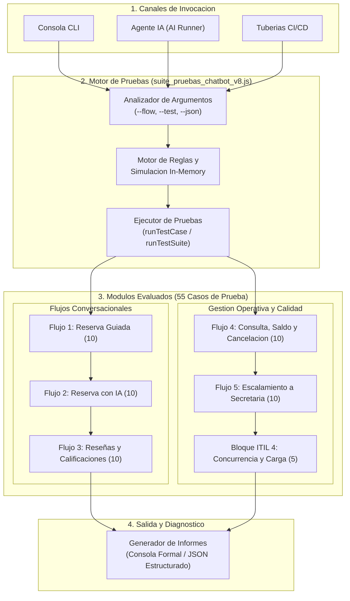

# Suite de Pruebas y Herramientas del Chatbot — Torre Satori

Este directorio contiene las herramientas de construcción, verificación de integridad arquitectónica y la suite automatizada de pruebas para el asistente conversacional en WhatsApp (V8) y los servicios transaccionales del servidor central (API) del Hotel Torre Satori.

El propósito principal de este conjunto de pruebas es validar de manera determinista y reproducible las transiciones de estado conversacionales, la interpretación de lenguaje natural con Inteligencia Artificial, el cálculo financiero estricto de tarifas y reembolsos, y las garantías de calidad y concurrencia bajo el marco ITIL 4 (Actividad 5).

---

## Estructura del Directorio

```text
tests/chatbot/
├── suite_pruebas_chatbot_v8.js      # Suite integral de 55 casos con motor AI Runner (CLI y Programatico)
├── build_v8_chatbot_flow.py         # Generador determinista del flujo n8n V8 (80 nodos ensamblados)
├── verify_n8n_flow_integrity.py     # Validador de topologia: 0 enlaces rotos, 0 huerfanos, 0 switch errors
├── test_reserva_guiada_abono_50.js  # Prueba de integracion de reserva guiada con abono del 50%
├── test_asistente_ia_autonomo.js    # Prueba de integracion del agente autonomo con extraccion JSON
├── test_cancelacion_reembolso.js    # Prueba de integracion de cancelacion y regla RN-03
├── test_pago_saldo_restante.js      # Prueba de integracion de liquidacion de saldo pendiente
├── test_registro_resena_google.js   # Prueba de integracion de captura de calificaciones y enlace Google
├── test_consulta_resenas.js         # Prueba de integracion de consulta publica y calculo de promedios
└── test_escalamiento_agente_humano.js # Prueba de integracion de escalamiento y silencio operativo
```

---

## Tecnologías y Estándares

| Tecnología / Herramienta | Rol en Pruebas | Versión / Estándar |
| :--- | :--- | :--- |
| Node.js | Entorno de ejecución de la suite automatizada y scripts de prueba | >= 18.x LTS |
| Python | Generación, reestructuración espacial y análisis topológico del flujo n8n | >= 3.10 |
| n8n Workflow Schema | Especificación del motor de orquestación de nodos y conmutadores | n8n v1.x (TypeVersion 2/3.4/4.2) |
| JSON Schema / REST API | Contratos de comunicación HTTP entre el chatbot y el servidor central | RFC 8259 |
| ITIL 4 Practices | Marco de validación de gestión de cambios, calidad y disponibilidad | Service Design & Transition |

---

## Arquitectura de Pruebas e Interfaz AI Runner

La suite implementa un diseño desacoplado que opera en dos modalidades complementarias:

1. **Modalidad In-Memory / Motor de Contratos:** Evalúa instantáneamente las funciones de normalización, transiciones de estados de n8n, parsers de expresiones regulares, reglas de validación de documentos colombianos (Ley 1581 de 2012) y cálculos aritméticos hoteleros sin requerir infraestructura externa levantada.
2. **Modalidad de Integración en Vivo:** Capaz de conectarse contra el servidor central (`http://localhost:8080`) y la instancia local de n8n (`http://localhost:5678`) para pruebas de extremo a extremo.



---

## Catálogo Detallado de Pruebas (55 Casos)

### Flujo 1: Reserva Guiada Paso a Paso (TC-01 a TC-10)
Valida la interacción guiada estructurada para usuarios que prefieren navegación menú a menú.

- **TC-01:** Validación de fechas futuras válidas (cálculo correcto de noches de estadía).
- **TC-02:** Rechazo de fechas pasadas en check-in (anterior a la fecha actual del sistema).
- **TC-03:** Rechazo de fecha check-out anterior o igual al check-in.
- **TC-04:** Selección válida de habitación por índice de listado o número de habitación.
- **TC-05:** Rechazo de selección de habitación fuera de rango o entrada de texto arbitraria.
- **TC-06:** Validación de cantidad de adultos (debe ser un entero mayor o igual a 1).
- **TC-07:** Validación estricta de identificación del titular (6 a 10 dígitos numéricos).
- **TC-08:** Validación de restricción de mascotas por habitación (`allows_pets = false`).
- **TC-09:** Desglose financiero: cálculo exacto del 50% de anticipo vs. 100% de pago total.
- **TC-10:** Cancelación manual en paso de pago y liberación limpia del bloqueo temporal.

### Flujo 2: Reserva con Asistente IA Autónomo (TC-11 a TC-20)
Valida el asistente impulsado por modelos generativos que extrae datos de mensajes libres.

- **TC-11:** Extracción completa de mensaje único con todos los parámetros (fechas, ocupación, titular, documento, mascota y acompañantes).
- **TC-12:** Detección y solicitud explícita ante información incompleta (ausencia de fechas o titular).
- **TC-13:** Detección y rechazo de rangos cronológicos incoherentes o invertidos interpretados por la IA.
- **TC-14:** Bucle de confirmación de datos: respuesta afirmativa ("Sí", "Correcto", "De acuerdo") avanza a disponibilidad.
- **TC-15:** Bucle de corrección de datos: ajuste incremental de parámetros en el borrador ante aclaraciones del huésped.
- **TC-16:** Selección de habitación única en el asistente IA.
- **TC-17:** Selección de habitaciones múltiples (ej. "1, 2" o "1 y 2") con bloqueo temporal conjunto.
- **TC-18:** Cálculo de recargo por huéspedes adicionales en reserva múltiple si se supera la capacidad base conjunta.
- **TC-19:** Aviso obligatorio y consentimiento expreso de política de tratamiento de datos personales (Ley 1581 de 2012).
- **TC-20:** Cancelación del flujo IA y liberación automática de candados en memoria.

### Flujo 3: Calificaciones y Reseñas (TC-21 a TC-30)
Valida la recolección interna de opiniones y la redirección pública a Google Maps.

- **TC-21:** Consulta de opiniones y cálculo de calificación promedio ponderada con reseñas previas.
- **TC-22:** Consulta de opiniones sin registros previos (emisión de mensaje de invitación cordial).
- **TC-23:** Registro de calificación numérica válida (rango entero de 1 a 5).
- **TC-24:** Rechazo de calificación fuera de rango (0, 6 o texto no numérico).
- **TC-25:** Persistencia de reseña con atribución de origen `source: 'chatbot'`.
- **TC-26:** Generación de enlace directo a Google Reviews / Google Maps con identificador Place ID.
- **TC-27:** Sanitización y límite estricto de 500 caracteres en comentarios de huéspedes.
- **TC-28:** Cancelación del flujo de reseñas mediante el comando de reinicio "menú".
- **TC-29:** Registro válido de reseña con puntuación numérica y comentario vacío.
- **TC-30:** Filtrado de registros inválidos o con calificación nula en la consulta pública.

### Flujo 4: Consulta, Pago de Saldo y Cancelación (TC-31 a TC-40)
Valida la gestión de reservas confirmadas bajo la nomenclatura oficial `TS-XXXX`.

- **TC-31:** Consulta exitosa con prefijo estandarizado `TS-XXXX` (Torre Satori).
- **TC-32:** Consulta insensible a mayúsculas/minúsculas o sin guion (`ts-1234`, `TS1234`).
- **TC-33:** Rechazo de código de reserva menor a 4 caracteres o inexistente en base de datos.
- **TC-34:** Consulta de reserva con saldo pendiente (habilitación de opciones 1 Pagar saldo y 2 Cancelar).
- **TC-35:** Consulta de reserva 100% pagada (presentación exclusiva de cancelación y retorno).
- **TC-36:** Liquidación de saldo pendiente al 100% (actualización a estado `paid` y saldo restante a $0.00).
- **TC-37:** Política de reembolso con más de 72h antes del check-in (reembolso del 100% de lo abonado).
- **TC-38:** Política de reembolso entre 24h y 72h antes del check-in (reembolso del 50% de lo abonado).
- **TC-39:** Política de reembolso con menos de 24h antes del check-in (0% de reembolso / penalidad total).
- **TC-40:** Doble confirmación de cancelación: respuesta "No" preserva la reserva intacta.

### Flujo 5: Escalamiento a Secretaria / Atención Humana (TC-41 a TC-50)
Valida la transferencia fluida de conversaciones complejas a recepción humana.

- **TC-41:** Activación de atención humana por palabras clave en cualquier momento ("agente", "recepcionista", "humano", "secretaria").
- **TC-42:** Activación mediante la Opción 6 del Menú Principal.
- **TC-43:** Bloqueo de respuestas automáticas del bot mientras la bandera `agent_active` sea `true`.
- **TC-44:** Comandos de escape ("menú", "hola", "inicio") desactivan el modo agente y devuelven el control al bot.
- **TC-45:** Generación de evento de notificación para el panel web de recepción.
- **TC-46:** Formato sobrio del mensaje de espera al huésped sin emojis.
- **TC-47:** Persistencia del estado `agent_active` en la sesión de Redis.
- **TC-48:** Manejo silencioso de mensajes consecutivos del huésped durante la espera sin respuestas duplicadas.
- **TC-49:** Expiración de inactividad de sesión establecida en 10 minutos (600 segundos).
- **TC-50:** Cierre limpio y normalización de la sesión tras finalizar la atención humana.

### Bloque ITIL 4: Garantías de Calidad y Concurrencia (TC-51 a TC-55)
Valida la resiliencia transaccional y la prevención absoluta de sobreventa (sobreventa = 0).

- **TC-51:** Doble Candado en Redis: Concurrencia en milisegundo 0 con `Promise.all` (`SET NX EX 900`). Garantiza que ante solicitudes simultáneas solo un cliente obtenga el bloqueo.
- **TC-52:** Doble Candado en PostgreSQL: Verificación en capa de persistencia final mediante aislamiento transaccional (`countConflictingBookings = 0`).
- **TC-53:** Prueba de rendimiento y estrés: Ráfaga de 50 consultas concurrentes de disponibilidad resueltas en menos de 500ms.
- **TC-54:** Tarifas dinámicas con eventos especiales: Aplicación de descuentos y recargos porcentuales estacionales.
- **TC-55:** Cálculo estricto de reembolso sobre el monto efectivamente pagado (`paid_amount`). Caso crítico: ante una reserva de $500.000 con $250.000 abonados cancelada a tiempo, se reembolsan exactamente $250.000 (el 100% de lo pagado), nunca los $500.000 del valor total de la estadía.

---

## Guía de Ejecución

### Ejecución Completa por Consola
Ejecuta los 55 casos de prueba con salida formateada para terminal:

```bash
node tests/chatbot/suite_pruebas_chatbot_v8.js
```

### Ejecución Filtrada por Flujo o Caso Unitario

Para ejecutar exclusivamente un flujo funcional específico:
```bash
# Ejecutar solo Flujo 2 (Reserva con IA):
node tests/chatbot/suite_pruebas_chatbot_v8.js --flow 2

# Ejecutar solo Bloque ITIL 4:
node tests/chatbot/suite_pruebas_chatbot_v8.js --flow itil
```

Para ejecutar un caso de prueba individual:
```bash
node tests/chatbot/suite_pruebas_chatbot_v8.js --test TC-55
```

Para generar salida estructurada en formato JSON (ideal para tuberías CI/CD o subagentes):
```bash
node tests/chatbot/suite_pruebas_chatbot_v8.js --flow 4 --json
```

### Integración Programática para Agentes de IA

Cualquier script o agente autónomo puede importar la suite y evaluar resultados en memoria:

```javascript
const { runTestSuite, runTestCase } = require('./tests/chatbot/suite_pruebas_chatbot_v8.js');

async function evaluarCalidad() {
  // Ejecutar el flujo de cancelacion y reembolso
  const reporte = await runTestSuite({ flow: '4', json: true });

  if (reporte.success) {
    console.log(`Verificacion completada: ${reporte.passed}/${reporte.total} pruebas aprobadas.`);
  } else {
    console.error(`Fallos detectados: ${reporte.failed} pruebas con error.`);
  }
}

evaluarCalidad();
```

### Verificación de Integridad de Flujo n8n

Para asegurar que las modificaciones al flujo [V8_ChatbotReservas.json](../../flows/n8n/V8_ChatbotReservas.json) mantengan 100% de coherencia topológica:

```bash
# Validar conexiones, nodos huerfanos y reglas de conmutacion:
python3 tests/chatbot/verify_n8n_flow_integrity.py

# Reconstruir y reposicionar el flujo con arquitectura horizontal separada:
python3 tests/chatbot/build_v8_chatbot_flow.py
```

---

## Políticas y Reglas del Negocio Validadas

1. **Prefijo Oficial de Reserva:** Toda reserva generada y consultada responde a la convención `TS-XXXX` (Torre Satori), eliminando cualquier nomenclatura provisional previa.
2. **Cálculo de Reembolso sobre lo Abonado:** Las políticas de cancelación (RN-03) operan exclusivamente sobre el dinero que el huésped ingresó efectivamente a la cuenta del hotel (`paid_amount`). Jamás se emiten reembolsos calculados sobre saldos pendientes por cobrar.
3. **Mecanismo de Doble Candado:**
   - **Candado Rápido (Redis):** Bloqueo en memoria por 15 minutos (900 segundos) para impedir que dos personas seleccionen la misma habitación en WhatsApp.
   - **Candado Firme (PostgreSQL):** Bloqueo transaccional a nivel de base de datos que garantiza 0 sobreventas incluso ante interrupciones de red o fallos de concurrencia.
4. **Protección de Datos Personales:** Cumplimiento riguroso del aviso de privacidad según la Ley 1581 de 2012 en el primer contacto con el asistente de Inteligencia Artificial.
5. **Caducidad de Sesiones:** El tiempo de espera máximo por inactividad del huésped está calibrado en 10 minutos (600 segundos), tras lo cual se liberan las habitaciones reservadas temporalmente para permitir nuevas reservas.

---

## Chatbot V9 — Cobro de la reserva con Wompi

El flujo [V9_ChatbotReservas.json](../../flows/n8n/v9-wompi/V9_ChatbotReservas.json) es el V8 con el cobro de la reserva conectado a Wompi. Al finalizar la reserva genera un link de pago por el 50% o el 100% del total, según la modalidad elegida. Ver [flows/n8n/v9-wompi/README.md](../../flows/n8n/v9-wompi/README.md).

| Archivo | Propósito |
| :--- | :--- |
| `build_v9_chatbot_flow.py` | Genera el V9 a partir del V8 sin modificarlo; solo aplica el parche de cobro. |
| `test_pago_wompi_v9.js` | 11 pruebas en memoria (W-01 a W-11) que ejecutan el código real de los nodos del V9. Con `--live` se suman 5 pruebas reales contra la API de Wompi (L-01 a L-05). |
| `test_e2e_reserva_wompi_v9.js` | E2E con el stack levantado: conversación completa → reserva → link en Wompi → evento firmado. |

```bash
python3 tests/chatbot/build_v9_chatbot_flow.py
node tests/chatbot/test_pago_wompi_v9.js [--live]
python3 tests/chatbot/verify_n8n_flow_integrity.py flows/n8n/v9-wompi/V9_ChatbotReservas.json
API_HOST=localhost node tests/chatbot/test_e2e_reserva_wompi_v9.js
```
